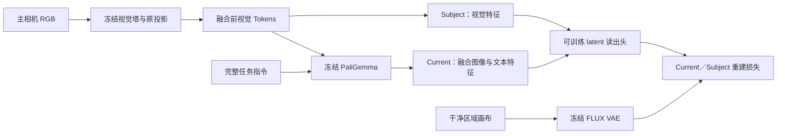

# ESkill-VLA

**E 代表 Event。** 项目研究如何从当前图像与任务指令中学习可复用的视觉运动知识。当前工作聚焦 **Current／Subject Grounding**：先验证模型能否定位任务要求的交互目标，以及真实夹爪所在区域，再研究接入 Motion／Action。

当前开发分支为 **`visual-primitive`**。模型入口、checkpoint 与部署说明见 [运行版本](docs/versions.md)。

Visual Primitive 使用 PaliGemma 多层原生注意力预测 Current，使用从头训练的独立分支定位 Subject。[架构、E0–E3 配方与评测入口](experiments/visual_primitive/README.md)

## VAE Grounding 对照



- **Current**：根据完整任务和当前观察选择交互目标。例如搬 milk 入 basket，Pick 时定位 milk，Place 时定位 basket。
- **Subject**：读取融合前视觉特征，定位夹爪局部区域。ROI 可包含持物像素，当前不单独监督持有物体身份。
- 两路独立投影、Query Decoder，各输出 `16×256`；VLM／VAE 冻结。损失为 `0.1 Current + 0.1 Subject`。
- 模型输入为当前主相机 RGB＋完整任务；Event、bbox、实例身份仅用于训练标签。不生成中间目标文本，不训练 Future、Skill、Motion 或 Action。

## 开始使用

[跨服务器数据准备与训练](docs/remote_grounding_training.md) 给出从更新仓库、同步完整数据，到检查、训练和恢复的操作步骤。远端可以继续使用现有 `ESkill-VLA` 目录。

| 需要做什么 | 入口 |
| --- | --- |
| 理解研究目标与模型 | [Idea](docs/idea.md) · [Design](docs/design.md) · [Grounding 监督](docs/target_grounding.md) |
| 准备数据／检查增强 | [LIBERO 示例](examples/libero/README.md) · [数据协议](docs/data.md) · [增强流程](docs/augmentation.md) |
| 训练与恢复 | [训练接口](src/openpi/training/README.md)；增强／无增强配置在 `examples/libero/train_current_grounding*.json` |
| 验证与验收 | [Evaluation](docs/evaluation.md) · [数据核验索引](data/libero/atomic-vla/check/test/README.md) |
| 查看实际运行 | [实验索引](experiments/README.md)；[真实双卡启动检查](experiments/current_grounding_fused/README.md) |
| 查找历史动作路线 | [历史索引](docs/history/README.md)；包括 Skill、Future、Motion 与闭环测评 |

两份 Grounding 配置都是 **32 步接口模板**，正式训练预算需另行指定。实际已完成真实 π0.5／FLUX 权重的双卡 BF16 8 步检查；这不代表正式训练收敛或位置泛化通过。

## 文件组织

```text
src/openpi/       模型、数据与策略接口、训练组件
scripts/         train.py 等薄入口；preprocess/ 离线标注与核验
examples/        平台配置与用法
  libero/        当前 Grounding 示例；保留历史动作配方供显式选用
docs/            当前设计、数据、增强、运行及验收说明
  history/       历史联合动作设计与操作说明
  ref_papers/    参考方法与采用边界
experiments/     按运行记录的配置与结果
data/            来源说明、固定划分及核验记录入口
tests/           数据、模型、增强、恢复与分布式检查
```

大体积数据、权重、环境和运行产物放数据盘，不随 Git 同步。当前 LIBERO40 Grounding 入口为 `atomicdata/libero40_grounding/index.json`，40 任务、1,693 条／273,465 帧；沿用固定父轨迹划分 1,518 train／175 val。训练不依赖 LIBERO 仿真或原始 HDF5。

运行时代码沿用 OpenPI 层次；离线仿真标注不进入 Dataset 依赖。新的使用说明放 `docs/`，实验结果放 `experiments/`，数据验收放对应 `check/test/`。完整导航见 [文档索引](docs/README.md)。
