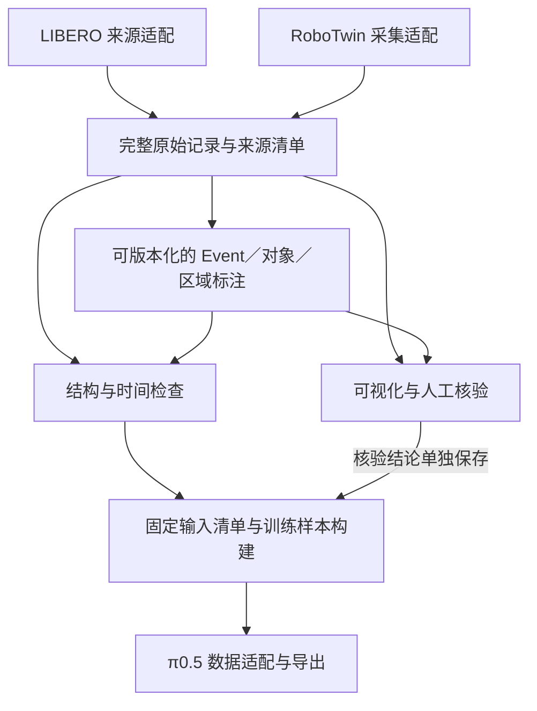

# 自研数据管线：软件架构审查

2026-10-30。本文保存重构前 RoboTwin／XPolicyLab 代码的只读审查；对应代码版本与前轮字段证据见 [pipeline_review.md](pipeline_review.md)。后续已实施的重构、当前入口和验证范围见 [README](../../examples/robotwin/README.md#统一-episode-入口)，不将下列历史问题全部视为当前代码状态。

判断：现有实现适合固定配置下批量产出“轨迹＋事件展示”，但在扩展 LIBERO／RoboTwin 数据引擎、反复修订标签时，采集事实、标注策略、可视化、完成判定和训练导出的边界需要重新明确。

## 主要问题与影响

| 优先级 | 架构问题 | 已确认的路径与影响 | 建议方向 |
| --- | --- | --- | --- |
| 高 | 采集完成依赖可选标注／渲染 | completion 固定要求 events、video_labeled、可视化 manifest；关闭可选渲染仍无法满足完成条件，渲染异常会使整条采集未完成 | 原始采集、标注、渲染各自记录完成状态；后续阶段从已完成原始记录继续 |
| 高 | 持久化原始数据时提前适配训练 | 原始 PKL 合并时直接写 state[:-1]／action[1:]／RGB[:-1]，成功后删除缓存，双腕终点丢失 | 原始层保留完整观察／控制时间线；训练窗口与移位由样本构建／导出层负责 |
| 高 | 数据身份和恢复没有绑定生成配置 | task_direct 路径可跨配置复用；完成标记只有任务／编号／seed 等，没有配置和代码指纹，重启时不比较生成条件 | 采集数据身份绑定配置、代码与本体／场景版本；标签和导出再各自绑定版本 |
| 高 | 验证和转换不共用输入准入契约 | deep 对 HDF5 只查 events/boundary；转换按目录扫描文件，不检查完成／验收清单，输出可部分成功 | 构建固定输入清单，区分结构／时间／语义／人工检查；导出保存成功与失败的源样本映射 |
| 中 | 事实采样、事件推断与展示筛选混在 recorder | EventRecorder 同时查询物理状态、推断 grasp／place、组织 primitive 和执行全局 NMS；payload() 同时给 JSON／HDF5／展示使用 | Recorder 保留原始证据，离线 EventBuilder 产生可版本化标注；稀疏关键帧作为展示派生物 |
| 中 | 恢复与任务连续编号耦合过强 | 首个不完整编号之后的所有产物会进入 quarantine，再从连续前缀恢复；原始／派生产物共用判定 | 按 episode 和阶段恢复；保留已有原始样本，仅重建缺失派生物，规划 seed 序列另行管理 |
| 中 | 多套入口存在行为分叉 | 旧样本采集器重复路径／完成逻辑；共享转换器与 Pi_05 旧 process_data 的动作、fps、字段处理不同 | 指定唯一推荐采集和导出入口；旧命令仅作显式兼容封装或报出不兼容原因 |

这里“高”表示扩展数据引擎前应先明确的契约，不代表当前 2,500 条数据已全部错误，也不要求立即整体重写。

## 关键代码证据

**完成判定与渲染耦合（历史实现）。** 旧 `scripts/collection_paths.py`（已退役，原代码见本文审查版本）的 EPISODE_ARTIFACTS 把 labeled_video／manifest 列为必需项；write_completion_marker 对全部产物检查存在且非空。旧 `_base_task.merge_pkl_to_hdf5_video` 却按 event_annotation／visualization 开关有条件生成这些文件。旧 `collect_data.run` 在合并、渲染和缓存删除之后才写完成标记。开关允许关闭，完成契约没有相应区分；可视化失败也没有独立的阶段完成状态。

**原始层与训练层耦合。** [pkl2hdf5.py](../../../RoboTwin/envs/utils/pkl2hdf5.py) 将模型所需的一步预测对齐作为首次持久化布局。末端姿态仍可由 action 最后一行恢复，主视角末帧仍在视频；但这些补救不替代明确的原始时间线。原始保存应先定义观察、控制、采样时刻和终点的关系，再让训练适配器选择切片；不需要强迫所有来源使用同一动作含义或帧率。

**身份缺少生成条件。** 完成标记保存 task／episode／seed／frame_count／frequency／路径，未保存内容指纹、配置摘要、采集代码或机器人资产版本。[inspect_episode](../../../RoboTwin/scripts/collect_event_dataset.py) 比较现有标记与现有文件，但不与本轮采集配置的物理条件比较。[StateStore](../../../RoboTwin/scripts/collect_event_dataset.py) 初始化会重写 collection_summary.json，且 worker 运行时再按配置名读取仓库内 YAML；日志和任务锁解决并发问题，不能独立解决跨版本恢复与历史配置追溯。

**验证边界不足。** inspect_episode 的 deep 检查读取事件时间和视频元数据／首尾解码，但 HDF5 只要求 events/boundary。现有 [test_deep_task_validation](../../../RoboTwin/tests/test_collect_event_dataset.py) 的测试输入就是仅有 events/boundary 的 HDF5，说明它并不验证 RGB、state、action、末端记录及其数值／维度／对齐。它可作为产物可用性检查，尚不是训练数据契约验收。

**导出没有固定输入／输出快照。** [共享 v3 转换器](../../../RoboTwin/XPolicyLab/scripts/transform_lerobot_v30_format.py) 从目录找 HDF5，未使用采集完成标记或人工核验清单；按成功数量限制轨迹，异常文件会被记入 failures 并继续，源样本编号到训练 episode 的关联未写入结果。create_empty_dataset 对同 repo_id 的已有输出目录执行删除，而非完成新版本后发布。后续训练应使用保存好的来源清单、转换配置与完成的输出版本，避免目录变化或一次局部失败悄悄改变训练样本集合。

核对范围限制：默认转换输入路径以 `/data` 结尾，隔离目录位于其外；本次检查没有发现活动任务存在额外隔离 HDF5，不据此声称默认转换已经读入隔离数据。

**跨来源约定。** 当前统一转换器对多目标取最大 fps，但逐帧写入时未重采样；当前同源 15 Hz 路径可一致，未来混入不同频率时需要显式重采样或分开保存。末端参考点、坐标、单位、夹爪含义与实际／命令状态也应由来源适配器说明，不能用同名字段或同维度代替语义检查。已有 RGB 共享解码规则应继续保留。

## 建议的模块边界



这是职责图，不规定需要新建服务、数据库或通用框架。可用同一仓库中的几个 Python 模块实现；两个仿真来源的采集方式、动作语义和单／双臂约定仍各自保留。人工未核验、已发现问题和缺少标签的状态显式记录；哪些样本进入训练由具体协议决定，不将“未核验”自动当通过。

- **来源与原始记录**：只描述实际保存的观察、命令、时间及必要场景证据；包括版本与完整性信息。为以后重标保留哪些接触／对象位姿证据，仍需按预算决定。
- **标注构建**：按臂生成语义 Event、对象关系与区域，记录规则／模型版本和有效性；重新标注不改写原始记录。
- **样本构建与导出**：根据同一时刻查每臂 Event，读取结束帧、路径及动作块；动作移位、归一化和模型 padding 在这里实现，保留源映射。
- **检查与人工核验**：结构、时间、语义约束和人工结论分开；渲染可以单独重跑，默认不改变原始采集完成状态。
- **调度与恢复**：继续使用任务独占和进程隔离；依据阶段产物和指纹决定重用／重跑，不在调度器中解释技能或筛选事件。

## 建议调整顺序

先分离原始采集完成状态与派生产物，再明确版本身份、时间／状态契约和固定导出清单；之后抽出离线标注和训练样本构建。已有任务独占调度、统一路径助手、原子完成标记、quarantine 保留旧文件及可用假对象测试的 EventRecorder 都可继续利用。

本轮只提供审查和职责建议。最终存储格式、模块 API、重构范围及新采集／标注试点尚未确定，不恢复已删除的 `data/schema.md`，不把此文当作冻结的统一 schema。

## 补充：依赖与简化原则

2026-10-30 补查。用户要求文件结构简洁、避免过多防御性代码；下列约束收敛前述建议，不增加新的框架或管理层。此次仍只读源码，未安装依赖或运行仿真。

| 已确认的问题 | 简化方向 |
| --- | --- |
| `render_event_labels.py` 导入 `envs.utils.event_visualizer`，会先执行 `envs/__init__.py` 和 `envs/utils/__init__.py` 的星号导入，间接加载 `create_actor`、`transforms` 等 SAPIEN 模块。离线视频处理被绑定到仿真环境 | 离线处理模块放在 `envs` 之外；包初始化保持轻量，使用显式导入。无需重写所有上游任务 |
| RoboTwin 的 requirements 固定 `torch==2.4.1`，本地 π0.5 的 pyproject 固定 `torch==2.10.0`。两者不能直接合成同一环境 | 沿用采集与训练两个环境，通过文件衔接；转换使用已有兼容 LeRobot 的环境。不是断言当前隔离环境已冲突 |
| RoboTwin requirements 同时列出 `opencv-python` 和 `opencv-python-headless`，两包提供同一 `cv2` 命名空间 | 按是否需要 GUI 选择一种；去掉重复的 `imageio` 项。实际版本调整另行验证 |
| 调度器包含视频深检、渲染修复、seed 修复和后缀隔离；采集、报告和转换又各有重复入口 | 保留一个采集入口和一个导出入口；调度器负责启动、退出和记录失败。渲染失败只重跑渲染；历史兼容按实际调用保留，不继续增加多套路径 |
| `EventRecorder.observe` 将接触查询异常置为 `False`；缺少夹爪接口也默认为 `False`；功能点查询失败会退回 actor 位姿 | 必需接口缺失直接报错；可选证据缺失明确记为 unknown。删掉会改变标签含义的静默兜底，不自动把查询失败解释成“无接触／夹爪关闭” |

最小职责边界是：**采集 → 离线标注 → 检查／渲染 → 训练导出**。这是四项工作，不要求四套子系统。采集继续在 RoboTwin，通用解码与现有导出继续复用 XPolicyLab；ESkill-VLA 只增加项目需要的事件／区域处理，不复制上游实现。`EventBuilder` 可以只是普通函数，不必引入基类、注册器或插件系统。

ESkill-VLA 中该来源的入口可维持浅层结构，以下是初步示意，未创建空文件；后续完整的文件与职责设计以 [construction_plan.md](construction_plan.md) 的“新版文件结构与职责规划”为准，其中将来源读取、标注、渲染、核验与导出明确分开：

```text
data/robotwin/
├── README.md              # 运行说明、来源与依赖环境
├── scripts/
│   ├── annotate.py        # 项目事件／区域构建，需要时才实现
│   └── check.py           # 字段检查、抽样、渲染用子命令组织
└── check/                 # 核验表、样本清单、视频与人工结果
```

现有调研文档和历史证据保持可追溯，不为追求目录外观立即移动或删除；后续结论优先更新现有文档，避免每轮再建一份 review／plan。已有 `inspect_source.py` 可在实际重构时纳入检查入口；仅在出现实质复用时提取共享函数，不创建空的 `core/`、`services/`、`managers/` 层。

必要检查集中在阶段入口／出口：必需字段、维度与有限值、时间和帧对齐、事件区间合法性、源样本映射。保留原子写入和采集任务锁，不在每个内部函数重复校验。运行级保存一份配置／代码版本与样本清单即可；不要求逐帧哈希、多套状态文件或通用恢复状态机。采集、标注和渲染是否完成可以用各自最终产物及小型记录判断；失败集中记录 episode、阶段和原因，允许显式重跑。

批处理在 episode 边界记录失败后继续可以保留，但应汇总失败并返回明确状态；内部捕获异常只做资源清理后重新抛出。不要把所有 `try/except` 都删除，也不要对确定性格式错误自动反复重试。
