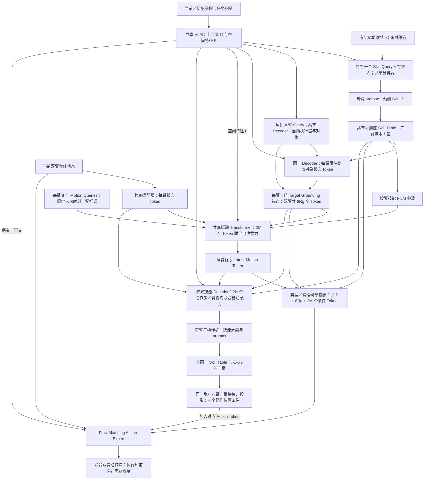
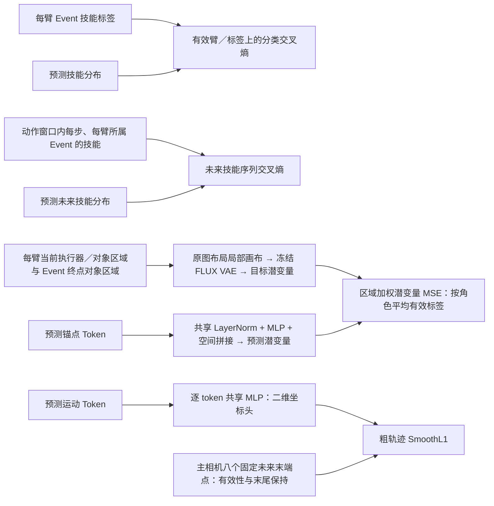

# Design：ESkill-VLA Stage 1 架构

本页是当前第一阶段的实现基准：明确网络、张量接口、监督数据及训练／推理路径。动机与方法来源分别见 [idea.md](idea.md)、[Event Organization](event_organization.md)、[Atomic Skill](atomic_skill.md)、[Target Grounding](target_grounding.md)、[Action Representation](action_representation.md)。

**近期目标：跑通数据与算法、完成模型训练和仿真闭环评测，首先看平均任务成功率是否改善。** 更新于 2026-11-03；Stage 1 采用下述事件表征与未来技能设计，视觉监督改为参考 AffordanceVLA 的冻结 FLUX VAE＋潜变量直接 MSE。现有代码已完成旧视觉去噪方案的四卡短程链路检查；每臂 8 个 tokens／间隔 4 步的二维 Motion 已接入并完成十条真实轨迹与小模型链路核验；视觉 FLUX 潜变量回归已接入，并完成真实 π0.5 LoRA 四卡 8 步训练与恢复至 10 步；ESkill 收敛与闭环效果仍待验证。逐项对比实验不作为启动条件。

**实现文档约定：本页是当前 Stage 1 的实现基准。`ref_papers` 只提供原方法、借鉴理由与适用边界；其中描述的原论文模块不自动进入本项目，也不形成额外实验或复现要求。新增设计应先明确更新本页及对应方向文档。**

## 1. 整体架构

Stage 1 基座统一为 **π0.5**，采用其共享 VLM 骨干和 OpenPI 风格 Flow Matching Action Expert。**以当前 Event 的技能、预期对象状态和固定时域未来运动为依据，预测动作窗口内每臂的未来技能安排，再用与动作步对齐的技能条件生成联合动作。** Event 按臂组织，网络参数共享；左右臂可以有不同技能、对象、事件终点及切换位置。

2026-10-30 范围更新：分别围绕 LIBERO 和 RoboTwin 构建仿真数据引擎，参考 GuidedVLA 的数据标注与训练组织方法；其复现暂不开展。两条数据链路均进行字段自查、10 条抽样渲染及最终人工验收。下述 ESkill-VLA 模块设计仍为实现依据，具体来源版本、任务规模、补标方法及训练预算随数据核对确定。

2026-10-31 来源选择：LIBERO 主来源采用 [AtomicVLA 事件标注＋基础数据](../data/libero/atomic-vla/README.md)，沿用其子事件与技能标签，优先补主相机夹爪和操作物体 bbox；Event 终点区域从实际结束帧的同一对象 bbox 读取。RoboTwin 采用原生实例区域，基座统一 π0.5，训练任务与预算后续确定。

在线路径为：**当前技能与 ee／obj 锚点 → 当前 Event 的 Goal 与固定时域 Latent Motion → 每臂未来技能序列 → 逐动作步技能条件 → 联合动作块。** 当前技能与两组当前锚点并行预测；未来技能 Decoder 读取这些预测表征以及当前／历史上下文、本体状态。当前事件条件也继续供动作专家读取。



图中箭头表示计算依赖。运动 Token 对应未来 `[4,8,12,16,20,24,28,32]` 个来源步，允许跨 Event，未来技能 Token 按动作步组织，两者通过注意力联系，不按槽位强行一一对应。VLM 原有任务上下文仍进入动作专家，运动分支读取空间特征而不另加完整语言直连。未来技能安排是预测，实际任务进展由执行短前缀后的新观察修正。

训练连接四个辅助监督出口，未来真值只用于目标分支：



动作专家另接受标准 Flow Matching 监督。推理不运行 VAE 目标编码、潜变量投影头和粗轨迹监督头，不生成未来 RGB；每次新观察计算一次当前事件表征、未来技能序列与动作位置条件，并在本次动作生成的 flow steps 中缓存复用。VAE 图像解码仅供离线重建核验。

## 2. 张量与模块接口

记批量大小为 \(B\)，共享辅助维度为 \(d\)，文本原型维度为 \(d_e\)，技能数为 \(N_{skill}\)，动作块长度为 \(H\)，动作维度为 \(d_a\)。臂索引 \(r\in\{L,R\}\)，角色索引 \(a\in\{ee,obj,goal\}\)，每角色查询数 \(R_g=g^2\)，\(M=8\) 为每臂固定运动查询数，间隔 \(\Delta=4\) 个来源步。\(C_z,h_z,w_z\) 表示 VAE 潜变量通道和空间网格，\(g\) 整除 \(h_z,w_z\)。下列形状显式保留臂维度，进入注意力时按约定展平。所有新增条件先投影到消费模块需要的维度。

| 模块／张量 | 形状 | 职责与初始实现 |
| --- | --- | --- |
| VLM 上下文 \(C_t\) | \([B,N_c,d]\) | 当前／历史视觉语言特征；骨干原有层特征继续服务动作专家 |
| 空间特征 \(F_{\le t}^{spatial}\) | \([B,N_v,d]\) | 视觉 Token，保留空间及必要的帧／视角标识 |
| 文本原型表 \(E\) | \([N_{skill},d_e]\) | 离线编码并归一化，冻结缓存 |
| 臂嵌入表 \(E^{arm}\) | \([2,d]\) | 标识左右臂，供查询、状态与动作条件使用；不编码技能类别 |
| Skill Query Decoder | \([B,2,1,d]\) | 共享基础 Query 加臂嵌入，共享 Decoder 读取 \(C_t\) |
| 技能概率与所选向量 | \([B,2,N_{skill}]\)、\([B,2,1,d]\) | 各臂余弦 softmax、argmax，索引同一张可训练表 \(\mathrm{SkillTable}\) |
| 三角色 Query Decoder | \([B,2,3,R_g,d]\) | 共享两层；每个臂／角色组内自注意力、上下文交叉注意力、FFN |
| 锚点拼接 \(\mathrm{TargetGrounding}_t\) | \([B,6R_g,d]\) | 每臂当前执行器、当前对象、事件目标各 \(R_g\) 个 Token |
| 共享潜变量投影头 | \([B,2,3,C_z,h_z,w_z]\) | 每个 Token 经 MLP 预测一个空间块，再按固定顺序拼接；仅用于训练监督与离线核验 |
| 冻结 VAE 目标 | \([B,2,3,C_z,h_z,w_z]\) | 三角色真实画布编码出的潜变量；不进入在线预测分支 |
| 本体适配 \(A_{body}(s_t^r)\) | \([B,2,1,d]\) | 共享 MLP 仅投影本臂当前状态；输出后加一次臂嵌入，完整状态仍进入动作专家 |
| 运动 Transformer | \([B,2,M,d]\) | 展平为 \(2M\) 个 Token 联合自注意力；FiLM 按所属臂应用 |
| 轨迹头 \(D_{trace}\) | \([B,2,8,2]\) | 逐 token 共享 MLP，预测对应未来时刻的归一化二维末端坐标 |
| 未来技能 Decoder | \([B,2,H,d]\) | 动作步／臂查询联合自注意力，交叉读取当前事件表征、上下文和本体状态 |
| 未来技能概率与所选向量 | \([B,2,H,N_{skill}]\)、\([B,2,H,d]\) | 共享线性分类头、逐位置 argmax、查同一 \(\mathrm{SkillTable}\) |
| 逐动作步技能条件 \(c_{t,j}^{skill}\) | \([B,H,d_A]\) | 同一步左右臂技能向量拼接，投影到 Action Token 宽度 \(d_A\) |
| 当前事件共享条件 | \([B,2+6R_g+2M,d]\) | 两个当前技能、\(6R_g\) 个锚点及 \(2M\) 个运动 Token，带类型／臂标识 |
| Action Expert | \([B,H,d_a]\) | 一次输出联合动作块；本次双臂数据为 14 维时保持 14 维，不是两套独立策略 |

第一版固定 \(d=256,R_g=16,g=4\)，共享两层角色 Query Decoder；256×256 监督画布经冻结 FLUX VAE 得到 \([C_z,h_z,w_z]=[16,32,32]\)。共享投影头为 LayerNorm(256) → Linear(256,512) → GELU → Linear(512,1024)，每个 Token 对应一个 16×8×8 潜变量块。单臂有 48 个有效视觉 Token，双臂有 96 个；保持双臂槽位与缺失臂 mask 的现有接口。Motion 固定 \(M=8\)，当前共享条件共 \(2+96+16=114\) 个槽位；Motion 时间点数与 Grounding 空间块数独立。具体权重 revision、FP32／mode 编码及画布约定见 [Target Grounding](target_grounding.md)。参数仍通过配置管理，未来技能 Decoder 保持两层共享 Transformer。当前代码已采用每角色 16 个 Grounding Query 与每臂 8 个二维 Motion Query。视觉监督已采用共享 MLP 潜变量回归与 256×256 画布，实际训练和恢复检查见 [grounding_mse_v1](../data/libero/atomic-vla/check/test/grounding_mse_v1/README.md)。

固定顺序为左臂、右臂；当前事件共享条件中，每臂按技能、ee、obj、goal、运动排列。未来技能按 \([r,j]\) 排列，\(j=0,\ldots,H-1\)，与联合动作块的第 \(j\) 行对应。原始动作维度与左右臂顺序由数据适配器明确映射；14 维不是所有 OpenPI 配置的通用约定。物理存在但静止的臂仍保留全部在线槽位；仅配置中不存在的执行器槽位使用 presence／attention mask，不能与标签缺失或 idle 混同。缺失臂的未来技能向量在拼接前置零，单臂来源到模型槽位的映射固定在配置中。

### 2.1 Atomic Skill：分类与技能先验分开

\[
e_k=\operatorname{Normalize}(E_{text}(d_k)),\quad
v_t^r=\operatorname{SkillDecoder}(Q^{skill}+e_r^{arm},C_t),\quad
q_t^r=\operatorname{Normalize}(W_s v_t^r),
\]

\[
p_t^r(k)=\operatorname{Softmax}_k((q_t^r)^\top e_k/\tau),\qquad
\widehat{\mathrm{SkillID}}_t^r=\arg\max_k p_t^r(k),\qquad \mathrm{SkillEmbedding}_t^r=\mathrm{SkillTable}[\widehat{\mathrm{SkillID}}_t^r].
\]

技能描述不含具体对象名，表达可复用交互目的。\(\mathrm{SkillTable}\) 是独立可训练参数，不再令下游向量每次等于 \(W_{adapt}e_k\)。可用投影后的文本原型初始化表值，之后独立优化；初始化投影不构成运行期必需模块。

左右臂同类技能共享同一表行，不将臂身份写入技能词表。\(\mathrm{SkillEmbedding}_t^r\) 参与本臂 Goal 预测和运动 FiLM，并作为未来技能预测器与动作专家的当前事件上下文。分类器专属参数由当前技能交叉熵训练，下游梯度不穿过 argmax；共享骨干仍接收其他分支的梯度。词表包含语义明确的 idle、hold、return：分别表示无主动交互、保持已建立的抓持／支撑关系、返回规定姿态，不能仅根据末端是否静止区分。

### 2.2 Target Grounding：共享预测器与三组角色 Query

**\(\mathrm{TargetGrounding}_t^{r,goal}\) 定义为 Event-boundary Object State Grounding：使用被操作对象在当前 Event 结束时的视觉区域，监督模型学习该对象应达到的目标状态。** 它与 \(\mathrm{TargetGrounding}_t^{r,obj}\) 绑定同一被操作对象，监督时刻分别为本臂事件终点 \(t_e^r\) 与当前时刻 \(t\)。

\[
\mathrm{TargetGrounding}_t^{r,ee}=P_\theta(Q^{ee}+e_r^{arm},C_t),\qquad
\mathrm{TargetGrounding}_t^{r,obj}=P_\theta(Q^{obj}+e_r^{arm},C_t),
\]

\[
\mathrm{TargetGrounding}_t^{r,goal}=P_\theta(Q^{goal}+e_r^{arm},[C_t,\mathrm{TargetGrounding}_t^{r,ee},\mathrm{TargetGrounding}_t^{r,obj},\mathrm{SkillEmbedding}_t^r]),
\qquad \mathrm{TargetGrounding}_t=[\mathrm{TargetGrounding}_t^L,\mathrm{TargetGrounding}_t^R],\quad \mathrm{TargetGrounding}_t^r=[\mathrm{TargetGrounding}_t^{r,ee},\mathrm{TargetGrounding}_t^{r,obj},\mathrm{TargetGrounding}_t^{r,goal}].
\]

各臂当前角色调用可并行或沿 batch 合并，目标调用随后执行。三组基础 Query 按角色学习、跨臂共享，臂嵌入在组内广播；每组自注意力仅处理本组 \(R_g\) 个 Query。预测 Token 通过共享投影头映射为监督用 VAE 网格，两者不直接逐元素比较。

训练目标采用保留原图布局的局部 RGB 画布：当前执行器／对象使用各自当前区域，事件目标使用同一被操作对象在 \(t_e^r\) 的区域。第一版对完整屏内 bbox 在源图中四周各留 4 像素并裁到屏内，区域外填黑色，整幅统一缩放至 256×256，不将局部区域独立居中放大。RGB 保留实际遮挡内容；π0.5 观察输入保持 224×224。原图、区域、背景与缩放约定统一保存；参考视角变化时先对齐，不能直接拼接不一致的空间标签。

执行器、当前对象和事件终点对象的区域统一采用忽略外部遮挡的完整屏内范围（`full_in_frame`）。仿真中分别独立渲染目标几何，屏外部分裁掉；遮挡不改变对象绑定或使完整框失效。RGB 保留原画面，因此框内可以包含真实遮挡物，不生成被遮挡对象的虚构外观。

令 \(o_i^r\) 为本臂当前 Event 的被操作对象，事件目标的 VAE 监督为：

\[
y_t^{r,goal*}=E_{VAE}\!\left(\operatorname{Canvas}\!\left(I_{t_e^r},R_{t_e^r}^{obj*}(o_i^r)\right)\right).
\]

其中 \(R_{t_e^r}^{obj*}(o_i^r)\) 仅由该对象在事件终点的标注区域确定。目标图像与区域只用于训练监督，在线分支仍按上述公式从当前／历史输入预测 \(\mathrm{TargetGrounding}_t^{r,goal}\)。

双臂所有角色共用冻结 FLUX VAE 和 LayerNorm → Linear → GELU → Linear 潜变量投影头。投影头只读取对应角色的预测 Token，将每个 Token 映射为 \([C_z,h_z/g,w_z/g]=[16,8,8]\) 空间块，再按固定行优先顺序拼接为 \(\widehat y_t^{r,a}\)。直接以 \(\widehat y_t^{r,a}\) 与冻结目标 \(y_t^{r,a*}\) 的区域加权 MSE 监督，不使用视觉扩散噪声、噪声时间或去噪器。目标编码使用 `latent_dist.mode()`，按权重配置执行 \((z-\mathrm{shift})\times\mathrm{scale}\)，具体来源见 [Target Grounding](target_grounding.md)。

mask 仅构造目标及区域损失权重，不进入在线预测器或潜变量投影头，不追加到冻结 RGB VAE 的输入通道。缺失或无效区域只屏蔽对应监督，在线槽位仍从当前输入预测。三角色与原位画布是本项目设计；AffordanceVLA 原版 Which2Act 的裁剪放大和独立热图头不自动进入本方案。

### 2.3 Action Representation：技能与空间条件联合解码

每臂使用 8 个可学习查询，槽位绑定固定未来偏移，左右臂共享查询参数并加入臂嵌入：

\[
\delta_j=4(j+1),\qquad
q_{r,j}^{motion}=q_j^{learn}+e_r^{arm},\quad j=0,\ldots,7.
\]

一步指一个来源步；LIBERO 为来源帧索引增量，不再额外乘四。输出八点对应 `[4,8,12,16,20,24,28,32]`，允许跨 Event。固定槽位和标签建立时间语义，第一版不额外向轨迹 head 输入时间编码。旧弧长进度编码不沿用为时间语义；在同步公共时间轴上，两臂相同槽位查询相同未来索引。

运动上下文为 \([\mathrm{TargetGrounding}_t,F_{\le t}^{spatial},A_{body}(s_t^L)+e_L^{arm},A_{body}(s_t^R)+e_R^{arm}]\)。将 \(2M\) 个查询展平后联合自注意力，再交叉关注双臂条件，配合 FFN；不按臂屏蔽信息交换。技能向量经共享 MLP 按臂生成 FiLM 参数，仅调制属于该臂的查询：

\[
(\gamma_\ell^r,\beta_\ell^r)=\operatorname{MLP}_\ell(\mathrm{SkillEmbedding}_t^r),\qquad
\operatorname{FiLM}_\ell(X_{r,j})=\gamma_\ell^r\odot\operatorname{LN}(X_{r,j})+\beta_\ell^r,
\]

\[
\mathrm{LatentMotion}_t=\operatorname{MotionTransformer}_{\mathrm{FiLM}(\mathrm{SkillEmbedding}_t^L,\mathrm{SkillEmbedding}_t^R)}
(Q^{motion},\mathrm{TargetGrounding}_t,F_{\le t}^{spatial},\text{双臂状态 Token}),\qquad
\hat u_{t,j}^r=D_{trace}(z_{t,j}^r)\in\mathbb R^2.
\]

FiLM 参数按层产生，在本臂的 \(M\) 个 Token 上广播；初始可设为单位缩放和零偏置以稳定接入。所有臂与技能共用同一运动网络和轨迹头。\(\mathrm{LatentMotion}_t\) 接受粗轨迹、未来技能分类与动作监督，并回传到选中的当前技能向量。联合注意力允许跨臂信息与梯度交换。

### 2.4 当前事件条件下的未来技能预测

每臂为动作窗口建立 \(H\) 个查询，使用共享基础 Query、固定正弦／余弦动作步位置编码和臂嵌入：

\[
q_{r,j}^{future}=q^{future}+\operatorname{PE}_{step}(j)+e_r^{arm},\qquad j=0,\ldots,H-1.
\]

Stage 1 使用动作步位置编码。只有控制周期和采样对应已核实、部署也使用同一时间约定时，才可将位置表达为 \(j\Delta t\)；不从展示 fps 或过滤后的帧号推造物理秒数。动作步位置、Motion 来源帧偏移与 Flow Matching 去噪时间分别定义；三者不能混用。

未来技能 Decoder 的上下文为：

\[
C_t^{future}=[C_t,\mathrm{SkillEmbedding}_t^L,\mathrm{SkillEmbedding}_t^R,
\mathrm{TargetGrounding}_t,\mathrm{LatentMotion}_t,
A_{body}(s_t^L)+e_L^{arm},A_{body}(s_t^R)+e_R^{arm}].
\]

将 \(2H\) 个查询展平后联合自注意力，再交叉关注上述上下文并经过 FFN；全部未来位置并行预测，不输入真值未来技能。共享线性分类头输出：

\[
Z_t^{future}=\operatorname{FutureSkillDecoder}(Q^{future},C_t^{future}),\quad
p_{t,r,j}^{future}=\operatorname{Softmax}(W_f Z_{t,r,j}^{future}+b_f),\quad
\hat k_{t,r,j}=\arg\max_k p_{t,r,j}^{future}(k),\quad
E_{t,r,j}^{future}=\mathrm{SkillTable}[\hat k_{t,r,j}].
\]

当前与未来技能使用同一词表和同一可训练表；当前技能保持冻结文本原型分类，未来分类头在各臂／动作步共享。未来分类器隐藏特征不直接绕过查表进入动作专家。双臂可以预测不同技能与切换位置，同一窗口允许跨 Event；不设置“最多两个 Event”的硬限制。

未来技能序列描述预期操作安排，不确认事件已成功；同类技能也可能对应不同对象和多个 Event。Goal 仍描述当前 Event 的对象终态，Motion 描述固定未来八点并允许跨 Event；后续对象和目标仍需结合任务与观察确定。首版不增加逐 Event 的未来 Goal 或剩余时长预测头。

### 2.5 Action Expert 条件接口

\[
H_t^{aux}=[\mathrm{SkillEmbedding}_t^L,\mathrm{TargetGrounding}_t^L,\mathrm{LatentMotion}_t^L,\mathrm{SkillEmbedding}_t^R,\mathrm{TargetGrounding}_t^R,\mathrm{LatentMotion}_t^R],\qquad
A_{t:t+H}\sim\pi_{FM}(\cdot\mid C_t,s_t,H_t^{aux},c_t^{skill}).
\]

同一动作步的左右臂技能向量按固定顺序拼接，经共享线性投影后加到对应动作 Token：

\[
c_{t,j}^{skill}=\operatorname{Project}([E_{t,L,j}^{future};E_{t,R,j}^{future}]),\qquad
h_{t,j}^{action}(u)\leftarrow h_{t,j}^{action}(u)+c_{t,j}^{skill}.
\]

\(u\) 表示 Flow Matching 去噪时间；\(h^{action}\) 为当次加噪动作经基座动作输入映射后的 Token。只对 \(H\) 个动作位置加入技能条件，保留基座的状态、位置及 flow time 处理。每次采样求解调用重新构造动作 Token，再加入缓存的 \(c_t^{skill}\)，不累计修改上次隐藏状态。

逐步技能投影 `step_projection` 的权重、偏置均初始化为零，使该加法条件初始贡献为零。动作损失首先更新投影，投影更新后再经此通路向技能向量传递梯度；未来技能分类仍由自身分类损失训练。共享事件 Token 的 KV 投影与注入方式保持不变，因此整体初始化不要求等价于原版 π0.5。零初始化仅发生在模型创建时，加载 checkpoint 时保留已训练的投影参数。

在保留基座上下文、动作噪声、flow time 和本体状态输入的前提下，将辅助 Token 加上所属臂和类型编码，经维度投影加入动作专家可访问的条件序列；尤其是共享表取出的技能向量需保留其臂归属。对层级 KV 接口，按层宽度投影辅助 Token，并追加到该层原有前缀 KV；查询、位置编码和可见性 mask 随新增长度同步扩展。具体 API 在实现时对照选定基座确认，不假定直接拼接最终层特征即可适配所有 OpenPI 版本。

共享事件 Token 与逐步技能条件均从当前／历史输入预测，构造过程不读取加噪动作或动作真值。训练与部署都使用预测类别查表；关闭辅助损失头不改变条件接口。共享条件保留“当前 Event”的含义，不将当前 Goal 当成所有未来技能共同的目标。真实动作专家负责姿态、夹爪和具体控制。

## 3. Event 数据与标签

各模块需要的外部数据见 [Data](data.md)。

一个 Event 对应**一条臂的一次 Skill 执行**；同一 Skill 类型跨臂、跨 Event 复用。采用可核验的脚本／状态记录组织语义 Event，保留全局同步序列，左右臂各有一条事件流 \(\{\mathcal E_i^r\}\)。同臂事件互不重叠，跨臂允许时间重叠；采样同一当前时刻 \(t\) 时，分别查找两臂的活动事件。技能粒度以交互目的为依据，词表与边界一致，不将每个脚本 primitive 自动当作独立 Skill。

```text
Episode
  episode_id, split, task_instruction, embodiment_id
  timestamps, images, states, actions
  arm_ids[L,R], arm_presence[2], action_arm_mapping
  effector_positions_3d[time,2,3], effector_reference_points
  coordinate_frame, units, calibration
  object_tracks, region_annotations, annotation_validity
  events_by_arm: {L: Event[], R: Event[]}
  cooperative_goal_groups[]  # 仅标注共享终态的协作组，无新增学习模块

Event
  event_id, arm_id, start_time, end_time, skill_label
  manipulated_object_id?  # obj 与 goal 使用同一对象，goal 区域取自 end_time
  cooperative_goal_group_id?  # 普通并发／不同效果的交接不强行分到同一组
  expected_effect?, observed_outcome?, boundary_source, confidence

CooperativeGoalGroup
  group_id, member_event_ids, shared_object_id, shared_goal_time
  # 成员共同追求同一对象终态，语义 end_time 与 shared_goal_time 对齐

TrainingSample
  inputs: current/history_images, instruction, current_state, arm_presence[2]
  targets:
    skill_labels[2], skill_validity[2]
    future_skill_labels[2,H], future_skill_validity[2,H]
    role_canvases_or_cached_vae_latents[2,3,...], role_validity[2,3]
    role_region_masks_on_vae_grid[2,3,h_latent,w_latent]
    future_trace_uv[2,8,2], trace_validity[2,8]
    future_observed[2,8], future_padded[2,8]
    actions[H,action_dim], action_validity
  metadata: episode_id, event_ids[2], end_times[2], object_ids[2], action_frame_indices[H]
            cooperative_goal_group_ids[2], current_time, reference_view, frame, units
            future_frame_indices[8], future_source_frame_indices[2,8]
```

先在每个任务内部按完整父轨迹划分 90% train／10% val，所有帧、视角、手臂和派生记录跟随同一侧；SFT 与辅助训练复用固定清单，统计只读 train。再从共同时间轴采样，保留事件内部各阶段。每臂区间为 \([t_{start}^r,t_e^r)\)，边界状态可作上一事件终点；末事件保留可观测终点。已知无主动操作的间隔可标 idle，未知／漏标区间使用无效标签，不能补成 idle。失败事件的实际结束状态不直接当作期望成功状态。

以上为训练样本的概念接口；实际预保存字段沿用 [fields.py](../scripts/preprocess/fields.py) 的 `start_frame/stop_frame/goal_frame` 和时间约定。未来技能标签在采样时派生，不增加落盘格式或重新标注边界。

**未来技能与动作逐行配对：** \(H\) 按动作记录行数计数，第 \(j\) 条动作先通过来源的对齐规则映射到公共索引，再分别查两臂该索引所属 Event 的技能。索引不一定是相机帧号，也不保证相邻动作为等物理时间间隔。padding、超出 Episode、缺失事件／技能及不存在臂不计未来技能分类损失；已知 idle／hold 作为正常类别。真值未来 Event ID 与边界只供标签构造，不决定在线查询或动作截断。

当前技能标签对应当前输入时刻，未来序列第 0 项对应第 0 条动作的命令时刻；两者按来源对齐关系匹配，避免默认错开一帧。当两者同刻时监督类别相同，不另加一致性损失。

**标签有效性逐臂、逐角色判断：** idle 或无对象 return 仍可监督当前 ee，obj 与对象 goal 无定义时标无效；hold 保留被抓持／支撑对象及可核验终态。不能因末端静止而屏蔽对象或轨迹监督，也不能给无对象事件伪造对象。标签缺失只影响对应辅助损失，不删除实际存在手臂的在线 Token，不关闭有真值的联合动作监督。`arm_presence` 来自机器人配置，只区分实际缺失的执行器；它不是事件活动标记。

**共享对象的协作目标：** 两臂操作同一对象且共同追求同一终态时，保留协作组，按可核验的共同效果对齐语义终点，使用同一目标时间和该对象的终点区域构造 goal 标签；两条 ee 路径仍各自取真实记录。原始 primitive 结束时间不同，不直接各取一帧作为互相矛盾的共同目标。无法核验共同终态、终点对象身份或区域时不虚构有效 goal 标签。仅同时操作同一物体、但承担不同阶段／效果的 handover 等事件，不强制共用终点；独立并发事件始终保留各自终点。上述元数据只服务标签一致性，不引入协作类别、额外头或新损失。

未来边界、协作组、真实 actor ID、区域、终点图像与辅助标签有效性均不进入在线预测器；训练和部署同样只根据当前／历史观测、指令与本体配置预测条件。

每臂在当前来源索引 \(t\) 上取未来 \(\delta_j=4(j+1)\) 的真实末端记录，投影到主相机并使用与模型观察相同的图像几何变换，得到归一化二维点。LIBERO 以已核验的 grip_site 为参考点；不替换为物体中心或框中心。标签与图像增强保持几何一致。

\[
\tau_{t,j}=t+\delta_j,\quad
\bar\tau_{t,j}=\min(\tau_{t,j},T_{last}),\quad
u_{t,j}^{r*}=\operatorname{ProjectToObservation}(p_{\bar\tau_{t,j}}^r).
\]

采用 Episode 末尾 `hold_last`，不在 Event 边界截断；末帧可靠且在画面内时，重复其坐标并参与监督。内部缺帧、屏外或无效投影保持无效；真实遮挡不使屏内几何点失效。请求帧、实际取值帧及 `future_observed`／`future_padded` 分开记录。运动静止按真实记录生成位置标签，不按 idle／hold 类别置零。详细投影与尾部规则见 [Action Representation](action_representation.md)。

## 4. 联合目标与梯度

\[
\mathcal L=\mathcal L_{FM}+\lambda_s\mathcal L_{skill}
+\lambda_f\mathcal L_{future}+\lambda_g\mathcal L_{ground}+\lambda_m\mathcal L_{trace}.
\]

技能分类在有效的批次／臂标签上求平均：

\[
\mathcal L_{skill}=\frac{\sum_{b,r}v^{skill}_{b,r}[-\log p_b^r(\mathrm{SkillID}_{b,r}^*)]}
{\max(1,\sum_{b,r}v^{skill}_{b,r})}.
\]

新增未来技能序列交叉熵，在有效批次／臂／动作步上求平均：

\[
\mathcal L_{future}=\frac{\sum_{b,r,j}v^{future}_{b,r,j}[-\log p_{b,r,j}^{future}(k_{b,r,j}^*)]}
{\max(1,\sum_{b,r,j}v^{future}_{b,r,j})}.
\]

该损失通过 Decoder 的连续输入路径回传到当前预测锚点、运动 Token 和所选当前技能表向量。示范中真实的未来技能只出现在分类目标中，不替换动作专家收到的预测技能。

视觉监督采用 [Target Grounding](target_grounding.md) 的区域加权潜变量 MSE：预测潜变量与冻结目标逐元素平方差、通道取均值、空间权重归一化，再对每角色的全局有效批次／臂样本求平均。DDP 中某卡无有效标签时仍参与相同的计数通信。二维轨迹使用归一化图像坐标上的逐元素 SmoothL1，先对 xy 两坐标取均值，再等权平均有效的批次／臂／点；终点保持点按同一有效性规则参与，不另加端点权重：

\[
\mathcal L_{trace}=\frac{\sum_{b,r,j}v^{trace}_{b,r,j}\operatorname{Mean}_{xy}
[\operatorname{SmoothL1}_{\beta_{trace}}(\hat u_{b,j}^r-u_{b,j}^{r*})]}{\max(1,\sum_{b,r,j}v^{trace}_{b,r,j})}.
\]

各有效性 mask 同时排除实际不存在的臂与缺失标签。分母按有效项计数，不直接相加两份单臂均值，避免仅增加臂维度就翻倍辅助损失。动作训练保留所选基座的 flow 插值、时间采样和损失约定，对原联合动作块计算一次 FM 损失，不拆成两个策略。

| 参数／通路 | 更新来源与边界 |
| --- | --- |
| 文本原型、VAE 目标编码器 | 冻结；目标 latent 不反向更新编码器 |
| 当前 Skill Query 与分类投影 | 当前技能交叉熵；下游损失不能穿过 argmax 更新类别选择 |
| 未来技能 Decoder、Query 与分类头 | 未来技能交叉熵；动作损失不能穿过逐步 argmax 直接优化切换位置 |
| 独立技能表 \(\mathrm{SkillTable}\) | 当前选中行接受 Goal、轨迹、未来技能与动作梯度；未来选中行通过逐步条件接受动作梯度 |
| 三锚点预测器 | 潜变量 MSE、下游轨迹、未来技能分类和动作损失 |
| 运动网络与 FiLM | 粗轨迹、未来技能分类和动作损失 |
| 逐动作步技能投影 | 动作 FM 损失 |
| 轨迹头／共享潜变量投影头 | 分别接受轨迹／潜变量 MSE 损失 |
| Action Expert | 动作 FM 损失 |
| 共享 VLM | 在可训练范围内接受各可达路径梯度；硬选择不会阻断其其他分支 |
| 共享臂嵌入 | 接受分类、Grounding、运动和动作等可达路径梯度；不属于纯分类参数 |

除冻结目标编码和离散选择外，不额外 detach 预测条件。不同臂、动作步选中同一 \(\mathrm{SkillTable}[k]\) 时梯度累加到同一行；联合注意力可使一臂监督影响另一臂的预测条件，但仍不能穿过 argmax 更新类别选择。新模块联合训练；骨干与动作专家的冻结／微调范围对齐所用基座并记录配置。联合目标仍为动作、当前技能、未来技能、视觉与轨迹五项；视觉项由噪声预测改为干净潜变量回归。

### 4.1 数值实现约定

以下是当前架构的训练配置，不增加模块、监督分支或消融要求。

| 项目 | 实现约定 | 必要诊断 |
| --- | --- | --- |
| 区域加权潜变量 MSE | 将角色区域及留边 mask 以覆盖率下采样到 VAE 网格；\(W=w_{bg}+(w_{fg}-w_{bg})m\)，\(w_{fg}>w_{bg}>0\)，按权重总和归一化 | 分别记录三角色 MSE、有效区域和背景误差；抽样比较目标画布、VAE 重建与预测重建 |
| 技能早期收敛 | 当前与未来技能均按预测类别查表；记录 \(\lambda_s,\lambda_f\) 与分类头学习率 | 当前／未来技能准确率、预测类别占比、技能表更新及少量技能时间线 |
| 运动坐标 | 主相机投影经过观察输入相同的图像变换，以画布尺寸归一化；每臂 8 点／间隔 4 个来源步 | 归一化与像素误差，逐偏移误差，真实／终点保持点的数量与误差 |
| SmoothL1 阈值 | 在归一化二维坐标中设置 \(\beta_{trace}>0\)，同时记录 \(\lambda_m\)；重新核验阈值与权重，不直接沿用旧米制三维损失尺度 | 检查轨迹头、运动网络和 FiLM 的实际梯度及训练稳定性 |

网格 mask 只参与目标构造和损失，不作为在线条件或潜变量投影头的额外真值输入。缺失区域按无效角色处理，不以全背景标签替代。冻结 VAE 编码、视觉潜变量差值与 MSE 均使用 float32；VAE 编码退出混合精度上下文。新潜变量尺度下重新检查视觉损失权重，不按旧去噪损失数值解释。Motion 图像变换、坐标归一化、八个偏移与末尾保持策略须保存到配置／checkpoint。Dataset、逐 token MLP 与损失已统一为二维接口；旧辅助 checkpoint 不作为新结构的同配置恢复，纯 π0.5 SFT 初始化入口仍可用。

明确采用逐元素 SmoothL1，记归一化二维坐标中的残差为 \(r\)：

\[
\operatorname{SmoothL1}_{\beta_{trace}}(r)=
\begin{cases}
\frac{r^2}{2\beta_{trace}},& |r|<\beta_{trace},\\
|r|-\frac{\beta_{trace}}2,&\text{其他}.
\end{cases}
\]

这不等于未归一化的 Huber；更换库实现时确认阈值和 reduction 语义。各损失数值无需相等，调节依据是有效梯度、收敛与最终控制表现。文本投影初始化不保证技能误选无害；二维位置监督不完整表达深度与接触状态；SmoothL1 不保证联合训练绝对稳定。推理虽移除辅助监督头，当前／未来技能、锚点与运动网络仍有新增开销。

## 5. 一次训练与一次部署

```text
online_forward(current_inputs):
  C, F = backbone(current_inputs)
  full_state, arm_presence = current_inputs.current_state, current_inputs.arm_presence
  state = split_state_by_arm(full_state)  # 使用固定数据映射
  # 固定臂顺序 [L,R]；各臂调用共享参数，可沿 batch 合并
  for r in present_arms(arm_presence):
    skill_prob[r] = semantic_selector(skill_query + arm_embed[r], C, frozen_text_prototypes)
    skill_embedding[r] = trainable_skill_table[argmax(skill_prob[r])]
    ee[r], obj[r] = shared_role_decoder(current_role_queries + arm_embed[r], C)
    goal[r] = shared_role_decoder(goal_queries + arm_embed[r], concat(C, ee[r], obj[r], skill_embedding[r]))
    target_grounding[r] = concat(ee[r], obj[r], goal[r])
    body[r] = state_adapter(state[r]) + arm_embed[r]
    Q_motion[r] = motion_queries[0:8] + arm_embed[r]  # 固定对应未来 4,8,...,32 个来源步
    Q_future[r] = future_query + action_step_encoding[0:H] + arm_embed[r]
  latent_motion = shared_motion_network(flatten_arms(Q_motion), flatten_arms(target_grounding), F, body,
                            per_arm_skill=skill_embedding, presence=arm_presence)
  future_context = concat(C, skill_embedding, target_grounding, latent_motion, body)
  future_hidden = future_skill_decoder(flatten_arms(Q_future), future_context, presence=arm_presence)
  future_prob = softmax(future_skill_head(unflatten_arms(future_hidden)))  # [B,2,H,K]
  future_embedding = trainable_skill_table[argmax(future_prob)]  # [B,2,H,d]
  future_embedding = zero_absent_arm_slots(future_embedding, arm_presence)
  step_condition = skill_to_action(concat_left_right(future_embedding))  # [B,H,d_A]
  action_condition = adapt_conditions(C, full_state, skill_embedding, target_grounding, latent_motion, arm_presence)
  return skill_prob, future_prob, target_grounding, latent_motion, action_condition, step_condition

training_step(batch):
  skill_prob, future_prob, target_grounding, latent_motion, condition, step_condition = online_forward(batch.inputs)
  L_skill = classification_loss(skill_prob, batch.targets)  # 有效批次／臂均值
  L_future = future_classification_loss(future_prob, batch.targets)  # 有效批次／臂／动作步均值
  target_latents = stop_gradient(frozen_flux_encode(batch.targets.role_canvases))
  predicted_latents = assemble_latent_patches(shared_latent_head(target_grounding))
  L_ground = weighted_role_latent_mse(predicted_latents, target_latents, batch.targets)  # 每角色：全局有效批次／臂均值
  L_trace = trace_loss(trace_head(latent_motion), batch.targets, beta=beta_trace)  # 有效归一化二维点均值
  L_FM = base_action_flow_loss(condition, step_condition, batch.targets.actions, batch.targets.action_validity)
  loss = L_FM + lambda_s * L_skill + lambda_f * L_future + lambda_g * L_ground + lambda_m * L_trace
  backward_and_update(loss)

deployment_step(observation_history):
  _, _, _, _, condition, step_condition = online_forward(observation_history)
  # 每个 flow step 复用条件，加入当次动作输入 Token；不重算技能、Goal 或 Motion
  action_chunk = base_flow_sampler(condition, step_condition)
  execute_configured_prefix(action_chunk)
  observe_again()
```

函数名是模块边界示意，非已经实现的代码。未存在臂槽位的 padding 由静态配置处理，物理存在的 idle／hold 臂始终运行在线预测。角色 Query 在各臂／角色组内自注意力；运动 Query 跨臂联合交互，未来技能 Query 跨臂及动作步联合交互。FiLM 只在所属臂的运动查询上广播。训练用真实未来信息构造 targets，在线前向与部署一致；整次动作采样只计算一遍当前事件表征和未来技能条件。

机器人执行固定长度动作块的短前缀，再根据新观察更新当前事件表征与技能安排。预测技能切换、动作块结束、夹爪闭合或预测路径到端点不自动代表目标达成。当前没有新增外置状态机或部署时梯度更新。

## 6. Stage 1 落地顺序与完成标准

1. 数据：在已保存的按臂 Event、区域和运动记录上构造训练样本，逐动作行派生未来技能序列及有效性；核对动作／事件对齐、当前 Event 的 Goal，以及每臂八点／四步的二维 Motion 与末尾保持标签。
2. 视觉监督：按第一版 16 Token／角色、256×256 画布和固定 FLUX VAE 版本，先抽 10 条轨迹核验真实三角色画布的 VAE 编解码，再接入共享潜变量回归头，核对目标／预测重建、标签有效性、梯度与 DDP 平均。结果按来源存入 check/test/，视频放 check/test/video/；核验重建质量与新损失权重的量级。
3. 模型：接入当前事件表征、未来技能 Decoder 和逐步条件化的单一动作专家，先用小批数据检查前向、损失与梯度，再开展完整训练。可继续从纯 π0.5 SFT 权重初始化新辅助实验；旧视觉去噪 checkpoint 不直接作为新头的同配置断点恢复。少量标签与预测技能时间线用于排查错位。
4. 评测：跑通 LIBERO／RoboTwin 对应环境的闭环执行，记录逐任务成功率与失败视频。需要比较时保持任务、数据拆分、示范预算和执行频率一致。

主指标是各任务成功率的平均，保留逐任务结果、评测次数及失败视频：

\[
\operatorname{MeanSuccess}=\frac1{N_{task}}\sum_{i=1}^{N_{task}}
\frac{\text{成功 rollouts}_i}{\text{评测 rollouts}_i}.
\]

Stage 1 先实现并运行完整新方案，不把旧方案复现、模块消融或多组对照作为前置任务。保留数据对齐、有效性、损失／梯度和闭环执行的必要检查；出现具体问题再做针对性分析。分类、视觉与轨迹指标服务排错，任务成功率用于评价整体表现。

实现时将基座条件 API、可训练参数范围、共享技能词表、臂／动作映射、动作采样与执行前缀长度、坐标／参考视角、\(H,M,d\)、辅助网络规模和损失尺度落到配置。Stage 1 保持固定动作块、当前 Event 的 Goal、每臂八点／四步的 Motion 与未来技能硬分类查表；不增加独立时长头、未来 Event 的视觉生成或额外规划器。

## 7. 工程组织

整体文件分工参考 AtomicVLA，采用单一 PyTorch 实现，模型统一放在 `src/openpi/models/`。`pi0.py` 承载 π0.5 基座；`pi0_eskill.py` 组合当前事件表征、未来技能序列与逐步动作条件，组织前向、五项损失和动作采样；技能、视觉接地和运动分支分别放在 `skill.py`、`grounding.py`、`motion.py`。本页定义的方法保持不变，不因目录参照引入 Think／Act 或 MoE。

`models/pi0_config.py` 管结构参数，`training/config.py` 管数据与训练设置；Dataset、平台适配、通用变换分别归 `policies/eskill_dataset.py`、`policies/*_policy.py`、`transforms.py`。训练循环入口为 `scripts/train.py`，统计入口为 `scripts/compute_norm_stats.py`，闭环客户端在 `examples/`。完整规划与实现状态见[项目说明](../README.md)，不预建空模型或重复框架目录。
