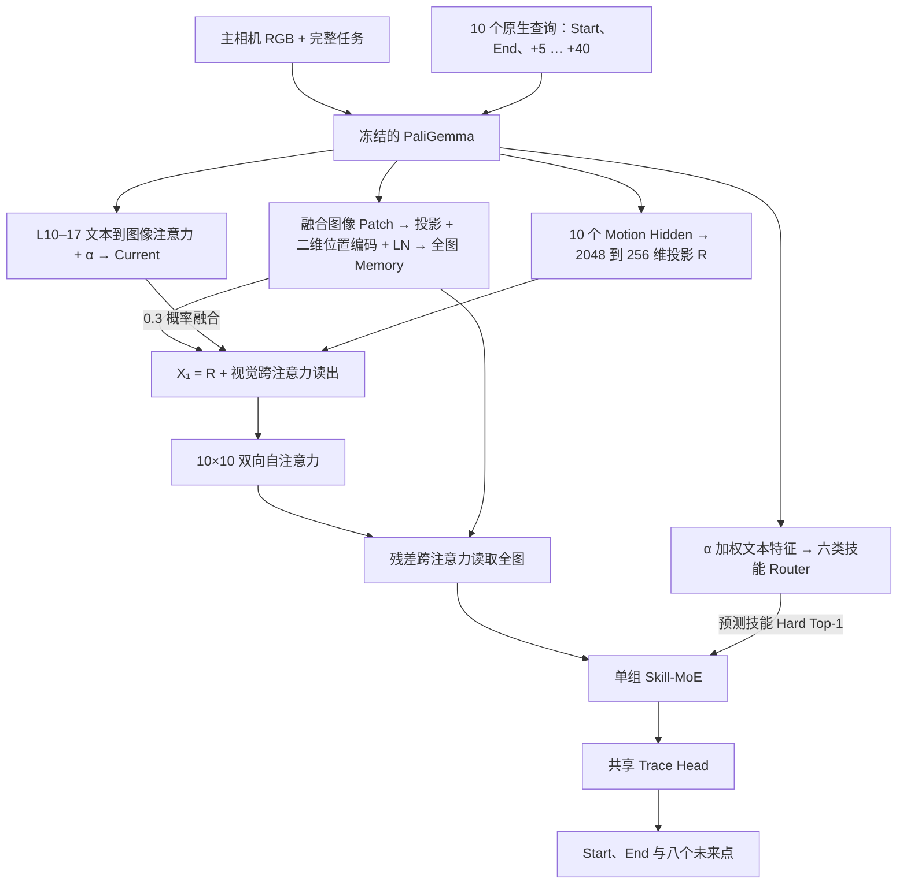

# ESkill-VLA Motion Planner

给定当前主相机 RGB 和完整任务指令，Planner 预测 Current、阶段技能、当前末端位置 Start、当前 Event 的末端终点 End，以及未来八个固定时刻的二维末端位置。以 `put the milk in the basket` 为例，Pick 段的 Current 是 milk，Place 段的 Current 是 basket。两段的 End 分别使用各自结束时刻的真实末端投影。[数据协议](data.md)

Learn to See 的双视角实验将主图、同帧腕图和完整指令送入同一次 PaliGemma 前向，只用主图 Current 标签监督 L10–L17 的原生文本注意力。腕图可用时参与全部图文层的融合。后续双视角 Planner 的设计沿用主相机的 256 个空间位置作为 Visual Memory，Motion hidden 可以读取两路视觉信息。当前 Planner 的训练入口使用单主相机，加载视觉权重时校验相机配置。[双视角训练与评测](../experiments/visual_primitive/README.md)

## 十槽联合解码 `v2_joint`

1. SigLIP 将 224×224 图像编码为 16×16 个 patch。PaliGemma 联合编码图文和十个查询。图文前缀只看图文，运动查询可读取整个有效序列。未来偏移采用保存的主相机帧。Start 对应偏移 0，End 使用独立可学习向量。九个固定槽位在输入端各加一次时间编码。校准时 End 与九个完整槽位输入的整体 RMS 对齐。冻结主干后，查询仍可通过主干反向传播。[主干](../src/openpi/models/pi0.py) · [校准](../src/openpi/models/pi0_eskill.py)
2. Current 沿用冻结的 KLAL 文本聚合器 α 与 L10–17 原生注意力。Router 读取同一组 α 加权的融合文本特征，预测 Pick、Place、Open、Close、Turn、Push。十个运动槽以 `0.7 × 自主注意力 + 0.3 × Current` 读取同一份全图 Value，结果加回投影后的原生运动特征。[Current](../src/openpi/models/visual_primitive.py) · [Planner](../src/openpi/models/motion_planner.py)
3. 十个槽位通过双向自注意力交换信息，再各自通过跨注意力读取全图。Router 为每条观测选择一个专家，该专家用同一组 SwiGLU 参数逐槽更新表征。一个共享 MLP 将最终的 `[B, 10, 256]` 序列一次映射到 `[B, 10, 2]`。按索引 0、1、2–9 分别取出 Start、End 和未来八点。[模型实现](../src/openpi/models/motion_planner.py)

这种组织参考了 VFlash 的做法，即给每个位置固定语义，再并行预测完整几何序列。此处用技能路由和连续二维回归实现。打开和关闭同一抽屉可以有不同的 End。Start 则取自当前图像，需检查改变目标或路由后它的预测漂移。[VFlash](https://research.nvidia.com/labs/lpr/vflash/)

## 监督与评测

Start 使用当前观测的 EEF 投影。End 使用当前 Event 半开区间内最后一个有效相机帧的 EEF 投影。该帧投影缺失时单独屏蔽 End。八个未来点仍使用 +5、+10、…、+40，最短 10 帧可跨 Event，尾部沿用终点保持。几何增强同时变换图像与十个点。[标签生成](../src/openpi/policies/eskill_dataset.py) · [几何增强](../src/openpi/augmentation.py)

正式配方从非 LoRA KLAL 10k 初始化并冻结上游。前 8 步预热 Router，随后训练 `0.02 × Skill CE + 0.25 × Motion Smooth L1`。运动损失按全局有效点数平均。真实示范的十点中只要有一个有效点，该样本便送入选中的专家。只有 End 标签时，回归梯度可更新专家和前面的自注意力。八个未来坐标各自依照有效标记计算损失，离散路由由技能 CE 训练。[训练说明](../experiments/motion_planner/README.md)

`native` 在锁定帧上独立统计 Start、End、真实未来点与保持点误差。Prior-only Swap 固定 A 的视觉特征、Motion Hidden 和路由，更换 Current。End Slot Swap 取 B 在首层残差视觉读出后的 End 槽，放到 A 相同位置，再运行 A 的时序注意力、视觉读取、专家和轨迹头。比较干预前后的最终 Start、End 和八个预测点，位移按模型画布上的二维欧氏像素距离计算。归一化方向响应使用 A、B 自然预测的最终 End。[离线评测](../scripts/analysis/motion_planner.py)

## 对照版本

| 配置 | 时序交互与技能专家 | 坐标读出 |
| --- | --- | --- |
| `v1` | 八个时间槽、两层技能专家 | 八个未来点 |
| `v2` | 八个时间槽读取十个槽位，八个时间槽经过专家 | Start、End 在首层视觉读出后解码，未来点在专家后解码 |
| `v2_joint` | 全部十个槽位互相读取并经过同一个样本选定的专家 | 十点全部在专家后解码 |

推理从 checkpoint 的模型配置选择前向路径。缺少版本字段的历史权重按 `v1` 恢复。两份十槽配方使用各自的输出目录。[分流版原始规范](motion_planner_v2.md) · [实验记录](../experiments/motion_planner/README.md)
