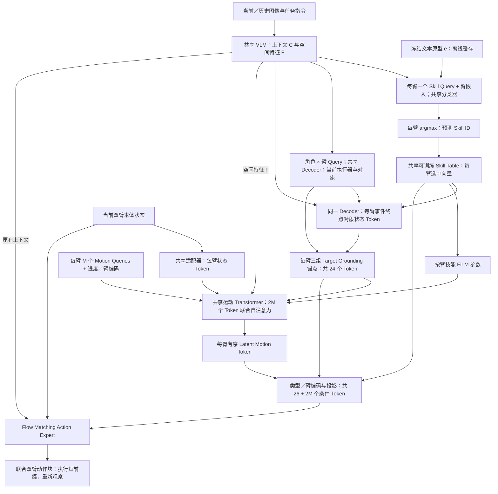
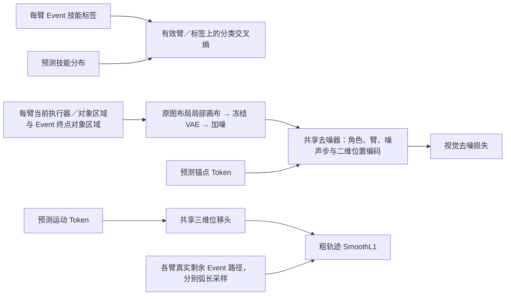

# Design：ESkill-VLA Stage 1 架构

本页是当前第一阶段的实现基准：明确网络、张量接口、监督数据及训练／推理路径。动机与方法来源分别见 [idea.md](idea.md)、[Event Organization](event_organization.md)、[Atomic Skill](atomic_skill.md)、[Target Grounding](target_grounding.md)、[Action Representation](action_representation.md)。

**近期目标：跑通数据与算法、完成模型训练和 RoboTwin 闭环评测，首先看平均任务成功率是否改善。** 更新于 2026-10-29；以下为已确定的方法和工程起点，尚未实现或取得实验结果。

**实现文档约定：本页是当前 Stage 1 的实现基准。`ref_papers` 只提供原方法、借鉴理由与适用边界；其中描述的原论文模块不自动进入本项目，也不形成额外实验或复现要求。新增设计应先明确更新本页及对应方向文档。**

## 1. 整体架构

采用共享 VLM 骨干和 π0.5 / OpenPI 风格 Flow Matching Action Expert。**Event 按臂组织；每臂预测自己的 Atomic Skill、Target Grounding 与 Latent Motion，网络参数共享，运动 Token 联合交互，动作专家统一输出双臂动作。** 左右臂可以同时执行不同技能，具有不同对象、事件终点与剩余路径，不再假设全局只有一个活动 Event。

在线路径按臂并行进行技能选择与当前 ee／obj 锚点预测，再预测各自事件目标，最后把技能与空间条件实例化为整段粗运动，条件化底层动作。按臂增加查询槽和标签维度，不复制两套网络，也不枚举双臂技能组合。



图中箭头表示计算依赖，不表示已证明的因果解耦。每臂的当前两锚点与技能选择并行，事件目标读取本臂两者及全局上下文。VLM 原有任务上下文仍进入动作专家，运动分支读取空间特征而不另加完整语言直连。双臂联合注意力提供信息交换通路，协调能力仍需由数据和联合动作监督学得。

训练额外连接三个监督出口，均不把未来标签送入在线路径：



动作专家另接受标准 Flow Matching 监督。推理移除 VAE 目标编码、去噪器和粗轨迹头；每次新观察计算一次结构化条件，并在本次动作生成的 flow steps 中缓存复用。

## 2. 张量与模块接口

记批量大小为 \(B\)，共享辅助维度为 \(d\)，文本原型维度为 \(d_e\)，技能数为 \(N_{skill}\)，动作块长度为 \(H\)，动作维度为 \(d_a\)。臂索引 \(r\in\{L,R\}\)，角色索引 \(a\in\{ee,obj,goal\}\)，每角色查询数 \(R_g=4\)，\(M\ge2\) 为每臂固定运动查询数。下列形状显式保留臂维度，进入注意力时按约定展平。所有新增条件先投影到消费模块需要的维度。

| 模块／张量 | 形状 | 职责与初始实现 |
| --- | --- | --- |
| VLM 上下文 \(C_t\) | \([B,N_c,d]\) | 当前／历史视觉语言特征；骨干原有层特征继续服务动作专家 |
| 空间特征 \(F_{\le t}^{spatial}\) | \([B,N_v,d]\) | 视觉 Token，保留空间及必要的帧／视角标识 |
| 文本原型表 \(E\) | \([N_{skill},d_e]\) | 离线编码并归一化，冻结缓存 |
| 臂嵌入表 \(E^{arm}\) | \([2,d]\) | 标识左右臂，供查询、状态与动作条件使用；不编码技能类别 |
| Skill Query Decoder | \([B,2,1,d]\) | 共享基础 Query 加臂嵌入，共享 Decoder 读取 \(C_t\) |
| 技能概率与所选向量 | \([B,2,N_{skill}]\)、\([B,2,1,d]\) | 各臂余弦 softmax、argmax，索引同一张可训练表 \(\mathrm{SkillTable}\) |
| 三角色 Query Decoder | \([B,2,3,4,d]\) | 共享两层；每个臂／角色组内自注意力、上下文交叉注意力、FFN |
| 锚点拼接 \(\mathrm{TargetGrounding}_t\) | \([B,24,d]\) | 每臂当前执行器、当前对象、事件目标各 4 个 Token |
| 本体适配 \(A_{body}(s_t^r)\) | \([B,2,1,d]\) | 共享 MLP 仅投影本臂当前状态；输出后加一次臂嵌入，完整状态仍进入动作专家 |
| 运动 Transformer | \([B,2,M,d]\) | 展平为 \(2M\) 个 Token 联合自注意力；FiLM 按所属臂应用 |
| 轨迹头 \(D_{trace}\) | \([B,2,M,3]\) | 共享 MLP，分别预测相对本臂当前末端的 XYZ 位移 |
| 结构化动作条件 | \([B,26+2M,d]\) | 两个技能、24 个锚点及 \(2M\) 个运动 Token，带类型／臂标识 |
| Action Expert | \([B,H,d_a]\) | 一次输出联合动作块；本次双臂数据为 14 维时保持 14 维，不是两套独立策略 |

4 个锚点 Query／两层角色 Decoder 是当前工程起点。\(d,M\)、Skill Decoder 与运动网络深度、去噪器宽度及画布分辨率在配置中记录，不作为新研究分支。当前不绑定具体代码仓库中的类名。

固定顺序为左臂、右臂；每臂按技能、ee、obj、goal、运动排列，运动内部按 \(j=0,\ldots,M-1\)。原始动作维度与左右臂顺序由数据适配器明确映射；14 维不是所有 OpenPI 配置的通用约定。物理存在但静止的臂仍保留全部在线槽位；仅配置中不存在的执行器槽位使用 presence／attention mask，不能与标签缺失或 idle 混同。

### 2.1 Atomic Skill：分类与技能先验分开

\[
e_k=\operatorname{Normalize}(E_{text}(d_k)),\quad
v_t^r=\operatorname{SkillDecoder}(Q^{skill}+e_r^{arm},C_t),\quad
q_t^r=\operatorname{Normalize}(W_s v_t^r),
\]

\[
p_t^r(k)=\operatorname{Softmax}_k((q_t^r)^\top e_k/\tau),\qquad
\widehat{\mathrm{SkillID}}_t^r=\arg\max_k p_t^r(k),\qquad \mathrm{SkillEmbedding}_t^r=\mathrm{SkillTable}[\widehat{\mathrm{SkillID}}_t^r].
\]

技能描述不含具体对象名，表达可复用交互目的。\(\mathrm{SkillTable}\) 是独立可训练参数，不再令下游向量每次等于 \(W_{adapt}e_k\)。可用投影后的文本原型初始化表值，之后独立优化；初始化投影不构成运行期必需模块。

左右臂同类技能共享同一表行，不将臂身份写入技能词表。\(\mathrm{SkillEmbedding}_t^r\) 参与本臂 Goal 预测和运动 FiLM，并直接输入联合动作专家。分类器专属参数由技能交叉熵训练，下游梯度不穿过 argmax；共享骨干仍接收其他分支的梯度。保留离散选择，不增加 VQ 或反事实训练。词表包含语义明确的 idle、hold、return：分别表示无主动交互、保持已建立的抓持／支撑关系、返回规定姿态，不能仅根据末端是否静止区分。

### 2.2 Target Grounding：共享预测器与三组角色 Query

**\(\mathrm{TargetGrounding}_t^{r,goal}\) 定义为 Event-boundary Object State Grounding：使用被操作对象在当前 Event 结束时的视觉区域，监督模型学习该对象应达到的目标状态。** 它与 \(\mathrm{TargetGrounding}_t^{r,obj}\) 绑定同一被操作对象，监督时刻分别为本臂事件终点 \(t_e^r\) 与当前时刻 \(t\)。

\[
\mathrm{TargetGrounding}_t^{r,ee}=P_\theta(Q^{ee}+e_r^{arm},C_t),\qquad
\mathrm{TargetGrounding}_t^{r,obj}=P_\theta(Q^{obj}+e_r^{arm},C_t),
\]

\[
\mathrm{TargetGrounding}_t^{r,goal}=P_\theta(Q^{goal}+e_r^{arm},[C_t,\mathrm{TargetGrounding}_t^{r,ee},\mathrm{TargetGrounding}_t^{r,obj},\mathrm{SkillEmbedding}_t^r]),
\qquad \mathrm{TargetGrounding}_t=[\mathrm{TargetGrounding}_t^L,\mathrm{TargetGrounding}_t^R],\quad \mathrm{TargetGrounding}_t^r=[\mathrm{TargetGrounding}_t^{r,ee},\mathrm{TargetGrounding}_t^{r,obj},\mathrm{TargetGrounding}_t^{r,goal}].
\]

各臂当前角色调用可并行或沿 batch 合并，目标调用随后执行。三组基础 Query 按角色学习、跨臂共享，臂嵌入在组内广播；每组自注意力仅处理本组 4 个 Query。预测 Token 不要求与监督用 VAE 网格形状相同。

训练目标采用保留原图布局的局部 RGB 画布：当前执行器／对象使用各自当前区域，事件目标使用同一被操作对象在 \(t_e^r\) 的区域。区域由对应 bbox／mask 确定，留边只按该区域和固定配置计算。区域外填固定背景，整幅统一缩放，不将局部区域独立居中放大。原图、区域、背景与缩放约定统一保存；参考视角变化时先对齐，不能直接拼接不一致的空间标签。

令 \(o_i^r\) 为本臂当前 Event 的被操作对象，事件目标的 VAE 监督为：

\[
y_t^{r,goal*}=E_{VAE}\!\left(\operatorname{Canvas}\!\left(I_{t_e^r},R_{t_e^r}^{obj*}(o_i^r)\right)\right).
\]

其中 \(R_{t_e^r}^{obj*}(o_i^r)\) 仅由该对象在事件终点的标注区域确定。目标图像与区域只用于训练监督，在线分支仍按上述公式从当前／历史输入预测 \(\mathrm{TargetGrounding}_t^{r,goal}\)。

双臂所有角色共用冻结 VAE 和轻量去噪器。后者读取加噪网格、二维位置编码、噪声步及角色／臂嵌入，交叉关注对应预测锚点。mask 仅构造目标及区域损失权重，不进入在线预测器，不直接追加到冻结 RGB VAE 的输入通道。每步训练采样一个噪声等级，无需完整反向生成链；缺失或无效区域只屏蔽对应监督，在线槽位仍从当前输入预测。

### 2.3 Action Representation：技能与空间条件联合解码

固定查询显式编码剩余路径进度：

\[
s_j=\frac{j}{M-1},\qquad
q_{r,j}^{motion}=q_j^{learn}+\operatorname{PE}(s_j)+e_r^{arm},\quad j=0,\ldots,M-1.
\]

\(\operatorname{PE}\) 为固定正弦／余弦编码，维度为 \(d\)，训练／部署频率配置一致。\(s_j\) 表示本臂剩余路径的空间进度，不是未来时间或当前任务完成率；它只由 \(M\) 决定，不依赖真实事件终点。左右臂各自归一化，同一 \(j\) 不意味着同一未来物理时刻。

运动上下文为 \([\mathrm{TargetGrounding}_t,F_{\le t}^{spatial},A_{body}(s_t^L)+e_L^{arm},A_{body}(s_t^R)+e_R^{arm}]\)。将 \(2M\) 个查询展平后联合自注意力，再交叉关注双臂条件，配合 FFN；不按臂屏蔽信息交换。技能向量经共享 MLP 按臂生成 FiLM 参数，仅调制属于该臂的查询：

\[
(\gamma_\ell^r,\beta_\ell^r)=\operatorname{MLP}_\ell(\mathrm{SkillEmbedding}_t^r),\qquad
\operatorname{FiLM}_\ell(X_{r,j})=\gamma_\ell^r\odot\operatorname{LN}(X_{r,j})+\beta_\ell^r,
\]

\[
\mathrm{LatentMotion}_t=\operatorname{MotionTransformer}_{\mathrm{FiLM}(\mathrm{SkillEmbedding}_t^L,\mathrm{SkillEmbedding}_t^R)}
(Q^{motion},\mathrm{TargetGrounding}_t,F_{\le t}^{spatial},\text{双臂状态 Token}),\qquad
\Delta\hat p_{t,j}^r=D_{trace}(z_{t,j}^r).
\]

FiLM 参数按层产生，在本臂的 \(M\) 个 Token 上广播；初始可设为单位缩放和零偏置以稳定接入。所有臂与技能共用同一运动网络和轨迹头。\(\mathrm{LatentMotion}_t\) 同时接受轨迹监督与动作监督，并回传到选中的技能向量；联合注意力也允许跨臂梯度影响，不保证两臂运动已经协调。不另设协作头或按技能独立的解码器。

### 2.4 Action Expert 条件接口

\[
H_t^{aux}=[\mathrm{SkillEmbedding}_t^L,\mathrm{TargetGrounding}_t^L,\mathrm{LatentMotion}_t^L,\mathrm{SkillEmbedding}_t^R,\mathrm{TargetGrounding}_t^R,\mathrm{LatentMotion}_t^R],\qquad
A_{t:t+H}\sim\pi_{FM}(\cdot\mid C_t,s_t,H_t^{aux}).
\]

在保留基座上下文、动作噪声、flow time 和本体状态输入的前提下，将辅助 Token 加上所属臂和类型编码，经维度投影加入动作专家可访问的条件序列；尤其是共享表取出的技能向量需保留其臂归属。对层级 KV 接口，按层宽度投影辅助 Token，并追加到该层原有前缀 KV；查询、位置编码和可见性 mask 随新增长度同步扩展。具体 API 在实现时对照选定基座确认，不假定直接拼接最终层特征即可适配所有 OpenPI 版本。

辅助 Token 可被动作查询读取，构造过程不读取加噪动作或动作真值。训练与部署使用相同的预测条件；关闭辅助损失头不改变动作专家条件维度。末端粗路径提供空间先验，真实动作专家负责姿态、夹爪和具体控制。

## 3. Event 数据与标签

各模块需要的外部数据见 [Data](data.md)。

一个 Event 对应**一条臂的一次 Skill 执行**；同一 Skill 类型跨臂、跨 Event 复用。采用可核验的脚本／状态记录组织语义 Event，保留全局同步序列，左右臂各有一条事件流 \(\{\mathcal E_i^r\}\)。同臂事件互不重叠，跨臂允许时间重叠；采样同一当前时刻 \(t\) 时，分别查找两臂的活动事件。技能粒度以交互目的为依据，词表与边界一致，不将每个脚本 primitive 自动当作独立 Skill。

```text
Episode
  episode_id, split, task_instruction, embodiment_id
  timestamps, images, states, actions
  arm_ids[L,R], arm_presence[2], action_arm_mapping
  effector_positions_3d[time,2,3], effector_reference_points
  coordinate_frame, units, calibration
  object_tracks, region_annotations, annotation_validity
  events_by_arm: {L: Event[], R: Event[]}
  cooperative_goal_groups[]  # 仅标注共享终态的协作组，无新增学习模块

Event
  event_id, arm_id, start_time, end_time, skill_label
  manipulated_object_id?  # obj 与 goal 使用同一对象，goal 区域取自 end_time
  cooperative_goal_group_id?  # 普通并发／不同效果的交接不强行分到同一组
  expected_effect?, observed_outcome?, boundary_source, confidence

CooperativeGoalGroup
  group_id, member_event_ids, shared_object_id, shared_goal_time
  # 成员共同追求同一对象终态，语义 end_time 与 shared_goal_time 对齐

TrainingSample
  inputs: current/history_images, instruction, current_state, arm_presence[2]
  targets:
    skill_labels[2], skill_validity[2]
    role_canvases_or_cached_vae_latents[2,3,...], role_validity[2,3]
    role_region_masks_on_vae_grid[2,3,h_latent,w_latent]
    remaining_trace_displacements_3d[2,M,3], trace_validity[2,M]
    robot_action_chunk[H,action_dim], action_validity
  metadata: episode_id, event_ids[2], end_times[2], object_ids[2]
            cooperative_goal_group_ids[2], current_time, reference_view, frame, units
```

先按完整 Episode 拆分训练／测试，再从共同时间轴采样，保留事件内部各阶段。每臂区间为 \([t_{start}^r,t_e^r)\)，边界状态可作上一事件终点；末事件保留可观测终点。已知无主动操作的间隔可标 idle，未知／漏标区间使用无效标签，不能补成 idle。失败事件的实际结束状态不直接当作期望成功状态。

**标签有效性逐臂、逐角色判断：** idle 或无对象 return 仍可监督当前 ee，obj 与对象 goal 无定义时标无效；hold 保留被抓持／支撑对象及可核验终态。不能因末端静止而屏蔽对象或轨迹监督，也不能给无对象事件伪造对象。标签缺失只影响对应辅助损失，不删除实际存在手臂的在线 Token，不关闭有真值的联合动作监督。`arm_presence` 来自机器人配置，只区分实际缺失的执行器；它不是事件活动标记。

**共享对象的协作目标：** 两臂操作同一对象且共同追求同一终态时，保留协作组，按可核验的共同效果对齐语义终点，使用同一目标时间和该对象的终点区域构造 goal 标签；两条 ee 路径仍各自取真实记录。原始 primitive 结束时间不同，不直接各取一帧作为互相矛盾的共同目标。无法核验共同终态、终点对象身份或区域时不虚构有效 goal 标签。仅同时操作同一物体、但承担不同阶段／效果的 handover 等事件，不强制共用终点；独立并发事件始终保留各自终点。上述元数据只服务标签一致性，不引入协作类别、额外头或新损失。

未来边界、协作组、真实 actor ID、区域、终点图像与辅助标签有效性均不进入在线预测器；训练和部署同样只根据当前／历史观测、指令与本体配置预测条件。

每臂粗路径取当前到其事件结束的真实末端位置 \(p_0^r=p_t^r,\ldots,p_{N_{path}}^r=p_{t_e^r}^r\)，双臂使用共同固定参考系，执行器参考点约定一致：

\[
\ell_0^r=0,\quad\ell_i^r=\sum_{k=1}^{i}\|p_k^r-p_{k-1}^r\|_2,\quad
L^r=\ell_{N_{path}}^r,\qquad \Delta p_{t,j}^{r*}=\gamma_t^{r*}(s_j)-p_t^r.
\]

\(\gamma_t^{r*}\) 按 \(\ell_i^r/L^r\) 插值，保留起止点，消除重复弧长造成的除零。只有真实测得 \(L^r\le\epsilon\) 才使用零位移目标；不能按 idle／hold 标签直接置零。空间位移保留统一物理尺度，不除以本条路径长度；只归一化采样进度。检查采样折线是否明显切掉转弯，缺失观测不无条件跨长缺口插值。终点为该臂末端真实位置，不是物体中心；两臂路径不串接，也不要求两个路径槽位具有相同时间戳。

## 4. 联合目标与梯度

\[
\mathcal L=\mathcal L_{FM}+\lambda_s\mathcal L_{skill}
+\lambda_g\mathcal L_{ground}+\lambda_m\mathcal L_{trace}.
\]

技能分类在有效的批次／臂标签上求平均：

\[
\mathcal L_{skill}=\frac{\sum_{b,r}v^{skill}_{b,r}[-\log p_b^r(\mathrm{SkillID}_{b,r}^*)]}
{\max(1,\sum_{b,r}v^{skill}_{b,r})}.
\]

视觉去噪沿用 [Target Grounding](target_grounding.md) 的区域加权目标：空间权重归一化、通道取均值，再对每角色的有效批次／臂样本求平均。粗路径使用固定尺度下的逐元素 SmoothL1，先对 XYZ 三坐标取均值，再等权平均有效的批次／臂／点；不另加端点权重：

\[
\mathcal L_{trace}=\frac{\sum_{b,r,j}v^{trace}_{b,r,j}\operatorname{SmoothL1}_{\beta_{trace}}
(\Delta\hat p_{b,j}^r/s_{xyz},\Delta p_{b,j}^{r*}/s_{xyz})}{\max(1,\sum_{b,r,j}v^{trace}_{b,r,j})}.
\]

各有效性 mask 同时排除实际不存在的臂与缺失标签。分母按有效项计数，不直接相加两份单臂均值，避免仅增加臂维度就翻倍辅助损失。动作训练保留所选基座的 flow 插值、时间采样和损失约定，对原联合动作块计算一次 FM 损失，不拆成两个策略。

| 参数／通路 | 更新来源与边界 |
| --- | --- |
| 文本原型、VAE 目标编码器 | 冻结；目标 latent 不反向更新编码器 |
| Skill Query 与分类投影 | 分类交叉熵；下游损失不能穿过 argmax 更新类别选择 |
| 独立技能表 \(\mathrm{SkillTable}\) | 选中行接受轨迹、动作及 Goal 分支去噪梯度 |
| 三锚点预测器 | 视觉去噪、下游轨迹和动作损失 |
| 运动网络与 FiLM | 粗轨迹和动作损失 |
| 轨迹头／共享视觉去噪器 | 分别接受轨迹／视觉去噪损失 |
| Action Expert | 动作 FM 损失 |
| 共享 VLM | 在可训练范围内接受各可达路径梯度；硬选择不会阻断其其他分支 |
| 共享臂嵌入 | 接受分类、Grounding、运动和动作等可达路径梯度；不属于纯分类参数 |

除冻结目标编码和离散选择外，不额外 detach 预测条件。左右臂选中同一 \(\mathrm{SkillTable}[k]\) 时梯度累加到同一行；联合注意力可使一臂监督影响另一臂的预测条件，但仍不能穿过 argmax 更新分类选择。新模块联合训练；骨干与动作专家的冻结／微调范围对齐所用基座并记录配置。原型分类和技能表职责分开，不新增技能学习损失。

### 4.1 数值实现约定

以下是当前架构的训练配置，不增加模块、监督分支或消融要求。

| 项目 | 实现约定 | 必要诊断 |
| --- | --- | --- |
| 区域加权去噪 | 将角色区域及留边 mask 以覆盖率下采样到 VAE 网格；\(W=w_{bg}+(w_{fg}-w_{bg})m\)，\(w_{fg}>w_{bg}>0\)，按权重总和归一化 | 分别记录有效区域和背景误差，检查小区域未被背景主导 |
| 技能早期收敛 | 继续预测类别查表；结合分类表现设置 \(\lambda_s\) 与分类头学习率 | 总体／逐类准确率、预测类别占比、技能表各行梯度或更新范数 |
| 运动尺度 | \(s_{xyz}>0\) 为统一固定空间尺度，保持训练／部署配置一致；仅损失输入使用 \(\Delta p/s_{xyz}\)，轨迹头输出仍为物理位移 | 缩放损失与物理单位路径误差 |
| SmoothL1 阈值 | 在缩放坐标中设置 \(\beta_{trace}>0\)，同时记录 \(\lambda_m\)；物理转折尺度为 \(s_{xyz}\beta_{trace}\) | 检查轨迹头、运动网络和 FiLM 的实际梯度及训练稳定性 |

网格 mask 只参与目标构造和损失，不作为在线条件或去噪器的额外真值条件。缺失区域按无效角色处理，不以全背景标签替代。空间缩放采用工作空间常数或仅从训练集计算并加正下限的统计量，保存到配置／checkpoint；不使用测试数据、不按每条轨迹长度缩放。物理位移解码接口保持不变。

明确采用逐元素 SmoothL1，记缩放坐标中的残差为 \(r\)：

\[
\operatorname{SmoothL1}_{\beta_{trace}}(r)=
\begin{cases}
\frac{r^2}{2\beta_{trace}},& |r|<\beta_{trace},\\
|r|-\frac{\beta_{trace}}2,&\text{其他}.
\end{cases}
\]

这不等于未归一化的 Huber；更换库实现时确认阈值和 reduction 语义。各损失数值无需相等，调节依据是有效梯度、收敛与最终控制表现。文本投影初始化不保证技能误选无害；三维监督不自动解决视觉深度歧义；SmoothL1 不保证联合训练绝对稳定。推理虽移除辅助监督头，在线技能、锚点与运动网络仍有新增开销。

## 5. 一次训练与一次部署

```text
online_forward(current_inputs):
  C, F = backbone(current_inputs)
  full_state, arm_presence = current_inputs.current_state, current_inputs.arm_presence
  state = split_state_by_arm(full_state)  # 使用固定数据映射
  # 固定臂顺序 [L,R]；各臂调用共享参数，可沿 batch 合并
  for r in present_arms(arm_presence):
    skill_prob[r] = semantic_selector(skill_query + arm_embed[r], C, frozen_text_prototypes)
    skill_embedding[r] = trainable_skill_table[argmax(skill_prob[r])]
    ee[r], obj[r] = shared_role_decoder(current_role_queries + arm_embed[r], C)
    goal[r] = shared_role_decoder(goal_queries + arm_embed[r], concat(C, ee[r], obj[r], skill_embedding[r]))
    target_grounding[r] = concat(ee[r], obj[r], goal[r])
    body[r] = state_adapter(state[r]) + arm_embed[r]
    Q_motion[r] = motion_queries + progress_encoding + arm_embed[r]
  latent_motion = shared_motion_network(flatten_arms(Q_motion), flatten_arms(target_grounding), F, body,
                            per_arm_skill=skill_embedding, presence=arm_presence)
  action_condition = adapt_conditions(C, full_state, skill_embedding, target_grounding, latent_motion, arm_presence)
  return skill_prob, target_grounding, latent_motion, action_condition

training_step(batch):
  skill_prob, target_grounding, latent_motion, condition = online_forward(batch.inputs)
  L_skill = classification_loss(skill_prob, batch.targets)  # 有效批次／臂均值
  L_ground = role_denoising_loss(target_grounding, batch.targets)  # 每角色：有效批次／臂均值
  L_trace = trace_loss(trace_head(latent_motion), batch.targets, scale=s_xyz, beta=beta_trace)
  L_FM = base_action_flow_loss(condition, batch.targets.actions)  # 联合双臂动作
  backward_and_update(L_FM + weighted_auxiliary_losses)

deployment_step(observation_history):
  _, _, _, condition = online_forward(observation_history)
  action_chunk = base_flow_sampler(condition)
  execute_configured_prefix(action_chunk)
  observe_again()
```

函数名是模块边界示意，非已经实现的代码。未存在臂槽位的 padding 由静态配置处理，物理存在的 idle／hold 臂始终运行在线预测。角色 Query 在各臂／角色组内自注意力，运动 Query 则跨臂联合自注意力；FiLM 只在所属臂的查询上广播。训练用真实未来信息构造 targets，在线前向与部署一致。

机器人不逐点跟踪辅助轨迹，也不一次开环执行完整 Event。技能与锚点随新观察更新；动作块结束、夹爪闭合或预测路径到端点不自动代表目标达成。当前没有新增外置状态机或部署时梯度更新。

## 6. Stage 1 落地顺序与完成标准

1. 数据：确定按臂 Event 流与共享技能词表，导出各臂三角色目标和剩余粗路径；检查同臂无重叠、跨臂同步、共享终态、无对象角色有效性及坐标。
2. 模型：接入共享技能表、每臂三锚点、联合运动 Token 和单一动作专家，跑通训练；用类别准确率、局部目标和路径可视化排查实现问题。
3. 评测：在相同任务、数据拆分、示范预算和执行频率下，对比动作基线与完整方案；记录额外标签来源。

主指标是各任务成功率的平均，保留逐任务结果、评测次数及失败视频：

\[
\operatorname{MeanSuccess}=\frac1{N_{task}}\sum_{i=1}^{N_{task}}
\frac{\text{成功 rollouts}_i}{\text{评测 rollouts}_i}.
\]

本阶段不预设大规模消融、特殊组合划分、人类视频或跨本体实验为门槛。分类、视觉重建和轨迹指标是训练诊断；出现具体问题再定位。成功率提升首先支持整体方案的实用价值，不要求本阶段同时证明各模块独立贡献、因果解耦或多模态运动建模。

实现时将基座条件 API、可训练参数范围、共享技能词表、臂／动作映射、坐标／参考视角、\(M,d\)、辅助网络规模和损失尺度落到配置。按臂组织是对并发数据与接口的适配；当前不增加协作技能组合、协作损失、剩余时长头、OBB 多候选、接触分类或独立轨迹生成器。
