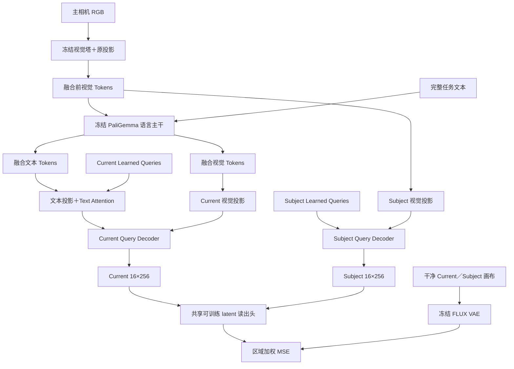

# Current／Subject Grounding：模型设计

Visual Primitive 从多层注意力读取 Current，并从头训练独立的 Subject。模型选择与 checkpoint 入口见[多层注意力设计与对照](../experiments/visual_primitive/README.md)和[版本说明](versions.md)。

下文记录 2026-11-18 的 VAE Grounding 对照。输入为主相机 RGB＋完整任务指令，冻结 π0.5 VLM 与 FLUX VAE，训练两个视觉读取分支。

## 信息流

上图展示 VAE Current 配方。VAE＋GAC 沿用两路 VAE 读出，并用 Current 查询的均值匹配同图候选实体。实体 key 从融合前视觉 tokens 的标注框采样，经独立线性投影得到。候选至少包含有效正例和一个负例时计算对比损失。在线推理直接返回两路查询 tokens。

BBox 配方将 Current 的查询平均后回归紧框，在线从预测框读取 4×4 图像特征。BBox＋GAC 加入同图实体对比，两组 Subject 都由独立预测头从纯图像特征回归夹爪紧框，在线返回两分支各自的框与 4×4 采样特征。[定位实验](../experiments/current_grounding_localization/README.md)

视觉塔只运行一次。原视觉投影后的 Tokens 同时保留给 Subject，并与任务文本一起经过冻结语言主干生成 Current 的融合特征。

Current Query 先通过 Text Attention 读取融合文本，再通过 Decoder 读取融合图像特征。融合文本本身也可包含视觉信息；这里不声称 Query 只有纯语言语义，或证明模型一定只通过图像 K/V 获得空间位置。

Subject Query 通过独立 Decoder 读取融合前视觉特征，不读取文本或 Current。两路使用独立可训练视觉投影，适应不同层次的特征；共享 latent 读出头。当前仅支持单臂，不加入 Arm Embedding；数据保留两槽布局，第二槽为空且不解码。

## 输出与监督

| 分支 | 条件 | 标签含义 |
| --- | --- | --- |
| Current | 当前图像＋完整任务 | 当前应交互的实例／部件／原生目标区 |
| Subject | 当前图像 | 夹爪局部区域，可自然包含持物像素 |

搬 milk 入 basket 时，Current 在 Pick 指向 milk，在 Place 指向 basket；切换由训练 Event 标签提供，推理时模型自行根据观察和任务预测。Subject 主要监督夹爪，不单独识别持物身份，也没有抓错检测分类头。

每路输出 16 个 256 维 tokens。共享读出头将 tokens 排成 4×4，每个预测 `16×8×8` latent patch，组成 `16×32×32` FLUX latent。标签为当前 RGB 中区域的原位画布；完整框忽略外部遮挡，RGB 保留实际遮挡。构造规则见 [Grounding 监督](target_grounding.md)。

## 训练与梯度

专项配置：`model_type=eskill`、`training_stage=grounding`、`grounding_subject=true`、`freeze_vlm=true`。配置入口强制校验冻结条件，编码前向使用 `torch.no_grad()`。

| 范围 | 是否更新 |
| --- | --- |
| π0.5 视觉塔、原视觉投影、语言主干 | 冻结 |
| FLUX VAE | 冻结 |
| 两路视觉投影、文本投影／Attention、Queries／Decoder | 训练 |
| 共享 latent 读出头 | 训练 |

`L = 0.1 L_Current + 0.1 L_Subject`。两路分别按有效监督计算区域加权 MSE，多卡归一化按全局有效数量处理。VAE＋GAC 配方在此基础上加上 `0.02 L_GAC`。没有目标文本生成或文本 CE，没有 Future、Skill、Motion 辅助损失，没有 Action FM。

`Pi0ESkill` 在该入口不实例化 Skill、历史 Grounding、Motion 或 Motion→Action 投影。继承的原生动作专家仍用于严格加载基座，但被冻结且不执行。其存在不表示当前训练会生成动作。

后续联合训练计划复用已有 Skill MoE，从图像与完整任务预测连续技能表征，作为 Current 的技能条件。Subject 继续读取纯视觉特征。真实 Event 技能用于有对应标注的原始样本的路由监督。当前独立视觉实验比较定位方法时，各组都只输入主相机与完整任务。

## 数据与在线接口

Dataset 先执行 Copy-Paste、单任务反事实和保护区外 Patch Mask，再由 batch 层同步几何增强并只对输入加颜色扰动。干净标签在 Patch 前构造，VAE 编码发生在几何变换后。详见 [增强流程](augmentation.md)。

在线使用 `create_current_grounding_policy(...).infer([main_rgb], task)`，返回 `grounding` 与 `subject_grounding`；不输入真实 Event、bbox、实例身份、本体状态或相机标定，不需要加载 VAE。该接口不接管机器人 rollout。

## 代码职责与状态

| 位置 | 职责 |
| --- | --- |
| `models/pi0_eskill.py` | 专项前向、冻结特征提取、两项损失 |
| `models/grounding.py` | `TaskGrounding`、共享读出头与冻结 VAE 监督 |
| `policies/grounding_dataset.py` | 保存标签读取、反事实与局部编辑 |
| `augmentation.py`、`transforms.py` | 输入／标签同步变换与组张量 |
| `policies/current_grounding.py` | 仅图像与任务的在线读取接口 |
| `training/`、`scripts/train.py` | 配置、采样、分布式、验证与保存恢复 |
| `scripts/preprocess/libero/` | 离线补标、数据迁移、覆盖率与可视化核验 |

当前已完成真实权重双卡 BF16 8 步启动与 checkpoint 回读，见 [技术记录](../experiments/current_grounding_fused/README.md)。尚未用正式视觉专项训练证明位置泛化或动作收益。验收以 [Evaluation](evaluation.md) 为准；历史联合模型另见 [历史设计](history/joint_design.md)。
