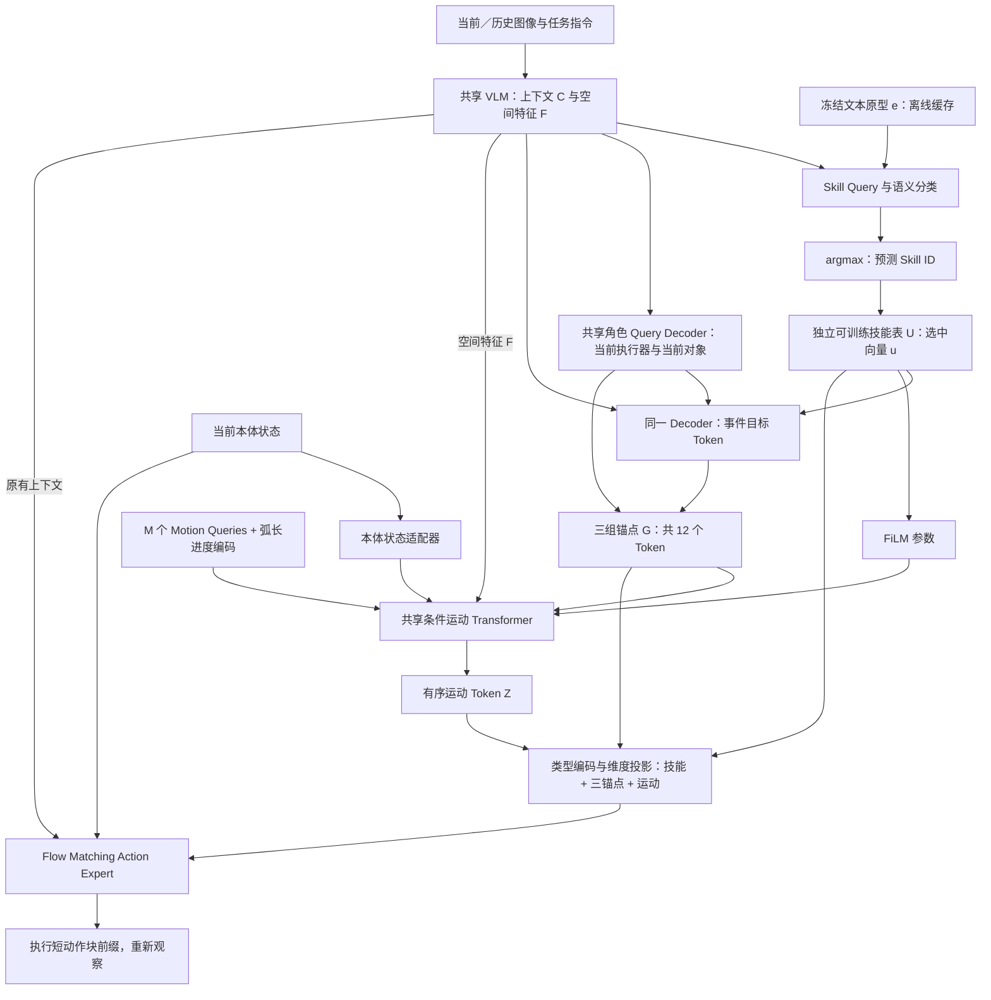
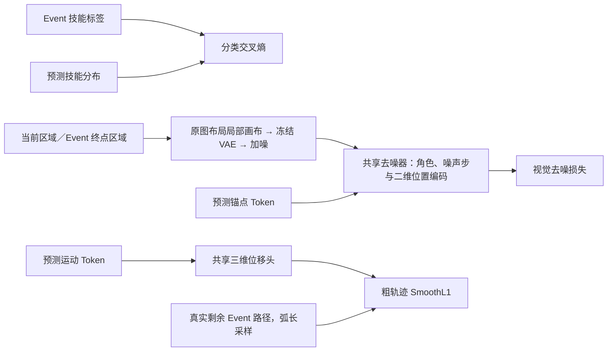

# Design：ESkill-VLA Stage 1 架构

本页是当前第一阶段的实现基准：明确网络、张量接口、监督数据及训练／推理路径。动机与方法来源分别见 [idea.md](idea.md)、[Event Organization](event_organization.md)、[Atomic Skill](atomic_skill.md)、[Target Grounding](target_grounding.md)、[Action Representation](action_representation.md)。

**近期目标：跑通数据与算法、完成模型训练和 RoboTwin 闭环评测，首先看平均任务成功率是否改善。** 更新于 2026-10-28；以下为已确定的方法和工程起点，尚未实现或取得实验结果。

## 1. 整体架构

采用共享 VLM 骨干和 π0.5 / OpenPI 风格 Flow Matching Action Expert。在线路径先识别操作、预测当前锚点，再预测事件目标，最后把技能与空间条件实例化为整段粗运动，条件化底层动作。



图中箭头表示计算依赖，不表示已证明的因果解耦。当前两锚点与技能选择并行；事件目标读取两者。VLM 原有任务上下文仍进入动作专家，运动分支读取空间特征而不另加完整语言直连。

训练额外连接三个监督出口，均不把未来标签送入在线路径：



动作专家另接受标准 Flow Matching 监督。推理移除 VAE 目标编码、去噪器和粗轨迹头；每次新观察计算一次结构化条件，并在本次动作生成的 flow steps 中缓存复用。

## 2. 张量与模块接口

记批量大小为 \(B\)，共享辅助维度为 \(d\)，文本原型维度为 \(d_e\)，技能数为 \(N_{skill}\)，动作块长度为 \(H\)，动作维度为 \(d_a\)。\(M\ge2\) 为固定运动查询数。所有新增条件先投影到消费模块需要的维度。

| 模块／张量 | 形状 | 职责与初始实现 |
| --- | --- | --- |
| VLM 上下文 \(C_t\) | \([B,N_c,d]\) | 当前／历史视觉语言特征；骨干原有层特征继续服务动作专家 |
| 空间特征 \(F_{\le t}^{spatial}\) | \([B,N_v,d]\) | 视觉 Token，保留空间及必要的帧／视角标识 |
| 文本原型表 \(E\) | \([N_{skill},d_e]\) | 离线编码并归一化，冻结缓存 |
| Skill Query Decoder | \([B,1,d]\) | 一个可学习 Query，交叉关注 \(C_t\)，输出分类特征 |
| 技能概率与所选向量 | \([B,N_{skill}]\)、\([B,1,d]\) | 余弦 softmax 分类；argmax 后索引独立参数表 \(U\) |
| 三角色 Query Decoder | 每角色 \([B,4,d]\) | 共享两层：查询自注意力、上下文交叉注意力、FFN |
| 三锚点拼接 \(G_t\) | \([B,12,d]\) | 当前执行器、当前对象、事件目标各 4 个 Token |
| 本体适配 \(A_{body}(s_t)\) | \([B,1,d]\) | 当前状态经 MLP 适配，原状态仍进入基座动作专家 |
| 运动 Transformer | \([B,M,d]\) | 联合自注意力、空间条件交叉注意力、技能 FiLM；所有技能共享 |
| 轨迹头 \(D_{trace}\) | \([B,M,3]\) | 共享轻量 MLP，预测相对当前末端的 XYZ 位移 |
| 结构化动作条件 | \([B,1+12+M,d]\) | 所选技能、三锚点及运动 Token，带角色／类型标识 |
| Action Expert | \([B,H,d_a]\) | 保留基座动作格式与 FM 生成机制 |

4 个锚点 Query／两层角色 Decoder 是当前工程起点。\(d,M\)、Skill Decoder 与运动网络深度、去噪器宽度及画布分辨率在配置中记录，不作为新研究分支。当前不绑定具体代码仓库中的类名。

### 2.1 Atomic Skill：分类与技能先验分开

\[
e_k=\operatorname{Normalize}(E_{text}(d_k)),\quad
v_t=\operatorname{SkillDecoder}(Q^{skill},C_t),\quad
q_t=\operatorname{Normalize}(W_s v_t),
\]

\[
p_t(k)=\operatorname{Softmax}_k(q_t^\top e_k/\tau),\qquad
\hat k_t=\arg\max_k p_t(k),\qquad u_t=U[\hat k_t].
\]

技能描述不含具体对象名，表达可复用交互目的。\(U\) 是独立可训练参数，不再令下游向量每次等于 \(W_{adapt}e_k\)。可用投影后的文本原型初始化表值，之后独立优化；初始化投影不构成运行期必需模块。

同类技能共享向量。\(u_t\) 参与 Goal 预测、运动 FiLM，并直接输入动作专家。原型分类仍只由技能标签训练；不增加 VQ 或反事实训练。

### 2.2 Target Grounding：共享预测器与三组角色 Query

\[
g_t^{ee}=P_\theta(Q^{ee},C_t),\qquad
g_t^{obj}=P_\theta(Q^{obj},C_t),
\]

\[
g_t^{goal}=P_\theta(Q^{goal},[C_t,g_t^{ee},g_t^{obj},u_t]),\qquad
G_t=[g_t^{ee},g_t^{obj},g_t^{goal}].
\]

前两次调用可并行或沿 batch 合并，参数共享；目标调用随后执行。三组 Query 独立学习，保持角色身份。预测 Token 不要求与监督用 VAE 网格形状相同。

训练目标采用保留原图布局的局部 RGB 画布：执行器／对象保留本体及必要邻域；事件目标保留终点对象与参照物并集外接区域并留边。区域外填固定背景，整幅统一缩放，不将局部区域独立居中放大。原图、区域、背景与缩放约定统一保存；参考视角变化时先对齐，不能直接拼接不一致的空间标签。

三个角色共用冻结 VAE 和轻量去噪器。后者读取加噪网格、二维位置编码、噪声步及角色嵌入，交叉关注对应预测锚点。mask 仅构造目标及区域损失权重，不进入在线预测器，不直接追加到冻结 RGB VAE 的输入通道。每步训练采样一个噪声等级，无需完整反向生成链；缺失或无效区域屏蔽对应监督。

### 2.3 Action Representation：技能与空间条件联合解码

固定查询显式编码剩余路径进度：

\[
s_j=\frac{j}{M-1},\qquad
q_j^{motion}=q_j^{learn}+\operatorname{PE}(s_j),\quad j=0,\ldots,M-1.
\]

\(\operatorname{PE}\) 为固定正弦／余弦编码，维度为 \(d\)，训练／部署频率配置一致。\(s_j\) 表示空间进度，不是未来时间或当前任务完成率；它只由 \(M\) 决定，不依赖真实事件终点。

运动上下文为 \([G_t,F_{\le t}^{spatial},A_{body}(s_t)]\)。查询先通过自注意力交换路径信息，再交叉关注条件，配合 FFN；技能向量经 MLP 生成 FiLM 参数，调制运动层特征：

\[
(\gamma_\ell,\beta_\ell)=\operatorname{MLP}_\ell(u_t),\qquad
\operatorname{FiLM}_\ell(X)=\gamma_\ell\odot\operatorname{LN}(X)+\beta_\ell,
\]

\[
Z_t=\operatorname{MotionTransformer}_{\mathrm{FiLM}(u_t)}
(Q^{motion},G_t,F_{\le t}^{spatial},A_{body}(s_t)),\qquad
\Delta\hat p_{t,j}=D_{trace}(z_{t,j}).
\]

FiLM 参数在运动 Token 维度广播，按层产生；初始可设为单位缩放和零偏置以稳定接入。所有技能共用同一运动网络和轨迹头。\(Z_t\) 同时接受轨迹监督与动作监督，并回传到选中的 \(u_t\)。不另设按技能独立的解码器。

### 2.4 Action Expert 条件接口

\[
H_t^{aux}=[u_t,g_t^{ee},g_t^{obj},g_t^{goal},Z_t],\qquad
A_{t:t+H}\sim\pi_{FM}(\cdot\mid C_t,s_t,H_t^{aux}).
\]

在保留基座上下文、动作噪声、flow time 和本体状态输入的前提下，将辅助 Token 经类型编码与维度投影加入动作专家可访问的条件序列。对层级 KV 接口，按层宽度投影辅助 Token，并追加到该层原有前缀 KV；查询、位置编码和可见性 mask 随新增长度同步扩展。具体 API 在实现时对照选定基座确认，不假定直接拼接最终层特征即可适配所有 OpenPI 版本。

辅助 Token 可被动作查询读取，构造过程不读取加噪动作或动作真值。训练与部署使用相同的预测条件；关闭辅助损失头不改变动作专家条件维度。末端粗路径提供空间先验，真实动作专家负责姿态、夹爪和具体控制。

## 3. Event 数据与标签

一个 Event 对应一次 Skill 执行；同一 Skill 类型可在多个 Event 中复用。采用可核验的脚本／状态记录组织语义 Event，保留原始同步序列，用区间索引关联标签。技能粒度以交互目的为依据，词表与事件边界一致，不强制拆成最细运动阶段。

```text
Episode
  episode_id, split, task_instruction, embodiment_id
  timestamps, images, states, actions
  effector_positions_3d, effector_id, coordinate_frame, units, calibration
  object_tracks, region_annotations, annotation_validity, events[]

Event
  event_id, start_time, end_time, skill_label
  manipulated_object_id, reference_object_ids
  expected_effect?, observed_outcome?, boundary_source, confidence

TrainingSample
  inputs: current/history_images, instruction, current_state
  targets:
    skill_label, skill_validity
    three_role_canvases_or_cached_vae_latents, role_validity[3]
    role_region_masks_on_vae_grid[3,h_latent,w_latent]
    remaining_trace_displacements_3d[M,3], trace_validity[M]
    robot_action_chunk[H,action_dim], action_validity
  metadata: episode/event IDs, current_time, reference_view, frame, units
```

先按完整 Episode 拆分训练／测试，再从 Event 内不同当前时刻采样。未来边界、真实对象区域与终点图像只构造标签，不进入策略输入。区间为 \([t_i,t_{i+1})\)，边界状态可作上一事件终点；末事件保留可观测终点。失败事件的实际结束状态不直接当作期望成功状态。Stage 1 先使用机器人示范中的有效监督。

粗路径取当前到事件结束的真实末端位置 \(p_0=p_t,\ldots,p_K=p_{t_e}\)，统一参考系和执行器参考点：

\[
\ell_0=0,\quad\ell_i=\sum_{r=1}^{i}\|p_r-p_{r-1}\|_2,\quad
L=\ell_K,\qquad \Delta p_{t,j}^*=\gamma_t^*(s_j)-p_t.
\]

\(\gamma_t^*\) 按 \(\ell_i/L\) 插值，保留起止点，消除重复弧长造成的除零。近静止 \(L\le\epsilon\) 使用零位移目标。空间位移保留统一物理尺度，不再除以本条路径长度；只归一化采样进度。检查采样折线是否明显切掉转弯，缺失观测不无条件跨长缺口插值。终点为末端真实位置，不是物体中心；多个执行器的数据需显式对应，不能串接成一条路径。

## 4. 联合目标与梯度

\[
\mathcal L=\mathcal L_{FM}+\lambda_s\mathcal L_{skill}
+\lambda_g\mathcal L_{ground}+\lambda_m\mathcal L_{trace}.
\]

技能分类采用有效标签上的交叉熵。视觉去噪沿用 [Target Grounding](target_grounding.md) 的区域加权角色条件噪声预测目标：空间权重归一化、通道取均值，再按角色平均有效样本。粗路径使用固定尺度下的 SmoothL1，先对 XYZ 三坐标取均值，再平均有效点：

\[
\mathcal L_{trace}=\frac{\sum_{b,j}v_{b,j}\operatorname{SmoothL1}_{\beta_{trace}}
(\Delta\hat p_{b,j}/s_{xyz},\Delta p_{b,j}^*/s_{xyz})}{\max(1,\sum_{b,j}v_{b,j})}.
\]

动作训练保留所选基座的 flow 插值、时间采样和损失约定，不重新定义其动作表示。

| 参数／通路 | 更新来源与边界 |
| --- | --- |
| 文本原型、VAE 目标编码器 | 冻结；目标 latent 不反向更新编码器 |
| Skill Query 与分类投影 | 分类交叉熵；下游损失不能穿过 argmax 更新类别选择 |
| 独立技能表 \(U\) | 选中行接受轨迹、动作及 Goal 分支去噪梯度 |
| 三锚点预测器 | 视觉去噪、下游轨迹和动作损失 |
| 运动网络与 FiLM | 粗轨迹和动作损失 |
| 轨迹头／共享视觉去噪器 | 分别接受轨迹／视觉去噪损失 |
| Action Expert | 动作 FM 损失 |
| 共享 VLM | 在可训练范围内接受各可达路径梯度；硬选择不会阻断其其他分支 |

除冻结目标编码和离散选择外，不额外 detach 预测条件。新模块联合训练；骨干与动作专家的冻结／微调范围对齐所用基座并记录配置。原型分类和技能表职责分开，不新增技能学习损失。

### 4.1 数值实现约定

以下是当前架构的训练配置，不增加模块、监督分支或消融要求。

| 项目 | 实现约定 | 必要诊断 |
| --- | --- | --- |
| 区域加权去噪 | 将角色区域及留边 mask 以覆盖率下采样到 VAE 网格；\(W=w_{bg}+(w_{fg}-w_{bg})m\)，\(w_{fg}>w_{bg}>0\)，按权重总和归一化 | 分别记录有效区域和背景误差，检查小区域未被背景主导 |
| 技能早期收敛 | 继续预测类别查表；结合分类表现设置 \(\lambda_s\) 与分类头学习率 | 总体／逐类准确率、预测类别占比、技能表各行梯度或更新范数 |
| 运动尺度 | \(s_{xyz}>0\) 为统一固定空间尺度，保持训练／部署配置一致；仅损失输入使用 \(\Delta p/s_{xyz}\)，轨迹头输出仍为物理位移 | 缩放损失与物理单位路径误差 |
| SmoothL1 阈值 | 在缩放坐标中设置 \(\beta_{trace}>0\)，同时记录 \(\lambda_m\)；物理转折尺度为 \(s_{xyz}\beta_{trace}\) | 检查轨迹头、运动网络和 FiLM 的实际梯度及训练稳定性 |

网格 mask 只参与目标构造和损失，不作为在线条件或去噪器的额外真值条件。缺失区域按无效角色处理，不以全背景标签替代。空间缩放采用工作空间常数或仅从训练集计算并加正下限的统计量，保存到配置／checkpoint；不使用测试数据、不按每条轨迹长度缩放。物理位移解码接口保持不变。

明确采用逐元素 SmoothL1，记缩放坐标中的残差为 \(r\)：

\[
\operatorname{SmoothL1}_{\beta_{trace}}(r)=
\begin{cases}
\frac{r^2}{2\beta_{trace}},& |r|<\beta_{trace},\\
|r|-\frac{\beta_{trace}}2,&\text{其他}.
\end{cases}
\]

这不等于未归一化的 Huber；更换库实现时确认阈值和 reduction 语义。各损失数值无需相等，调节依据是有效梯度、收敛与最终控制表现。文本投影初始化不保证技能误选无害；三维监督不自动解决视觉深度歧义；SmoothL1 不保证联合训练绝对稳定。推理虽移除辅助监督头，在线技能、锚点与运动网络仍有新增开销。

## 5. 一次训练与一次部署

```text
online_forward(current_inputs):
  C, F = backbone(current_inputs)
  skill_prob = semantic_selector(C, frozen_text_prototypes)
  u = trainable_skill_table[argmax(skill_prob)]
  ee, obj = shared_role_decoder(current_role_queries, C)
  goal = shared_role_decoder(goal_queries, concat(C, ee, obj, u))
  G = concat(ee, obj, goal)
  Z = shared_motion_network(motion_queries + progress_encoding,
                            G, F, state_adapter(state), skill=u)
  action_condition = adapt_conditions(C, state, u, G, Z)
  return skill_prob, G, Z, action_condition

training_step(batch):
  skill_prob, G, Z, condition = online_forward(batch.inputs)
  L_skill = classification_loss(skill_prob, batch.targets)
  L_ground = role_denoising_loss(G, batch.targets)  # 冻结 VAE 标签、区域权重归一化
  L_trace = trace_loss(trace_head(Z), batch.targets, scale=s_xyz, beta=beta_trace)
  L_FM = base_action_flow_loss(condition, batch.targets.actions)
  backward_and_update(L_FM + weighted_auxiliary_losses)

deployment_step(observation_history):
  _, _, _, condition = online_forward(observation_history)
  action_chunk = base_flow_sampler(condition)
  execute_configured_prefix(action_chunk)
  observe_again()
```

函数名是模块边界示意，非已经实现的代码。当前角色并行调用时分别执行各自 Query 的 self-attention，再共享参数读取相同上下文。训练用真实未来信息构造 targets，在线前向与部署一致。

机器人不逐点跟踪辅助轨迹，也不一次开环执行完整 Event。技能与锚点随新观察更新；动作块结束、夹爪闭合或预测路径到端点不自动代表目标达成。当前没有新增外置状态机或部署时梯度更新。

## 6. Stage 1 落地顺序与完成标准

1. 数据：确定可核验 Event 与技能词表，导出三角色视觉目标和剩余粗路径，检查坐标、边界和有效性。
2. 模型：接入技能表、三锚点、运动 Token 和动作条件，跑通联合训练；用类别准确率、局部目标和路径可视化排查实现问题。
3. 评测：在相同任务、数据拆分、示范预算和执行频率下，对比动作基线与完整方案；记录额外标签来源。

主指标是各任务成功率的平均，保留逐任务结果、评测次数及失败视频：

\[
\operatorname{MeanSuccess}=\frac1{N_{task}}\sum_{i=1}^{N_{task}}
\frac{\text{成功 rollouts}_i}{\text{评测 rollouts}_i}.
\]

本阶段不预设大规模消融、特殊组合划分、人类视频或跨本体实验为门槛。分类、视觉重建和轨迹指标是训练诊断；出现具体问题再定位。成功率提升首先支持整体方案的实用价值，不要求本阶段同时证明各模块独立贡献、因果解耦或多模态运动建模。

实现时仅需将基座条件 API、可训练参数范围、技能词表、坐标／参考视角、\(M,d\)、辅助网络规模和损失尺度落到配置。当前不增加剩余时长头、OBB 多候选、接触分类或独立轨迹生成器。
