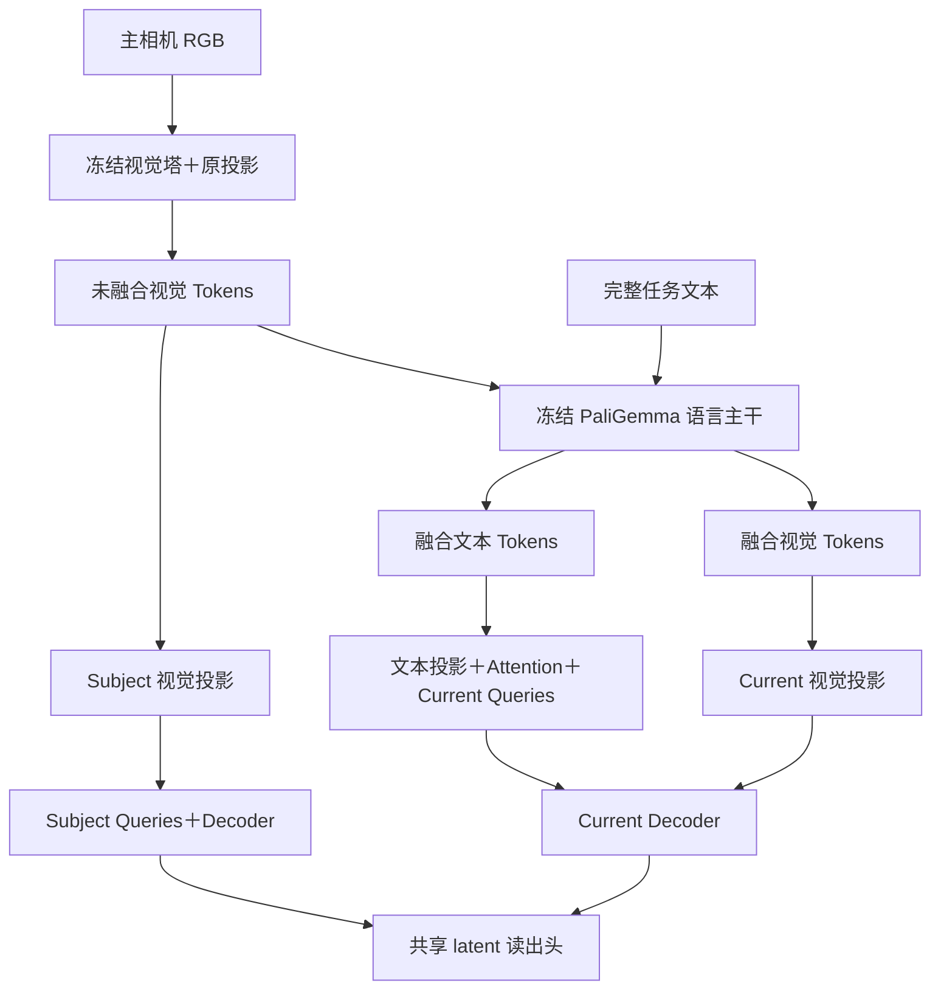

# ESkill-VLA：模型与实现设计

当前 Visual Primitive 的架构和对照见 [实验说明](../experiments/visual_primitive/README.md)。下文记录联合动作架构。

更新：2026-11-13。本文定义当前 RGB＋Language 的 ESkill 方案，模型、采样、训练与在线接口已接入；当前 Motion 使用每 5 个保存主相机帧采样，不以时间戳核验为前置。模块动机见 [Idea](idea.md)，数据要求见 [Data](data.md)。

## V3 Visual Primitive 变体（待训练验证）

本页以下各节描述 `visual_primitive_version=v0` 的已实现基线。2026-11-14 起新增可选
`visual_primitive_version=v1/v2/v3`；默认仍为 `v0`，旧 checkpoint 的参数名称和
Flow Matching 接口不变。新方案与实验控制见 [V3 计划](../experiments/eskill_visual_primitive_v3/README.md)。

- **v1：文本条件 Current**：VLM 经过视觉语言融合的指令 token 与每臂 Current Queries
  cross-attend，再由已有 Query Decoder 预测对象潜变量；无需外部解析 object noun。
- **v2：Current → Future**：Current 先独立解码，Future 再由同一指令、预测的
  Current tokens 和当前场景上下文解码。Future 继续表示**该操作对象的 Event 终点状态**，
  不改变真实监督图、事件边界或 FLUX VAE。
- **v3：Goal-first Motion Bottleneck**：Motion 时间 Query 先只读取对应臂的
  Current/Future tokens 与连续 Skill，再从预训练视觉塔投影后的、**未经过语言主干融合**
  的主相机 patch tokens 获得空间细节。Motion 无法直接访问完整融合 VLM context；
  原视觉塔位置编码沿用，原 8 点 EEF 2D／gripper 监督、Motion Auxiliary K/V 到 Action
  的接口保持不变。

本轮**不引入** robot state、标定参数、proposal、biased Flow Matching、接触图、
深度图、CRAFT 或额外对比损失；Action-side Patch Masking 保持现有可选消融，
V3 首轮配对训练配置将其关闭。上述结构只约束 Motion 的直接输入通路，
**不保证**网络不会学习新的统计捷径，也不能解释 Motion→Action 低敏感度；须靠
Grounding 迁移、C/F 干预、Motion 轨迹响应和闭环成功率共同验收。

2026-11-15：V3 recipe 另启用 `motion_terminal_hold=true`。保留 +5／+10 最短真实未来窗口；二维点超过 Event／最短窗口较晚的终点后重复该位置，Episode 末尾同样保持最后观察，作为显式派生停止目标进入 Trace loss。夹爪只监督真实命令；Future Object、Action、Skill 不变。完整规则见 [Action Representation](action_representation.md#event-边界与缺失标签)。因此本轮相对旧基线同时改变架构和二维终点监督；纯架构消融需关闭此开关。

## Current Grounding 专项入口（待效果验证）

`training_stage=grounding` 使用单臂并行的 Current／Subject，两者各输出 `16×256`。主相机只经过一次冻结 π₀.₅ 视觉塔和原投影层，保留融合前的视觉 Tokens；图像 Tokens 与完整任务一起经过一次冻结 PaliGemma 语言主干，得到融合后的视觉／文本 Tokens。两个独立的小型 Query Decoder 分别读取不同层次的特征。

Current 使用**完整任务指令**：融合后的文本 Tokens 经可训练文本投影与 Text Cross-Attention 为 Learned Queries 提供条件，再读取融合后的视觉 Tokens。Subject 使用自己的 Learned Queries，读取融合前的视觉 Tokens，前向不依赖任务文本。Current／Subject 各有独立的可训练视觉投影，以适配两种特征；两路 Decoder 独立。单臂不再设置独立 Arm Embedding；两槽数据布局只为兼容统一标签接口，第二槽固定为空且不解码。

同一任务 `put the milk in the basket` 在 Pick Event 监督 milk，在 Place Event 监督 basket，按已有 Event 边界切换。Subject 仍监督夹爪完整框和每边 4 源像素的局部 RGB；自然包含的持物像素保留，但不额外要求识别持物身份或覆盖完整持物。

删除目标短句生成、语言头调用及文本 CE。训练仅优化两路视觉投影、文本条件模块、两组 Queries／Decoder 和共享 latent 读出头；视觉塔、原投影、语言主干及 FLUX VAE 均冻结。损失为 `0.1 L_Current + 0.1 L_Subject`。输入和推理都不需要 Event、bbox、本体状态或相机标定，标签只参与损失。

在线增强保留两阶段流程；完整任务反事实先限定为能唯一绑定源物体／目的物体的简单搬运任务，反事实候选满足定位条件且不在夹爪交互锁定区，不再依赖 Copy 资格。Copy 使用独立候选与小型空间词保护，并在原 Event 目标可安全移动时以 80% 概率优先移动它；反事实文本替换概率设为 20%。无法改写的任务仍可做安全 Copy。复杂／多物体任务不改写文本，空间消歧任务首版跳过 Copy，不再退回 `Locate`。细节见[训练接口](../src/openpi/training/README.md#current-grounding-专项训练)。

专项模型不实例化 Skill／Future／Motion 及 Motion→Action 投影。继承的 π₀.₅ Action 基座参数冻结且不执行，便于严格加载原始基座；下文原有联合动作路径尚未迁移。本次结构与旧专项 checkpoint 不兼容，需要新开训练。技术检查不能证明位置泛化改善，VAE 画布亮度也不代表目标存在概率。

## 1. 目标与信息流

从有限示范中学习可复用的视觉技能，将技能与当前／期望对象状态结合，生成能够影响实际控制的局部交互运动。核心链路为 **Skill → Goal-conditioned Motion → Action**。

~~~mermaid
flowchart TD
    O["当前主相机 / 腕部 RGB + 任务指令"] --> V["π0.5 VLM"]
    V --> S["连续 Skill Query → 六类预测路由"]
    S --> E["Shared Expert + Top-1 Skill Expert"]
    E --> P["连续 Skill Prior · 512"]
    V --> G["Current / Future Object · 各 16 × 256"]
    V --> M["Event Motion · 每臂 8 × 256"]
    P -->|"512 → 256 / FiLM"| M
    G --> M
    M -->|"唯一新增 Auxiliary K/V"| A["π0.5 Flow Matching Action Expert"]
    V --> K["原始逐层 K/V · 训练时 Action-side Patch Masking"]
    K --> A
    A --> U["动作块 · 执行短前缀后重规划"]
    M -.-> X["训练读出：未来 EEF 2D + Gripper Command"]
    G -.-> Y["训练读出：Current / Future Object VAE latent"]
    S -.-> C["训练监督：当前 Skill CE"]
~~~

Skill 与 Grounding 都从当前 VLM 上下文预测。Future Object 表示**当前 Event 的操作对象在该 Event 终点的状态**；Motion 表示朝此目标推进、未来 40 个保存帧内的局部行为。长 Event 的终点可以超出该局部窗口。

Action 保留原始 VLM 条件，新增结构化条件只有高维 Motion tokens。Skill 和两组 Object tokens 均通过 Motion 影响 Action；不设置其他辅助直连。未来图像、真实技能、Event 边界及未来状态只用于监督。

## 2. 首版规模与张量

以双臂槽位统一 batch；LIBERO 使用一个真实臂槽位，另一个由 arm presence mask 排除。左右臂共享参数，以 arm embedding 区分。

| 内容 | 默认形状／设置 |
| --- | --- |
| VLM 最终上下文 | `[B,N,2048]` |
| 连续 Skill Hidden／Prior | `[B,2,512]`，每臂一个 Query |
| 活跃路由 logits | `[B,2,6]` |
| Skill Experts | 6 个专门化 + 1 个 Shared；宽度 512，FFN 中间宽度 2048，深度 2，SwiGLU |
| Skill → Motion 适配 | `Linear(512,256)` |
| Current／Future Object | 各 `[B,2,16,256]`；合并为 `[B,2,2,16,256]` |
| Motion | `[B,2,8,256]` |
| EEF 2D／Gripper 读出 | `[B,2,8,2]`／`[B,2,8,1]` |
| Action 辅助条件 | 双臂共 16 个 Motion 槽位；LIBERO 8 个有效 |
| 图像空间 | VLM／二维路径 224×224；Grounding 画布 256×256 |
| LIBERO 动作块 | `action_horizon=10`，源 7 维补到模型 32 维 |

七个专家的 SwiGLU 权重约为 `7 × 2 × 3 × 512 × 2048 = 44,040,192`，不含 Query Decoder、适配器、分类器及归一化等参数。这是首版小模型默认值，不代表已验证的最优容量；Grounding 和 Motion 的 token 数分别由各自监督决定，不要求相等。

## 3. Continuous Visual Skill-MoE

保留九类数据编号：0 Pick、1 Place、2 Open、3 Close、4 Turn、5 Push、6 Hold、7 Idle、8 Return。当前数据只支持前六类，路由 softmax 只覆盖这六类；后三类不创建专门化专家。全局 ID 与活跃类别索引显式映射。

每臂连续 Query 从 VLM 提取 512 维 hidden，经可训练分类器预测当前技能。训练和推理都用预测 **Hard Top-1** 选择专家，不用真实技能替换路由。连续 hidden 同时经过 Shared Expert 与选中专家，以残差组合、归一化得到 Skill Prior：

~~~text
h = SkillQuery(VLM context, arm)
k = argmax(Classifier(h))             # 仅六类
z_skill = Norm(h + Shared(h) + Expert[k](h))
~~~

专家内部采用两层残差 SwiGLU FFN；残差缩放／初始化在配置中明确记录。相同专家面对不同视觉上下文可输出不同 prior，技能不是一个固定向量。

Skill CE 训练分类器和 Query。Motion 损失可沿连续输入更新 Query、Shared 与选中专家；Stage 2 的 Action 损失也沿此路径更新；**不能穿过 argmax 更新离散选择**。不以直通估计器冒充这条梯度。

未支持或未知标签不重映射为其他技能，也不自动当 Idle；排除其 Skill CE，并显式记录不支持状态。首版不宣称能识别未训练的三类技能。记录每类标签量、预测路由频率与专家梯度，不强制语义类别均匀负载。详见 [Atomic Skill](atomic_skill.md)。

## 4. Current／Future Object Grounding

每臂两组各 16 个 Query，经共享两层 Decoder，在臂内交换当前／终点信息，并 cross-attend 当前 VLM 上下文。两组预测始终指向**当前 Event 的同一操作实例／部件**。

- Current Object：当前主相机中的操作对象。
- Future Object：该对象在当前 Event 的 `goal_frame` 对应画面；容器、承托物等参照物不替代它。
- 不输入当前 EEF 二维投影点，也不另设 EEF 视觉重建分支；未来 EEF 投影只作为轨迹监督。

沿用原位对象画布：保留 bbox 内 RGB 在原图的位置、比例与真实遮挡，框外置黑。Current 保持每边 4 个源图像素的留量，再生成 256×256 目标；Future 在同样范围上每边额外外扩 8 个画布像素，保留终点周围上下文，监督权重同步扩大并裁到有效图像边界。源 bbox 与终点定义不变。完整屏内 bbox 允许包含遮挡位置，但不意味着有被遮挡表面的 RGB 真值。

冻结 FLUX VAE，以 FP32、posterior mode、固定 scaling／shift 编码目标；**Token→latent 的共享投影头参与训练**。16 个 tokens 按 4×4 排列，每个映射到 `16×8×8` latent patch，拼成 `16×32×32` 网格。采用区域加权 MSE，前景／背景默认 1／0.1，分别应用 Current／Future 有效性。

预测 Object tokens 进入 Motion，VAE 目标不进入前向条件。推理不需要真实 bbox、终点图像、VAE 或 latent 读出头。详见 [Target Grounding](target_grounding.md)。

## 5. Event Interaction Motion

Motion 只从 VLM 视觉语言上下文、Skill Prior 和预测的 Current／Future Object 生成。Skill 经 512→256 适配，以每臂 FiLM 调制 Motion；双臂 Query 联合 self-attend，保留协作关系。保留固定 arm embedding 和平台臂存在性，不输入任何当前本体状态、二维起点或相机标定；删除 state_projection 与 arm_state_mask。

每臂八个槽位有固定帧偏移编码，目标偏移为：

`[5, 10, 15, 20, 25, 30, 35, 40]` 个已保存主相机帧

第一版直接使用已保存的帧顺序，不要求精确物理时钟。按 LIBERO 默认 20 Hz 的连续控制步估算，间隔约 0.25 秒，最远约 2 秒；仅作量级参考，不伪造时间戳。

每个 token 的共享 `trace_head` 直接预测图像画布中的归一化二维绝对坐标，`p_hat = trace_head(z_motion)`；不输入当前投影起点，也不相加起点偏移。未来轨迹投影仅用于训练监督；`gripper_head` 预测同一时刻的开／合命令 logits。路径用 SmoothL1，LIBERO 的二值命令用 BCEWithLogits；当前真实夹爪开度与未来控制命令是不同字段。

每臂使用 **Event 边界＋最短 10 个保存帧的监督窗口**：查询仍属于当前 Event，或偏移不超过 `motion_min_horizon_frames=10` 时，可使用真实未来记录。当前 Event 剩余不足 10 帧时，前两个查询（+5、+10）允许跨界；更远的点仍按当前 Event 边界屏蔽。10 帧按名义 20 Hz 约为 0.5 秒，不移动首个查询点，也不增加 token。Episode 尾部始终排除，不重复终点、插值或补造记录；未来点出画或缺测时独立屏蔽；当前投影无效不影响未来有效点的监督。未知／边界无效的当前 Event 不启用此扩展。

跨界点记录 `future_cross_event=true`，采用实际未来 EEF 与夹爪命令；当前 Skill 标签和 Future Object 的 Event 终点保持原定义。因此 Motion 可描述转入下一 Event 的短程过渡，不能再把所有点都解释成当前技能内部动作。

以上越界屏蔽是 `motion_terminal_hold=false` 的基线行为。V3 配方将其设为 true：保留最短真实窗口后，后续二维点保持窗口终点并计入主路径损失，Episode 末尾同样保持。派生点通过 `trace_terminal_hold` 与 `observed_mask` 区分，不用于夹爪命令损失；终点投影无效时仍排除。具体来源帧规则见 [Motion 监督](action_representation.md#event-边界与缺失标签)。

八个槽位均预测未来点。长 Event 的第八点仍为 +40 个保存帧，不能强制等于 Event 终点。所有有效臂的八个高维 tokens 都进入 Action；真实 Event 边界与标签 mask 不得控制在线 token 可见性。Stage 2 中，无辅助标签的槽位仍可接受 FM 梯度。无论哪种方式，这些槽位的解码点不能标为已监督的真实计划。详见 [Action Representation](action_representation.md)。

## 6. Action 与视觉 Patch Masking

每层将 Motion tokens 投影为匹配 Action Expert KV head 数与 head dim 的 K/V，与原始逐层 VLM K/V 合并。保留 arm／time 标识，完整条件编码在一个动作块内缓存复用。Action 直接读取高维 Motion，不将解码的 `(x,y,gripper)` 再编码成唯一动作条件；Stage 2 的条件路径不 detach，FM 经 Motion 更新连续 Skill 与 Grounding，以及动作专家和 Motion K/V 适配。

沿用 π0.5 Flow Matching 的噪声分布、速度目标和动作专家主体。LIBERO 明确设置 H=10，不继承基类的 50；40 帧 Motion 与十步动作块是不同尺度。Action 保持 recipe 原有完整动作窗口监督，Event 边界不截断 FM loss；先统计 H=10 和实际执行前缀 5 步的跨 Event 比例。

训练时仅对 **Action 读取原始视觉 K/V 的可见性**施加 Patch Masking：

1. VLM 输入与 Skill、Grounding、Motion 都读取完整当前图像。
2. 主相机、腕部相机分别纳入策略；遮蔽比例和无遮蔽样本比例可配置，不能只控制主视角。
3. 原始 prefix validity／position mask 与 Action visibility mask 独立。只改可见性，不删除／压缩 token，不按剩余可见 patch 数重算 RoPE 位置。
4. 同一动作块的所有 Action 层、所有 FM 采样步骤共用一次遮蔽选择；新观察的训练样本重新采样。
5. 训练保留完整视觉样本；常规推理使用完整视觉。遮蔽比例是待验证超参数，不预设某个比例有效。

这是动作注意力遮蔽，不是图像几何增强，因此本操作不改变 bbox 或轨迹坐标。语言融合特征与未遮蔽视觉仍可能形成替代通路；是否更依赖 Motion 要用行为实验判断。

## 7. 损失、训练与推理

联合训练的损失全集为（两阶段分别选择对应项）：

`L = λ_action L_FM + λ_skill L_CE + λ_current L_current + λ_future L_future + λ_xy L_xy + λ_grip L_grip`

| 项目 | 监督 | 主要训练对象 |
| --- | --- | --- |
| Action | 源动作窗口的 Flow Matching | Stage 2 更新 Action、Motion K/V、Motion、Grounding 及连续 Skill 上游 |
| Skill | 当前 Event 六类标签 CE | Query、Classifier |
| Current／Future Object | 冻结 VAE 目标的加权 MSE | Grounding Decoder、可训练共享投影头 |
| EEF 2D | Event＋最短窗口内固定偏移的真实二维位置 | Motion、trace head 及连续上游 |
| Gripper | 同时刻的开／合控制命令 | Motion、gripper head 及连续上游 |

各项在 Stage 2 也回传至可训练的连续上游 VLM。各项按自己的全局有效数量归一化；DDP 下同时聚合分子与分母。无有效标签的项不伪造准确率。Stage 1 与 Stage 2 的 Skill／Current／Future／Trace／Gripper 初始权重统一为 0.02／0.01／0.01／0.25／0.05；Stage 2 另加入权重为 1 的 Action FM，依据见[实验配方](../experiments/eskill_libero40_mirror/README.md#损失权重依据)。这些系数是首轮候选，不能从加权 loss 数值直接推断梯度贡献或效果。每 100 步测量实际加权的 FM／辅助损失对共享 Motion 参数的梯度范数、比例与余弦；排除辅助专用读出头，复用同一前向随机条件，多卡先平均梯度向量。长期尺度与方向冲突需结合训练过程判断。

为比较训练配方，另提供[直接联合训练对照](../experiments/eskill_libero40_direct/README.md)：官方基座直接40k，不分阶段，关闭增强／Action视觉遮蔽／技能重采样，Action权重1、五项辅助各0.1。模型结构和监督定义保持当前版本；不将系数对齐解释为损失或梯度等价。

同一直接训练路线新增A1颜色、A2颜色＋同步主图轻裁切、A3再加±5°中心旋转，保持A0其他参数。增强位于训练batch层，不改变模型条件或模块结构；几何变换同步对象和轨迹监督，不在联合训练中做水平镜像。详见[增强配方](../experiments/eskill_libero40_direct/README.md#视觉增强对照)。

不带 Functional Reuse 的两阶段配方保留如下：

1. **Stage 1：官方原生 π0.5 初始化，20k。** 冻结 VLM、Action 和 FLUX VAE，训练 Skill／Grounding／Motion、其输入适配与辅助读出头；仅五项辅助损失。符合条件的训练样本以 50% 概率水平镜像。
2. **Stage 2：从 Stage 1 的 20k 权重初始化，另训练 40k。** 解冻 VLM 的视觉编码器、视觉投影和语言主干，与 Skill／Grounding／Motion、其输入适配与辅助读出头，以及 Action Expert、动作／时间投影和 Motion K/V 联合训练；仅 VAE 编码器冻结。使用原图与真实动作，保留五项辅助损失并加入 FM；FM 沿连续路径回传至先验和 VLM；Skill CE 继续训练路由分类器，FM 不穿过 Hard Top-1 的离散选择。完整继承 Stage 1 模型权重，重新建立优化器与步数，不使用 donor／recipient 复用。

镜像是二维图像增强：主／腕 RGB、Current／Future 画布及权重同步翻转，有效未来路径点 `x'=1-x`；夹爪命令、臂身份和技能不变。没有本体输入，因此不需要状态门控或镜像三维状态。方向性指令保留原图。目标画布先翻转再经冻结 VAE 编码；验证不增强。Action 不接收镜像动作监督。

recipe 见 [Stage 1](../examples/libero/train_eskill_stage1.json)／[Stage 2](../examples/libero/train_eskill_stage2.json)。本机仅做技术测试和视频核验，正式训练在远端进行。Functional Reuse 作为后续独立对照加入；当前测试不能证明迁移或泛化收益。比较方法时同步核对数值状态通路与训练预算。

推理顺序：当前观察 → VLM → 预测 Skill 和 Object → Motion → 原始 K/V 与 Motion K/V → FM 动作块 → 执行短前缀 → 新观察。只需当前图像与任务指令，不读取真实 Event、目标帧、技能标签或未来图像。二维路径、开合与视觉 latent 读出头仅在诊断时运行。

## 8. 实现职责与验收顺序

复用现有 OpenPI 文件层次，按模块修改，不另建数据接口框架：

| 文件／目录 | ESkill 责任 |
| --- | --- |
| `models/skill.py` | 连续 Query、六类分类器、6+1 小型专家、512→256 适配 |
| `models/grounding.py` | 两组 Object Query、冻结 VAE、可训练共享投影头 |
| `models/motion.py` | 固定时间槽位、视觉语言上下文、Skill FiLM、联合双臂交互、xy／gripper 读出 |
| `models/pi0_eskill.py` | ESkill 前向与六项损失，只有 Motion 的 Auxiliary K/V，Action-side mask |
| `models/pi0_config.py`、`training/config.py` | 模型结构参数与训练 recipe 分工，`eskill`／`pi05` 选择方法或基线 |
| `policies/eskill_dataset.py`、`transforms.py` | 真实时间映射、Event 内同步 xy／grip 标签、独立 mask、图像坐标变换 |
| `policies/`、`examples/libero/` | RGB＋语言在线接口；未来投影只进入离线监督 |
| `scripts/preprocess/` | 补齐来源时钟／索引依据、统计覆盖率、保存与渲染核验 |

先核验时间、坐标、夹爪命令、类别覆盖及跨 Event 统计，再实现前向和损失；随后检查硬路由、无标签样本、padding、单臂 mask、RoPE 位置及 FM 梯度路径。抽十条保存标签回读渲染供人工核验。

当前实现统一使用 `model_type=eskill`。CPU 技术回归覆盖六项损失、硬路由／连续梯度、两进程全局梯度、训练恢复与在线回读；不代表真实模型已收敛。运行示例见 [训练接口](../src/openpi/training/README.md)，实际时间与命令声明缺口见 [数据核验](../data/libero/atomic-vla/check/test/training/README.md)。模型效果以同协议 LIBERO／Plus、Object–Goal 重绑定及同状态同噪声 Motion Donor 实验验收，见 [Evaluation](evaluation.md)。
