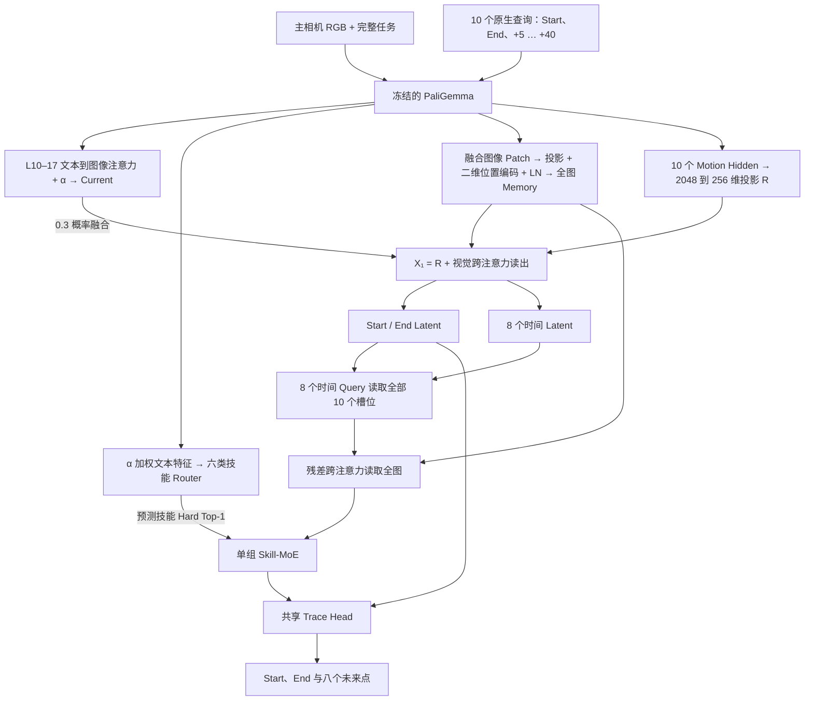

# ESkill-VLA Motion Planner

给定当前主相机 RGB 和完整任务指令，Planner 预测 Current、阶段技能、当前末端位置 Start、当前 Event 的末端终点 End，以及未来八个固定时刻的二维末端位置。以 `put the milk in the basket` 为例，Pick 段的 Current 是 milk，Place 段的 Current 是 basket。两段的 End 分别使用各自结束时刻的真实末端投影。[设计规范](motion_planner_v2.md) · [数据协议](data.md)

## 一次前向

1. SigLIP 将 224×224 图像编码为 16×16 个 patch。PaliGemma 联合编码图文和十个查询。图文前缀只看图文，运动查询可读取整个有效序列。未来偏移采用保存的主相机帧。Start 对应偏移 0，End 使用独立可学习向量。九个固定槽位在输入端各加一次时间编码。校准时 End 与九个完整槽位输入的整体 RMS 对齐。冻结主干后，查询仍可通过主干反向传播。[主干](../src/openpi/models/pi0.py) · [校准](../src/openpi/models/pi0_eskill.py)
2. Current 沿用冻结的 KLAL 文本聚合器 α 与 L10–17 原生注意力。Router 读取同一组 α 加权的融合文本特征，预测 Pick、Place、Open、Close、Turn、Push。十个运动槽以 `0.7 × 自主注意力 + 0.3 × Current` 读取同一份全图 Value，结果加回投影后的原生运动特征。[Current](../src/openpi/models/visual_primitive.py) · [Planner](../src/openpi/models/motion_planner.py)
3. 八个时间槽以标准 8×10 注意力读取 Start、End 与其余时间表征，再独立读取全图。每个样本的八个槽共用一个预测技能，由该技能的 SwiGLU 专家更新。Start、End 直接从第一阶段 latent 解码，八个未来点从专家输出解码，十个点共用一个 MLP。时间规划直接读取高维边界 latent。[模型实现](../src/openpi/models/motion_planner.py)

## 监督与评测

Start 使用当前观测的 EEF 投影。End 使用当前 Event 半开区间内最后一个有效相机帧的 EEF 投影。该帧投影缺失时单独屏蔽 End。八个未来点仍使用 +5、+10、…、+40，最短 10 帧可跨 Event，尾部沿用终点保持。几何增强同时变换图像与十个点。[标签生成](../src/openpi/policies/eskill_dataset.py) · [几何增强](../src/openpi/augmentation.py)

正式配方从非 LoRA KLAL 10k 初始化并冻结上游。前 8 步预热 Router，随后训练 `0.02 × Skill CE + 0.25 × Motion Smooth L1`。运动损失按全局有效点数平均。没有有效未来点的样本在送入专家前过滤，仍可监督有效的边界和技能。配置、启动和恢复命令见[训练说明](../experiments/motion_planner/README.md)。

`native` 在锁定帧上独立统计 Start、End、真实未来点与保持点误差。`pair` 支持两种控制变量干预。Prior-only Swap 固定 A 的视觉特征、Motion Hidden 和路由，更换 Current。End Latent Swap 在时序归一化之前只替换 A 的 End latent，保留 A 的 Start、八个时间槽、视觉 Memory 和路由。位移使用模型画布上的二维欧氏像素距离。[离线评测](../scripts/analysis/motion_planner.py)

## 第一版对照

已有 checkpoint 默认按 `planner_version=v1` 读取。第一版使用八个原生 Motion Query 和两层各自独立的技能专家。第一层完全从 Current 引导的视觉读出起步，再加时间编码。第二层自主读取全图。该接口输出八个未来点。`planner_version=v2` 选择上图的事件边界架构。原有冻结与联合开发配方和既有结果保留在[实验目录](../experiments/motion_planner/README.md)。
