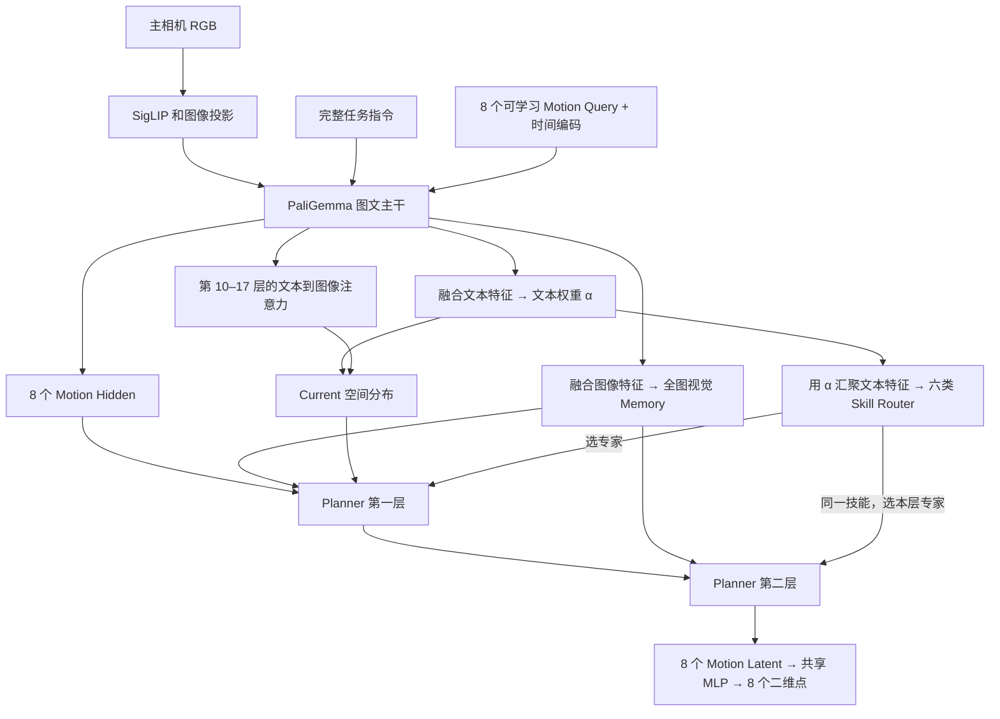

# ESkill-VLA Motion Planner

Motion Planner 从当前一帧主相机 RGB 和完整任务指令预测当前交互目标的空间分布（**Current**）、阶段技能（**Skill**）和未来八个时刻的**二维末端轨迹**。本分支研究同一项技能能否根据目标位置改变规划。以 `put the milk in the basket` 为例，示范在 Pick 阶段将 Current 标为 milk，到 Place 阶段改标为 basket。推理时，每次收到新观察，模型都要重新判断阶段和目标。[研究问题](idea.md) · [模型入口](../src/openpi/models/pi0_eskill.py)

## 一次前向

当 `training_stage` 和 `model.current_grounding` 均为 `motion_planner` 时，前向使用下图中的 CurrentAttention 与 MotionPlanner。这个分支的输出是主相机平面上的末端计划。

### 图文主干与 Motion Query

主图缩放并补边到 224×224，经视觉塔生成 16×16 个 patch。256 个视觉 token、有效文本 token 和 8 个 Motion Query 一起进入 18 层 PaliGemma。图文 token 只读取图文前缀，Motion Query 可以读取图文和其他 Motion Query；RoPE 的位置按有效 token 连续编号。这让新增查询能在主干内部逐层读取信息，同时保持原有 Current 的图文注意力路径。[主干与注意力掩码](../src/openpi/models/pi0.py)

每个 Motion Query 对应一个固定的未来时刻，由可学习向量和该时刻的正弦编码相加。初始化时，先让两部分具有相同 RMS，再将两者之和校准到真实训练样本有效文本 embedding 的 RMS。训练还记录视觉 embedding、第一层查询注意力以及二维位置编码相对于视觉内容的尺度。[Query 与校准实现](../src/openpi/models/pi0_eskill.py)

### Current 和 Skill 如何共享任务信息

| 读出 | 计算 | 传给 Planner 的信息 |
| --- | --- | --- |
| Current | 从最后一层文本 hidden 学习有效词元权重 α。对 L10–L17 的原生文本→图像注意力，逐词元、逐头在视觉 patch 内归一化，再平均各头、按 α 汇聚词元，最后平均八层 | 16×16 空间分布，指示此刻应交互的实体或区域 |
| Skill | 用同一组 α 对融合文本 hidden 加权求和，经 LayerNorm 和线性层得到 Pick、Place、Open、Close、Turn、Push 六类分数 | 预测分数最高的技能 ID，选择两层各自的专家 |

一次预测中，八个时间槽共享这个技能。下一次观察可以切换技能。真实 Skill 标签用于分类监督，正常训练和推理都用模型自己的预测选专家。Current 和 Skill 在同一帧并行读出，两者的切换时机由数据学习。[Current 与 α](../src/openpi/models/visual_primitive.py) · [Router 与硬路由](../src/openpi/models/motion_planner.py)

### 两层 Skill-MoE 如何生成轨迹

Planner 使用 PaliGemma **最后一层归一化后的融合图像特征**。每个 patch 从 2048 维投影到 256 维，加二维位置编码，再经 LayerNorm 构成全图 Memory。两层均使用八头注意力，每层有六个独立的 SwiGLU 专家，专家中间宽度为 1024。同一层的注意力由各技能共享。[Planner 实现](../src/openpi/models/motion_planner.py)

| 层 | 按执行顺序 |
| --- | --- |
| 第一层 | 用 8 个 Motion Hidden 作 Query 读取视觉 Memory。在每个头、每个时间槽上，以 **0.7 × 自主注意力 + 0.3 × Current** 聚合同一组视觉 Value，再统一做输出投影。以这次视觉读出作为起点，加时间编码，做槽间自注意力，进入本层选中的技能专家。原始 Query 在此只用于寻址。 |
| 第二层 | 先做槽间自注意力，再用残差跨注意力自主读取全图 Memory，最后进入同一技能对应的第二层专家。此层的 Current 混合系数为 **0**。 |
| 输出 | 得到 `8 × 256` 的 Motion Latent。所有技能和时间槽共用一个 MLP，逐槽回归模型画布上的归一化 `(x, y)`，输出形状为 `8 × 2`。 |

0.3 控制第一层如何分配读取概率。要测量它对**最终轨迹**的影响，可以在同一帧固定 Motion Hidden、视觉 Memory 和专家，仅替换 Current，分别比较首层读出和轨迹位移；另用同配置、同种子的 `ρ=0` 训练作对照。[配对干预](../scripts/analysis/motion_planner.py)

## 监督与训练

Current 的目标来自当前实体的可见区域；投影任务区域沿用已保存的区域几何。代码在**每一层**分别计算目标分布到预测图的 KL 散度，再平均各层。Skill 使用交叉熵，Trace 仅在有效点上计算 Smooth L1。成功替换任务目标、移动物体或遮掉关键交互证据的样本只保留有效的视觉监督。标签一致的几何增强同步变换主图、目标和轨迹。[数据构造](../src/openpi/policies/grounding_dataset.py) · [损失计算](../src/openpi/models/motion_planner.py)

八个轨迹标签按未来第 5、10、15、20、25、30、35、40 个**保存的主相机帧**取样。事件剩余时间较短时，前 10 帧允许跨 Event 取真实点；整个窗口受 Episode 末尾限制。有效终点之后的槽重复终点位置，记为派生的停止目标。例如有效终点在 +20，第 4 到第 8 个槽均监督到 +20 的位置。评测分别统计真实点与终点保持点的误差。[时间窗与标签](../src/openpi/policies/eskill_dataset.py)

| 训练配方 | 初始化与可训练范围 | Current KL / Skill CE / Trace 权重 |
| --- | --- | --- |
| [冻结 KLAL](../examples/libero/train_motion_planner_frozen.json) | 从 KLAL 20k 继承并冻结 Q-LoRA 和 α，π₀.₅ 基座冻结。更新 Motion Query、Router、视觉投影、两层 Planner 和轨迹头 | 0 / 0.02 / 0.25 |
| [联合训练](../examples/libero/train_motion_planner_joint.json) | 从原生 π₀.₅ 初始化，基座原参数冻结。在上述规划模块之外，更新 L10–L17 的 Q-LoRA 和共享 α | 0.1 / 0.02 / 0.25 |

轨迹损失更新本次预测选中的专家，Router 分类器由 Skill CE 更新。联合训练时，轨迹梯度还能沿连续的 Current 概率融合和图文特征路径回传。两份配方各自独立启动，仓库中的 128 步是技术短训模板。[训练与校准入口](../scripts/train.py)

## 验证状态与实验入口

已使用真实 LIBERO 帧和随机初始化的 CPU 小模型验证训练、恢复和同帧干预。双进程回归检查了各 rank 选择不同专家时的梯度同步及全局闲置专家的 AdamW 状态。一条 136 帧示范已对齐 Pick→Place 边界、Current、轨迹和仿真双指接触记录。真实 KLAL 20k 的晚期 Place 定位、轨迹对新目标的方向响应，以及跨组合泛化仍待测量。[实验记录、训练命令与评测方法](../experiments/motion_planner/README.md)

独立 Visual Primitive 实验及既有联合动作策略的入口见[仓库模型索引](versions.md)。
