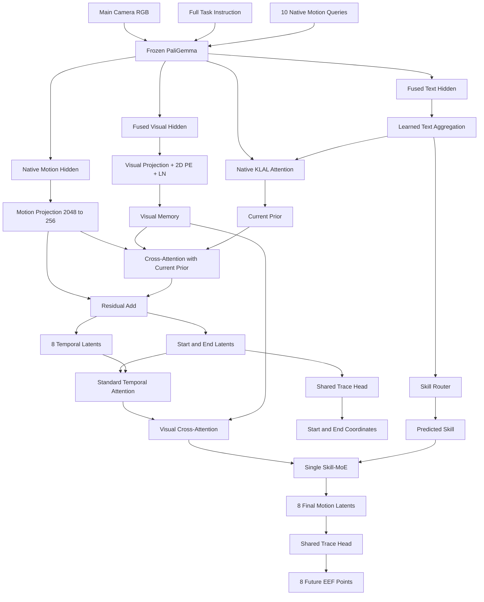

# ESkill-VLA V2：Event Boundary-conditioned Motion Planner

这份方案以已经完成训练的 V1 为实验基础，不再引入我们已经否决的设计。新版的核心不是增加更多约束，而是通过**原生运动表征、显式事件边界监督和功能性 Skill-MoE**，学习更加自然的目标条件化运动生成机制。

本次实现范围也明确锁定：**先实现简化版 V2，使用真实示范训练和评测，暂不加入反事实运动监督，不接入 Action Expert。** 但数据和模型接口应当能够自然支持后续反事实 End 监督。

## 1. 项目背景与实现目标

代码仓库：

[https://github.com/lyk-nju/ESkill-VLA/tree/motion-planner](https://github.com/lyk-nju/ESkill-VLA/tree/motion-planner)

当前已经完成第一版 Motion Planner（以下简称 V1）的正式训练与评测。V1 使用经过 KLAL 空间对齐训练的 PaliGemma，冻结视觉语言基座，通过 Native Motion Queries、Current Attention Prior 和两层 Skill-MoE Planner 预测未来二维 EEF 轨迹。

本次希望在 V1 的基础上实现更加简洁的 V2 架构，显式引入事件运动的空间起点和终点，使模型能够进一步学习：

**如何根据当前执行器位置、事件目标位置以及功能性技能知识，生成具有组合泛化能力的时序运动。**

本次不是为了构造新的外部规划器，也不是为了增加复杂的反事实 Loss，而是希望充分利用 VLM 的原生多模态表征能力，并建立明确的事件级运动表征。

---

## 2. 为什么需要修改 V1？

### 2.1 V1 已经验证了 Current → Motion 信息传递的有效性

V1 使用非 LoRA、解冻后八层 VLM 训练得到的 KLAL 10k checkpoint，冻结上游视觉基座，仅训练 Motion Queries、Skill Router、Planner 和 Trace Head。

正式训练采用：

- LIBERO40 原始真实运动示范。
- 1,518 条训练轨迹，共 245,553 个训练帧。
- Global Batch Size = 128。
- Learning Rate = 5e-5。
- 20k Training Steps。
- 八个 Motion Queries，对应未来 +5、+10、……、+40 个保存相机帧。

目前结果如下：

| 指标             | 10k     | 15k     | 20k     |
| -------------- | ------- | ------- | ------- |
| 真实未来点平均误差      | 7.82 px | 7.52 px | 7.05 px |
| Skill Accuracy | 97.8%   | 98.3%   | 98.2%   |
| 同图换目标，双边更近     | 45/48   | 40/48   | 39/48   |
| 新增物体，双边更近      | 27/48   | 28/48   | 27/48   |

在 20k checkpoint 上，固定 Skill、视觉特征和 Motion Query，仅替换 Current Map，后四个轨迹点沿新目标方向的平均位移投影中位数达到 +12.57 px。

这说明 V1 的 Current Prior 概率融合机制已经能够有效影响运动生成。

因此，V2 应当保留这一机制，而不是重新设计视觉定位与运动之间的接口。

### 2.2 当前主要问题：真实运动拟合与目标泛化没有同步提升

随着训练从 10k 推进到 20k，真实轨迹预测误差不断下降，但同图换目标的双边更近指标从 45/48 下降至 39/48。

尤其是 Goal 子集，从 19/20 下降至 14/20。

这表明模型对真实示范的拟合能力不断增强，但不一定同步提升对新目标的运动重绑定能力。

当前研究假设是：

VLM 已通过反事实视觉数据获得较强的空间定位泛化能力，而 Motion Planner 主要依赖原始真实示范学习运动。两者的监督分布不同，因此 Planner 仍可能偏向训练任务中的熟悉运动模式。

目前尚不能仅根据上述实验确定具体退化机制，需要通过新版架构及后续反事实监督进行验证。

### 2.3 固定时间窗口无法完整表达 Event

V1 的八个 Motion Tokens 表示固定未来时间点，而不是完整 Event 的运动过程。

全量 LIBERO40 离线诊断发现：

| 预测窗口    | 全部技能终点覆盖率 | Place 终点覆盖率 |
| ------- | --------- | ----------- |
| +5…+40  | 49.79%    | 62.32%      |
| +10…+80 | 83.55%    | 92.59%      |

扩大窗口虽然能够覆盖更多真实事件终点，但会降低近期轨迹的时间分辨率，并产生更多重复的 Terminal Hold 标签。

因此，V2 不通过扩大预测窗口解决问题，而是将事件终点与固定时间预测解耦。

新增两个空间运动槽位：

- Start：当前时刻的 EEF 位置，本质上是 Future = 0。
- End：当前 Event 最终完成时的 EEF 位置，不绑定固定未来时间。

其余八个时间槽位保持 +5 至 +40 不变。

### 2.4 为后续反事实部分标签监督建立基础

现有反事实视觉样本具有新的 Current 实体区域标注，但缺少真实未来轨迹与 Action 标签。

全量数据诊断发现，Place 的 EEF 终点与目标区域存在一定程度可复用的空间偏移关系。

在固定验证集上：

- 原始 Current Mask 加 10 px 容忍范围：覆盖 77.5% 的真实终点。
- 使用训练集估计的统一 Place Offset 后：覆盖 95.6% 的真实终点。

这说明未来有机会通过目标区域为反事实 Event End 提供弱空间监督。

但 Current Mask 不等于真实 EEF 终点区域，上述结果也主要基于 Event 起始帧，不能直接视为任意当前帧下的可靠反事实标签。

V2 首轮只使用真实运动示范训练。后续再验证反事实 End 软区域监督。

---

## 3. V2 核心设计原则

本次实现必须遵循以下原则：

1. 保留 VLM-native Motion Queries，充分利用原生多模态理解能力。
2. 使用显式 Start / End 坐标监督塑造高维运动 Latent。
3. 让八个固定时间 Motion Tokens 自主读取 Start、End 和其他时间表征。
4. 保留完整视觉 Memory，不限制为局部 ROI。
5. 恢复 Native Motion Residual，取消重复 Time PE。
6. 只保留一组 Skill-MoE，明确其功能性运动生成职责。
7. 不为尚未发生的问题提前引入额外 Gate、Mask、概率比例或 Loss。

本版本不要求通过结构强制保证后续 Motion 一定 Follow Start/End。是否形成有效的功能依赖，应通过真实实验与控制变量干预检验。

---

## 4. 完整架构图

以下 Mermaid 图为本次 V2 的目标架构。



说明：

- 图中的两个 Shared Trace Head 实际上是同一个参数共享模块。
- Start / End 坐标仅用于监督和评测，不重新编码回 Planner。
- Temporal Attention 直接读取 Start / End Latents，而不是读取解码出的二维坐标。
- Skill Router 与 Current Grounding 均来自原生 VLM 的图文理解。
- 第一阶段没有 Skill Expert。
- 只有最终 Motion Generation 阶段使用一组 Skill-MoE。

---

## 5. VLM-native Motion Queries

### 5.1 输入与输出

继续使用单主相机 RGB 和完整任务指令。

主相机输入为 224×224，Patch Size 为 14，形成 16×16、共 256 个视觉 Tokens。

VLM 工作宽度为 2048。

新增十个 Native Motion Queries：

$$
Q_M=[q_0,q_E,q_5,q_{10},\ldots,q_{40}]
$$

固定时间槽位为：

$$
\Delta t\in\{0,5,10,15,20,25,30,35,40\}
$$

其中：

- $q_0$：当前时刻 EEF。
- $q_E$：当前 Event 的最终 EEF。
- 其他八个 Query：未来固定时间的 EEF。

Start 不再拥有特殊的视觉读取规则，它只是时间偏移为 0 的 Motion Token。

真正特殊的只有 End，因为它不对应固定时间偏移。

### 5.2 Query 初始化

对于九个固定时间槽位：

$$
q_j=e_j+s_tPE_t(\Delta t_j)
$$

其中 $e_j$ 为可训练 Query，$PE_t$ 为固定正余弦时间编码，$s_t$ 为初始化校准尺度。

对于 Event End：

$$
q_E=e_E
$$

End 使用独立可学习 Query，不设置人为的固定未来帧数。

End 在 VLM 序列中仍然拥有正常的序列 Position ID，这与实际机器人运动的时间偏移不是同一个概念。

初始化时先沿用 V1 的 RMS 校准，将九个固定时间槽位的完整输入校准到有效文本 embedding 的 RMS。再单独缩放 End Query，使进入 PaliGemma 第 0 层前的 $\operatorname{RMS}(e_E)$ 等于这九个完整输入的 RMS。

$$
Q_{\mathrm{fixed}}=\operatorname{stack}_{j\in\{0,5,\ldots,40\}}\!\left(e_j+s_t\,\mathrm{PE}_t(j)\right), \qquad
e_E \leftarrow e_E\,\frac{\operatorname{RMS}(Q_{\mathrm{fixed}})}{\operatorname{RMS}(e_E)}.
$$

$\operatorname{RMS}(Q_{\mathrm{fixed}})$ 在九个槽位及全部隐藏维上一起计算，包含它们的时间编码。End 自身只包含 $e_E$。这次缩放仅在初始化时执行。

**Time PE 只在 Native Query 输入阶段使用一次，Planner 内部不再重复添加时间编码。**

### 5.3 Attention Mask

保留 V1 的非对称 Prefix Attention Mask。

| Query / Key | Image | Text | Motion |
| ----------- | ----- | ---- | ------ |
| Image       | ✓     | ✓    | ×      |
| Text        | ✓     | ✓    | ×      |
| Motion      | ✓     | ✓    | ✓      |

要求：

- 原有图文 Tokens 不读取新增 Motion Tokens。
- 十个 Motion Tokens 可以读取全部有效图文 Tokens。
- 十个 Motion Tokens 可以相互读取。
- 保留文本 Padding Mask。
- Position IDs 继续基于有效 Token 数量计算。

因此，新增 Motion Queries 在计算图上不会反向改变原有图文 Prefix 的前向结果。

冻结 VLM 参数时，不能使用全局 `torch.no_grad()` 或 `inference_mode()` 包裹 Native Motion Query 前向，因为新 Query 仍然需要通过冻结 VLM 接收梯度。

### 5.4 特征输出

从 VLM 最后一层归一化后的 Hidden States 中分别提取：

$$
H_V\in\mathbb R^{256\times2048}
$$

$$
H_T\in\mathbb R^{L\times2048}
$$

$$
H_M\in\mathbb R^{10\times2048}
$$

这里 $H_V$ 必须是经过 PaliGemma 图文联合计算后的视觉 Hidden，而不是融合前的 SigLIP 输出。

---

## 6. Current Prior 与 Skill Router

### 6.1 Current Prior

继承 V1 中已经验证的 KLAL 读取机制。

从指定 VLM 层的原生 Text-to-Image Attention 中，按原实现进行：

- 有效文本 Token 聚合。
- 视觉区域条件归一化。
- Attention Head 聚合。
- 多层 Attention Map 聚合。

获得：

$$
P_C\in\mathbb R^{256}
$$

满足：

$$
\sum_p P_C(p)=1
$$

Current Prior 必须与 16×16 视觉 Patch 的空间排列一致。

本轮继续使用已经训练好的非 LoRA KLAL 10k 基座及其文本聚合器，冻结所有上游视觉参数。

不引入 GAC 对比学习。

### 6.2 Skill Router

保留 V1 的共享文本聚合及轻量分类器：

$$
q_{\mathrm{event}}=\sum_l\alpha_lH_{T,l}
$$

$$
p_{\mathrm{skill}} = \operatorname{softmax}\!\left(W_k\operatorname{LN}(q_{\mathrm{event}})\right)
$$

六类技能：

- Pick
- Place
- Open
- Close
- Turn
- Push

使用预测技能进行 Hard Top-1 Routing：

$$
\hat k=\arg\max_k p_{\mathrm{skill},k}
$$

同一个样本的八个最终 Motion Tokens 使用同一个 Skill Expert。

正常训练和推理均使用预测 Skill，GT Skill 仅用于分类监督与 Oracle 诊断。

Skill Router 的分类监督保持不变。Trace Loss 不会直接通过 argmax 向 Router 参数传递梯度。

---

## 7. Visual Memory

保持 V1 的完整视觉 Memory。

$$
B=\operatorname{LN}(W_VH_V+PE_{xy})
$$

维度：

$$
B\in\mathbb R^{256\times256}
$$

其中：

- $W_V$：2048 → 256 的视觉投影。
- $PE_{xy}$：16×16 Patch Grid 上的二维空间位置编码。
- LN：LayerNorm。

继续复用 V1 已实现的 Patch Center 二维正余弦编码。

这里的 Spatial PE 用于保留视觉 Patch 的空间排列，必须保留。

注意不要将它与已经删除的 Coordinate PE Reinjection 混淆：

- Visual Memory Spatial PE：保留。
- Start / End 预测坐标回注：删除。

---

## 8. Planner 第一阶段：Grounded Residual Readout

第一阶段的职责是从 VLM 原生运动理解中提取具有空间意义的运动特征。

### 8.1 恢复 Native Motion Residual

首先将 Native Motion Hidden 统一投影至 Planner 的工作维度：

$$
R=W_MH_M
$$

其中：

$$
R\in\mathbb R^{10\times256}
$$

随后：

$$
X_1= R+\operatorname{CrossAttn} (\operatorname{LN}(R),B;P_C)
$$

与 V1 相比，V2 恢复了 Native Motion Residual。

这样做的动机：

- 保留 VLM-native Motion Queries 已经获得的图文理解信息。
- 让显式视觉读取作为原生运动理解的补充，而不是完全替代原生表征。
- 避免时间信息只能通过视觉 Attention 权重间接传递。
- 删除 Planner 内部重复的 Time PE。

需要强调：V1 的实验并不能证明恢复 Residual 后一定不会产生 Shortcut。V2 仍然需要实际验证 Current Prior 的功能作用。

### 8.2 Cross-Attention with Current Prior

保留 V1 已有的注意力概率融合。

对于第 $h$ 个 Attention Head：

$$
Q^h=W_Q^h\operatorname{LN}(R)
$$

$$
K^h=W_K^hB,\qquad V^h=W_V^hB
$$

标准视觉读取：

$$
A^h=\operatorname{softmax} \left(\frac{Q^h(K^h)^\top}{\sqrt{32}}\right)
$$

融合 Current Prior：

$$
\widetilde A^h=0.7A^h+0.3P_C
$$

输出：

$$
G=W_O\operatorname{Concat}_h (\widetilde A^hV^h)
$$

最终：

$$
\boxed{X_1=R+G}
$$

实现要求：

- Planner Width = 256。
- Attention Heads = 8。
- Head Dimension = 32。
- 所有十个 Motion Tokens 统一使用 $\rho=0.3$。
- Start 不使用特殊的 Prior Ratio。
- Prior 在 Softmax 后进行概率融合，而不是直接添加至 QK Logits。
- 两个分支共享相同的 Value Projection。
- Current Prior 在有效视觉 Patch 上归一化。
- Prior Value Aggregation 使用 FP32 计算。
- 两个分支融合后只执行一次 Output Projection。

建议继续复用 V1 的 SDPA + einsum 实现，不需要额外显式构造完整 Attention Matrix。

第一阶段到此结束。

不再包含：

- 第一层 Temporal Self-Attention。
- 第一组 Skill-MoE。
- 重复的 Time PE。
- 额外 Residual Gate。

---

## 9. Event Boundary Readout

将第一阶段输出拆分为：

$$
X_1=[z_S,z_E,U]
$$

其中：

$$
z_S,z_E\in\mathbb R^{1\times256}
$$

$$
U\in\mathbb R^{8\times256}
$$

Start、End 与时间运动共享同一个 Trace Head。

$$
\hat y_S=D(z_S)
$$

$$
\hat y_E=D(z_E)
$$

Trace Head 延续 V1：

```text
LayerNorm(256)
Linear(256, 256)
GELU
Linear(256, 2)
```

输出为归一化二维 EEF 坐标。

不新增独立的 Start Head 或 End Head。

### 为什么不使用 Coordinate PE Reinjection？

Start 和 End 已经通过明确的真实空间坐标监督获得空间语义。

预测坐标本身是从对应 Latent 解码得到的，再将坐标编码回 Latent 不会增加新的观测信息，只是额外引入一种空间归纳偏置。

首轮希望验证的是：

**Spatially Supervised Latent → Functional Motion Generation**

因此下游直接读取 $z_S,z_E$，而不是读取预测坐标或其位置编码。

Trace Head 的坐标输出只用于监督、评测和可视化。

注意：第一阶段的空间坐标读出与第二阶段的运动生成不是自回归生成关系。真正传递给下游的是边界 Latents，坐标解码只是对这些 Latents 的显式监督。

---

## 10. Planner 第二阶段：Boundary-conditioned Skill Generation

第二阶段负责将事件空间边界展开为具体的时序运动。

### 10.1 标准 Temporal Attention

八个时间槽位作为 Query，读取全部十个 Latents：

$$
Q=W_Q\operatorname{LN}(U)
$$

$$
K=W_K\operatorname{LN}(X_1)
$$

$$
V=W_V\operatorname{LN}(X_1)
$$

即：

$$
Q:8\times256
$$

$$
K,V:10\times256
$$

Attention Matrix 为：

$$
A_{\mathrm{temporal}}:8\times10
$$

矩阵结构：

| Query / Key | Start | End | +5 | +10 | +15 | +20 | +25 | +30 | +35 | +40 |
| ----------- | ----- | --- | -- | --- | --- | --- | --- | --- | --- | --- |
| +5          | ✓     | ✓   | ✓  | ✓   | ✓   | ✓   | ✓   | ✓   | ✓   | ✓   |
| +10         | ✓     | ✓   | ✓  | ✓   | ✓   | ✓   | ✓   | ✓   | ✓   | ✓   |
| +15         | ✓     | ✓   | ✓  | ✓   | ✓   | ✓   | ✓   | ✓   | ✓   | ✓   |
| +20         | ✓     | ✓   | ✓  | ✓   | ✓   | ✓   | ✓   | ✓   | ✓   | ✓   |
| +25         | ✓     | ✓   | ✓  | ✓   | ✓   | ✓   | ✓   | ✓   | ✓   | ✓   |
| +30         | ✓     | ✓   | ✓  | ✓   | ✓   | ✓   | ✓   | ✓   | ✓   | ✓   |
| +35         | ✓     | ✓   | ✓  | ✓   | ✓   | ✓   | ✓   | ✓   | ✓   | ✓   |
| +40         | ✓     | ✓   | ✓  | ✓   | ✓   | ✓   | ✓   | ✓   | ✓   | ✓   |

输出：

$$
X_2=U+ \operatorname{MHA} (\operatorname{LN}(U),\operatorname{LN}(X_1),\operatorname{LN}(X_1))
$$

这是标准多头 Attention。

不设置：

- Boundary Ratio $\beta$。
- Boundary/Temporal 分组 Softmax。
- 反向因果 Mask。
- 额外 Boundary Attention 层。
- 手工规定的起终点插值权重。

理由是十个 Key/Value 本身已经是高度任务相关的运动表征，Start 和 End 具有明确空间监督，不应在没有实验依据时进一步约束它们的 Attention Mass。

当然，能够读取边界不等于一定使用边界，必须通过 End Swap 实验验证。

### 10.2 Visual Cross-Attention

经过边界条件化时序交互后，再读取完整视觉 Memory：

$$
X_3= X_2+\operatorname{CrossAttn} (\operatorname{LN}(X_2),B)
$$

这一层不再显式融合 Current Prior：

$$
\rho_2=0
$$

其职责是根据当前运动表征自主获取场景信息，例如机器人、目标及周围物体的空间关系。

不限制为 Current ROI。

### 10.3 单组 Skill-MoE

最终使用一个 Event-routed Skill-MoE：

$$
Z_M= X_3+\mathcal E_{\hat k} (\operatorname{LN}(X_3))
$$

其中：

$$
Z_M\in\mathbb R^{8\times256}
$$

专家结构继续使用 V1 的 SwiGLU：

$$
\mathcal E_k(x)= W_{\mathrm{down},k} \left[ \operatorname{SiLU}(W_{\mathrm{gate},k}x) \odot W_{\mathrm{up},k}x \right]
$$

每个 Expert：

- 输入宽度：256。
- 中间宽度：1024。
- 输出宽度：256。
- 三个 Linear Projection 均不使用 Bias，延续 V1 配置。

共六个专家，每个样本仅激活一个。

八个时间槽位共享同一 Event Route。

不新增 Shared Expert、Skill Embedding、FiLM 或额外专家负载均衡损失。

与 V1 相比，将两组 Skill-MoE 简化为一组：

| Expert 参数    | V1    | V2    |
| ------------ | ----- | ----- |
| Expert 数量    | 12    | 6     |
| 总 Expert 参数量 | 9.44M | 4.72M |

这只是专家参数量，不包含其他模块。

此设计希望让 Skill Expert 专注于根据空间条件生成可复用的功能性运动，而不是同时在多个层级重复承担边界理解和运动生成职责。

最后使用共享 Trace Head：

$$
\hat Y_{1:8}=D(Z_M)
$$

---

## 11. 核心前向伪代码

以下是 V2 的完整 Planner 前向逻辑。实际实现请复用现有模块、参数初始化和训练接口，不要求完全使用下面的变量命名。

```python
# H_M: [batch, 10, 2048]
# H_V: [batch, 256, 2048]
# P_C: [batch, 256]

memory = visual_norm(
    visual_proj(H_V) + visual_xy_pe
)

# Stage 1: Grounded Residual Readout

r = motion_proj(H_M)

x1 = r + cross_attention_with_prior(
    query=norm1(r),
    memory=memory,
    prior=P_C,
    ratio=0.3,
)

# No repeated Time PE
# No Stage-1 Self-Attention
# No Stage-1 Skill-MoE

# Event Boundary Readout

boundaries = x1[:, :2]
u = x1[:, 2:]

boundary_xy = trace_head(boundaries)

# Stage 2: Boundary-conditioned Motion

kv = norm2(x1)

x2 = u + temporal_attention(
    query=kv[:, 2:],
    key=kv,
    value=kv,
)

x3 = x2 + visual_cross_attention(
    query=norm3(x2),
    memory=memory,
)

# Supervised training supplies [batch, 8] validity. Inference routes every sample.
dispatch_route = route
if trace_valid is not None:
    dispatch_route = route.masked_fill(~trace_valid.any(dim=-1), -1)

motion = x3
for k, expert in enumerate(skill_experts):
    rows = (dispatch_route == k).nonzero(as_tuple=True)[0]
    if rows.numel():
        update = expert(norm4(x3.index_select(0, rows)))
        motion = motion.index_add(0, rows, update.to(x3.dtype))

trace = trace_head(motion)

return {
    "start": boundary_xy[:, 0],
    "end": boundary_xy[:, 1],
    "boundary_latents": boundaries,
    "trace": trace,
    "motion_latents": motion,
}
```

所有 Attention 使用标准 Pre-Norm Residual 结构。

核心 Planner 只包含：

```text
Cross-Attention with Current Prior
    ↓
Start / End Readout
    ↓
Temporal Attention
    ↓
Visual Cross-Attention
    ↓
Skill-MoE
    ↓
Motion Latent
```

---

## 12. 数据监督设计

### 12.1 真实 Start 标签

Start 表示当前观察时刻的 EEF 投影：

$$
y_S^{GT}=y_{\mathrm{EEF}}(t)
$$

不是整个 Event 历史起始帧的 EEF。

这样 Start 在任意当前观察帧都具有明确且可获得的真实监督。

### 12.2 真实 End 标签

End 表示当前 Event 最终完成时的 EEF 投影：

$$
y_E^{GT}=y_{\mathrm{EEF}}(t_{\mathrm{end}})
$$

需要严格检查现有 Event 定义。

对于当前 Event 的半开区间 `[start_frame, stop_frame)`，优先使用区间内最后一个实际保存的主相机帧对应的真实 EEF 投影。

注意：

- 不直接使用 stop_frame 本身。
- 不默认 goal_frame 等于 Event 最后一帧。
- 不将 +40 帧当作 Event End。
- 不使用跨入下一个 Event 后的 EEF 作为当前 End。
- 如果对应投影无效，屏蔽 End Loss，不应将无效坐标默认为零。
- 不应静默使用更早的可见点替代真实终点。

真实未来 EEF 仅作为监督标签，不作为模型输入。

### 12.3 八个未来时间标签

继续严格复用 V1 的 `event_motion_targets` 逻辑：

$$
[+5,+10,+15,+20,+25,+30,+35,+40]
$$

保留原有：

- 保存相机帧的时间轴。
- 最短 10 帧预测窗口。
- 短距离跨 Event 规则。
- Terminal Hold。
- Trace Valid Mask。
- Trace Source Frame Indices。

独立 End 始终属于当前 Event，而八个时间槽位可能按照旧逻辑短距离跨 Event。

因此，不额外添加 End 与最后一个时间槽位的一致性 Loss，也不强制它们相等。

### 12.4 数据字段建议

为保持 V1 的数据与诊断兼容，建议保留原有八点 Trace 字段，新增边界字段，而不是直接将所有原有 Trace 张量改为十点。

```python
targets = {
    # Existing V1 targets
    "skill_labels": ...,
    "skill_valid": ...,
    "trace": ...,             # [8, 2]
    "trace_valid": ...,       # [8]
    "trace_terminal_hold": ...,

    # New V2 targets
    "boundary_xy": ...,       # [2, 2], Start / End
    "boundary_valid": ...,    # [2]
}
```

可在 Loss 内部临时拼接为十点监督。

Start、End 和八个未来点必须使用相同的图像坐标变换规则。

### 12.5 图像增强

首轮只使用真实示范，沿用 V1 的训练数据和增强配置：

- 水平翻转。
- 轻裁切。
- 旋转。
- 颜色增强。

几何增强必须同步更新 Start、End、八点 Trace、Current Mask 和对应有效性。

如果增强使某个 EEF 标签超出画布，则按照有效性规则屏蔽，不要通过裁剪坐标将其强行拉回图像内部。

继续保留方向性任务的增强保护规则。

本轮不要开启：

- Counterfactual Text Swap。
- Object Copy-Paste。
- Random Patch Masking。

后续反事实监督是独立实验阶段，不应混入 V2 首轮基线。

---

## 13. 训练 Loss

首轮冻结 KLAL 和 PaliGemma，只训练新增 Motion Queries、Motion Projection、Skill Router、Planner 和共享 Trace Head。

### 13.1 Motion Loss

将 Start、End 与八个固定时间点统一视为同一种二维 EEF 位置监督。

对于真实点：

$$
\ell_{b,i}=\tfrac12\sum_{c\in\{x,y\}}\operatorname{SmoothL1}(\hat y_{b,i,c},y_{b,i,c}^{GT})
$$

使用与 V1 一致的 Smooth L1 配置，对 xy 两个坐标分量取平均。

整体：

$$
\mathcal{L}_{\mathrm{Motion}} = \frac{\sum_b\sum_{i\in\mathcal I} m_{b,i}\,\ell_{b,i}}{\sum_b\sum_{i\in\mathcal I} m_{b,i}}, \qquad \mathcal I=\{S,E,1,\ldots,8\}
$$

其中 $b$ 遍历本步所有 rank 的样本，$m_{b,i}$ 是样本 $b$ 第 $i$ 个位置的有效性标记，$\ell_{b,i}$ 是该位置两个坐标分量的平均 Smooth L1。

分母为零时，应安全返回零监督损失。

多卡训练继续按照 V1 的全局有效监督数量进行归一化，不能先对每个 Rank 独立平均，再无条件平均各卡 Loss。

所有有效坐标采用统一权重，不额外引入 Start Loss Weight、End Loss Weight 等超参数。

需要注意：加入两个边界点后，十点平均会改变原有八点 Trace 在 Motion Loss 内的相对权重。因此必须单独记录时间轨迹误差，不能直接将 V1 和 V2 的总 Motion Loss 数值视为完全相同的指标。

### 13.2 总 Loss

冻结视觉基座版本：

$$
\boxed{ \mathcal L= 0.02\mathcal L_{\mathrm{Skill}} + 0.25\mathcal L_{\mathrm{Motion}} }
$$

KLAL Loss 权重为 0，不更新上游 Current。

本轮不增加：

- CIG Loss。
- Preserve Loss。
- Latent Contrastive Loss。
- Direction Loss。
- Goal-Set CE。
- Boundary Consistency Loss。
- Attention Alignment Loss。

---

## 14. 与 V1 的完整区别

| 模块                        | V1     | V2           |
| ------------------------- | ------ | ------------ |
| Native Motion Queries     | 8      | 10           |
| 时间槽位                      | +5…+40 | 0、End、+5…+40 |
| Native Time PE            | 保留     | 保留           |
| Planner 内 Time PE         | 有      | 删除           |
| Native Motion Residual    | 无      | 有            |
| 第一阶段 Current Ratio        | 0.3    | 所有槽位统一 0.3   |
| 第一层 Self-Attention        | 有      | 删除           |
| 第一组 Skill-MoE             | 有      | 删除           |
| Start / End 监督            | 无      | 有            |
| Coordinate PE Reinjection | 无      | 不引入          |
| 第二阶段 Temporal Attention   | 8×8    | 标准 8×10      |
| Boundary Ratio            | 无      | 不引入          |
| 第二次视觉读取                   | 有      | 保留           |
| 最终 Skill-MoE              | 有      | 保留           |
| Skill Expert 总数           | 12     | 6            |
| Trace Head                | 共享     | 所有十点共享       |
| Action Expert             | 未接入    | 未接入          |

V2 不是在 V1 上简单增加两个 Token，而是对运动规划计算进行更加明确的功能分工。

---

## 15. 训练配置与 Checkpoint 继承

第一轮尽量复用 V1 的实际正式训练配置。

| 参数                    | V2 首轮设置         |
| --------------------- | --------------- |
| Visual Primitive      | 非 LoRA KLAL 10k |
| VLM                   | 冻结              |
| Global Batch Size     | 128             |
| Learning Rate         | 5e-5            |
| Training Steps        | 20k             |
| Checkpoint            | 5k、10k、15k、20k  |
| Skill Loss Weight     | 0.02            |
| Motion Loss Weight    | 0.25            |
| Current Prior Ratio   | 0.3             |
| Planner Width         | 256             |
| Attention Heads       | 8               |
| Expert Hidden Width   | 1024            |
| 数据划分                  | 与 V1 完全一致       |
| 数据增强                  | 与 V1 完全一致       |
| Router Warmup         | 继承 V1 实际正式配置    |
| Counterfactual Motion | 关闭              |

Optimizer、Precision、Weight Decay、梯度裁剪、Sampler、随机种子等也以 V1 实际配置为准，不要直接采用仓库早期的 128 步技术短训模板作为正式训练配方。

特别注意：本轮继承的是完整后八层解冻训练得到的 KLAL 权重，而不是旧 Q-LoRA checkpoint。

必须核查现有 Checkpoint 加载代码是否正确恢复：

- 完整更新后的 VLM 权重。
- Learned Text Aggregation 参数。
- 原有视觉编码与投影参数。
- 一致的 Tokenizer、输入尺寸和 Attention Layers。

不能只加载 LoRA 参数或文本聚合器，而遗漏完整后八层更新。

V2 应从相同 KLAL 基座重新初始化 Planner，不默认从 V1 的运动权重继续训练，以免引入不同的初始化历史。

---

## 16. 工程实现要求

请在当前代码基础上实施最小改造。

重点检查：

```text
src/openpi/models/motion_planner.py
src/openpi/models/pi0_eskill.py
src/openpi/models/pi0.py
src/openpi/models/pi0_config.py
src/openpi/policies/grounding_dataset.py
src/openpi/policies/eskill_dataset.py
src/openpi/transforms.py
src/openpi/augmentation.py
src/openpi/training/config.py
src/openpi/training/checkpoints.py
scripts/train.py
scripts/analysis/motion_planner.py
```

以上是已知 V1 相关文件，具体实现请以当前仓库实际版本为准。

要求：

1. 保留 V1 模型及已有 checkpoint 的加载、推理和诊断能力。建议使用一个简单的 Planner Version 配置区分 V1 与 V2，不要直接破坏旧实现。
2. 尽量复用现有 CrossAttention、Expert、RMS Calibration、全局 Masked Mean 和 Sparse Routing 实现。
3. 原 `motion_queries` 与 `motion_offsets_frames` 之间的关系需要明确。V2 仍然只有八个固定未来时间槽位，但 Native Motion Query 总数变为十个。不要直接将 Motion Offsets 扩展至 +50。
4. 保留冻结 VLM 下 Native Query 的梯度传播及 Gradient Checkpointing。
5. 继续使用现有 DDP 稀疏专家处理方式。全局未使用的 Expert 保持 `grad=None`，不要通过虚假的零梯度更新其 AdamW 状态。
6. **训练时在派发前过滤。** 每个样本按 `trace_valid.any(dim=-1)` 检查八个未来点。结果为 False 时跳过该样本的 Skill Expert 路由，仍按各自的有效标记计算 Start、End 和 Skill 监督。每个专家仅对命中且有有效轨迹的样本执行前向。使用 `zero_grad(set_to_none=True)` 时，本步所有 rank 均无有效样本命中的专家保持 `param.grad is None`，其 AdamW 状态不更新。只要任一 rank 有效命中，DDP 就正常归约该专家的梯度。推理按预测技能路由全部样本。
7. 保留正常 checkpoint 恢复与随机状态恢复机制。
8. 不引入任何未在本方案中明确要求的额外模块或损失。

---

## 17. 训练日志与早期诊断

恢复 Native Residual 后，需要观察它是否削弱原有 Current Prior 的功能作用。

不提前引入 Gate 或额外训练约束，仅记录诊断信息。

### 17.1 Residual 与视觉读取分支

记录：

$$
r_G= \frac{\operatorname{RMS}(G)} {\operatorname{RMS}(R)+\epsilon}
$$

其中：

- $R$：Native Motion Projection。
- $G$：第一阶段完整 Cross-Attention 输出。

另外单独记录 0.3 Current Prior 分支经过 Output Projection 后的 RMS 与 Residual 的比值。

分支贡献计算时应注意共享 Output Projection Bias 只计算一次。单独比较两路贡献时可以排除 Bias。

建议每 500 步在诊断 batch 上记录，分别统计 Start、End 和时间槽位。

这些范数只用于观察训练趋势，不能单独证明或否定 Shortcut。

### 17.2 Temporal Attention

记录标准 8×10 Attention 中：

- Start Attention Mass。
- End Attention Mass。
- 其他八个时间槽位的总 Attention Mass。

尽可能保留各时间 Query 的独立统计，而不是只有一个全局平均值。

注意不要因为常规日志而改变正常训练的 Attention 计算路径或造成明显训练开销。

Attention Mass 仅是辅助诊断，不是功能依赖的充分证据。

### 17.3 运动监督指标

单独记录：

- Start Error。
- End Error。
- 八个真实未来点的平均误差。
- 各时间偏移的真实点误差。
- Terminal Hold Error。
- Skill Accuracy。
- 各 Skill Expert 的有效路由数量及梯度范数。

Start、End 和八个未来点使用 V1 的 224×224 模型画布，报告有效样本数和二维欧氏像素距离。对归一化画布坐标 $p,q$，该距离为 $d_{\mathrm{px}}(p,q)=224\,\lVert p-q\rVert_2$。

---

## 18. 正式评测与功能依赖实验

沿用 V1 的全部正式评测清单，确保新旧结果可以配对比较。

### 18.1 原生验证

复用 175 条验证示范、401 个 Event、1,203 个早中晚观察帧。

V1 20k 基线：

- 真实未来点平均误差：7.05 px。
- +5 帧误差：5.40 px。
- +40 帧误差：8.11 px。
- Skill Accuracy：98.2%。

V2 除原有指标外，额外评价 Start 和 Event End 的真实定位误差。

### 18.2 自然反事实任务评测

复用 V1 已有 A–D 配对清单：

- A：目标位置移动。
- B：同图换指令目标。
- C：随机布局下换目标。
- D：跨场景新增物体。

以及原有无关物体移动对照。

继续统计方向正确率、双边更近和实际轨迹变化，同时增加：

- Start 是否随指令改变而错误漂移。
- End 是否跟随 Current 目标改变。
- End 的目标响应是否能够传递到八个时间槽位。

不能仅根据最后四个时间点是否接近目标，就假定完整 Event 已经完成。

### 18.3 Prior-only Swap

固定：

- Native Motion Hidden。
- Visual Memory。
- Skill Route。

仅替换 Current Prior。

重新计算完整 Planner，并分别记录：

- Start 变化。
- End 变化。
- 八个时间点变化。
- 后四个时间点沿新目标方向的位移投影。

用于判断恢复 Native Residual 后，Current Prior 是否仍能够有效影响运动。

V1 20k 的 +12.57 px 可作为历史参考，但不能直接作为 V2 5k 的硬性通过阈值。

优先补测已保存的 V1 5k checkpoint，进行相同训练步数、相同评测样本的比较。

### 18.4 End Latent Swap

这是 V2 最重要的新实验。

在同一真实场景中选择两个具有合法不同目标、相同功能技能的任务条件 A 和 B。

取得：

$$
X_1^A=[z_S^A,z_E^A,U^A]
$$

$$
X_1^B=[z_S^B,z_E^B,U^B]
$$

固定：

- $z_S^A$
- $U^A$
- Visual Memory $B^A$
- Skill Route $\hat k^A$

只替换：

$$
z_E^A\rightarrow z_E^B
$$

在 `kv = norm2(x1)` **之前**替换原始 End latent。取 A 的副本，保留 A 的基线供配对比较。第二阶段使用 A 的视觉 Memory 和 Skill Route。

```python
x1 = x1_a.clone()
x1[:, 1:2] = x1_b[:, 1:2]
kv = norm2(x1)
```

然后重新运行第二阶段：

$$
[z_S^A,z_E^B,U^A] \longrightarrow \hat Y^{A\leftarrow B}
$$

对同一时间槽比较原轨迹与替换后的轨迹，绝对位移沿用第 17.3 节的 224×224 画布欧氏像素距离。

除绝对像素位移外，可统计每个时间槽位沿 End 变化方向的归一化响应：

$$
r_j= \frac{ (\hat y_j^{A\leftarrow B}-\hat y_j^A)^\top (\hat y_E^B-\hat y_E^A) }{ \lVert\hat y_E^B-\hat y_E^A\rVert_2^2+\epsilon }
$$

$r_j$ 是无量纲的方向响应。若两个 End 在画布上几乎重合，应单独报告这些配对，避免分母过小。

不要求所有时间点都立即向目标移动，也不要求响应比例为 1。

真实机器人运动可能包含抬升、避障和局部交互。

该实验需要回答：

**Start、End 是否真的形成了能够被下游运动生成使用的空间条件？**

本版本已经删除 Coordinate PE Reinjection，因此不需要 Coordinate-only Swap 实验。

### 18.5 Start 稳定性

对于同一 RGB、不同任务指令：

$$
\Delta_S=d_{\mathrm{px}}(\hat y_S^A,\hat y_S^B)=224\,\lVert\hat y_S^A-\hat y_S^B\rVert_2
$$

统计 Start 的绝对定位误差和指令变化导致的预测漂移。

2–3 px 可以作为初步观察参考，但不能作为预设的硬性阈值。

如果 Start 很稳定且定位准确，则说明统一 $\rho=0.3$ 是合理的。

### 18.6 5k Checkpoint 验收

保存 5k 后优先进行：

1. 原生真实轨迹质量。
2. Prior-only Swap。
3. End Latent Swap。
4. Start 稳定性。
5. 自然反事实目标响应。

若结果尚未达到 V1 后期水平，不应立即认定 Residual 导致失败。V2 同时改变了多项结构，且训练成熟度可能不同。

必要时先进行同 checkpoint 的分支移除诊断，再决定是否需要控制变量训练。不要自动修改架构或中断正式实验。

---

## 19. 后续反事实监督接口

此部分仅用于说明 V2 的未来扩展能力，首轮不要实际启用。

对于合法的 Place 反事实目标替换或 Copy-Paste 样本：

- 如果当前执行器状态未被改变，Start 仍可使用真实 EEF 坐标。
- End 可以使用反事实目标对应的软区域监督。
- 八个固定时间运动点没有真实标签，不伪造完整轨迹。

未来候选目标集合：

$$
\mathcal{G}_E^{\mathrm{CF}} = (R_B + \delta_{\mathrm{Place}}) \oplus \mathcal{B}(r)
$$

其中：

- $R_B$：反事实目标的真实标注区域。
- $\delta_{\mathrm{Place}}$：从训练集真实示范估计的技能相关空间偏移。
- $r$：通过独立验证集校准的容忍半径。

真实坐标与软区域可以进一步统一为同一空间预测任务下的不同标签类型。

但目前不要实现 GS-CE、CIG、DMP 或额外反事实监督。

首先验证真实示范下的 V2 是否能够学习有效的边界条件化运动生成。

---

## 20. 单元测试与交付要求

请至少覆盖以下回归检查：

- 十个 Native Queries 的 Shape、顺序和时间语义正确。
- 校准后 End Query 的 RMS 与九个固定槽位完整输入的整体 RMS 一致。
- 原图文 Prefix 与 KLAL 输出不因新增 Query 而产生非预期变化。
- Start/End 与八点 Trace 的坐标标签及有效性正确。
- 几何增强同步修改所有新增坐标。
- 第一阶段概率融合与显式公式数值一致。
- Native Residual 正确接入，不存在重复 Time PE。
- Temporal Attention 的 Query 数为 8、Key/Value 数为 10。
- Start/End 与未来点使用同一 Trace Head。
- 真实 Trace Loss 能通过 Temporal Attention 对边界 Latent 产生梯度；使用非退化测试样本检查计算图，不将梯度大小视为真实功能依赖证明。
- 冻结 Backbone 后 Native Queries 仍有梯度。
- Hard Top-1 Routing 在派发前滤除八个轨迹点全无效的训练样本。覆盖仅有边界标签、全局无命中和仅其他 rank 有效命中三种情况，核对专家前向、梯度及 AdamW 状态。
- 保存、加载、恢复训练正常。
- End Swap 在 `norm2` 前只替换第 1 号槽位（从 0 编号）。A 换 A 复现基线，A 换 B 时只改变 End，按 224×224 画布上的欧氏像素距离报告位移。
- V1 原有测试和 checkpoint 兼容性不被破坏。

建议先通过 CPU 小模型测试和真实 GPU 技术短训，再进入正式训练。

最终交付：

1. V2 代码及独立训练配置。
2. 更新后的 Mermaid 架构图与模型设计文档。
3. 新增数据监督说明。
4. 单元测试及短训记录。
5. V1/V2 参数量、显存和训练速度对比。
6. 支持 Start/End 及 End Swap 的评测脚本。
7. 5k、10k、15k、20k checkpoint 的正式评测结果。

请注明实际修改的文件、代码 Commit、运行配置、测试结果和未解决问题。

---

## 21. 最终研究目标

V2 的核心研究逻辑可以概括为：

$$
\text{Native VLM Understanding} \longrightarrow \text{Event Spatial Boundaries} \longrightarrow \text{Reusable Skill Motion}
$$

其中：

- Current：当前应该操作哪个实体。
- Start：执行器现在在哪里。
- End：当前 Event 应该在哪里完成。
- Skill：当前应该执行哪一种功能。
- Motion：具体应该如何运动。

本次设计通过两个明确监督的空间边界 Latents，建立从原生视觉语言理解到功能性运动生成的计算接口。

首轮只验证架构本身的能力。后续再利用反事实视觉数据扩展 Event End 的空间监督，研究在没有新组合真实运动示范的情况下，能否将视觉泛化传递给可复用的 Skill Motion。

不要通过引入大量人为约束来预先保证实验成功。应保留模型的表达能力，通过实际实验检验其是否能够形成有效的功能性分工。

## **最终架构的直观总结**

整份设计中，Motion Planner 真正的核心只有以下三部分。

**Frozen VLM**

十个 Native Motion Queries，Time PE 只添加一次

0

End

5

10

15

20

25

30

35

40

$H_M\in\mathbb R^{10\times2048}$

**① Grounded Residual Readout**

$R=W_MH_M$，$X_1=R+\operatorname{CrossAttn}(\operatorname{LN}(R),B;P_C)$。保留原生运动理解，利用 Current Prior 补充空间证据。

**Start**

$z_S$当前 EEF

**End**

$z_E$事件终点

**Time**

$U_{1:8}$时序表征

Start / End → Shared Trace Head → 空间监督

**② Boundary-conditioned Temporal Attention**

标准 8×10 Attention，不设置额外的概率比例。边界 Latents 直接参与时序信息交互。

**③ Functional Motion Generation**

Visual Cross-Attention

Hard Top-1 Skill Routing

Pick

Place

Open

Close

Turn

Push

**8 Motion Latents**

$Z_M\in\mathbb R^{8\times256}$Shared Trace Head → 8 个未来 EEF 坐标

Place 专家高亮仅为路由示例。全模型只保留一个固定 Attention Prior Ratio：ρ=0.3。

我认为可以将这份方案作为 **V2 的正式实现规范**。尤其需要让 Agent 注意，不要把我们之前讨论过但已经删除的候选机制重新加回来。

这次真正需要验证的是：

$$
\boxed{ \underbrace{\text{Start + End}}_{\text{空间条件}} + \underbrace{\text{Skill-MoE}}_{\text{功能知识}} \longrightarrow \underbrace{\text{Motion}}_{\text{时序运动}} }
$$

这份方案已经根据我们的最终讨论收敛，但我本轮没有重新检查最新 GitHub 提交或修改代码，也没有验证服务器上的实际训练配置。因此，具体 checkpoint 格式和工程兼容性需要 Agent 按当前代码确认。

另外，直接比较 V1 和 V2 是一次整体方法验证，不是单变量消融。现阶段我认为这是可以接受的：**先证明更加简洁、具有明确空间边界的 Planner 是否有效，再研究哪些设计真正贡献了泛化收益。**
